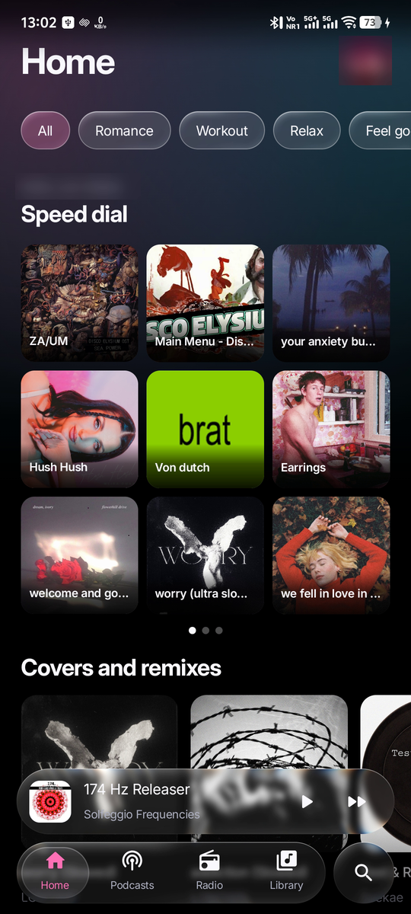
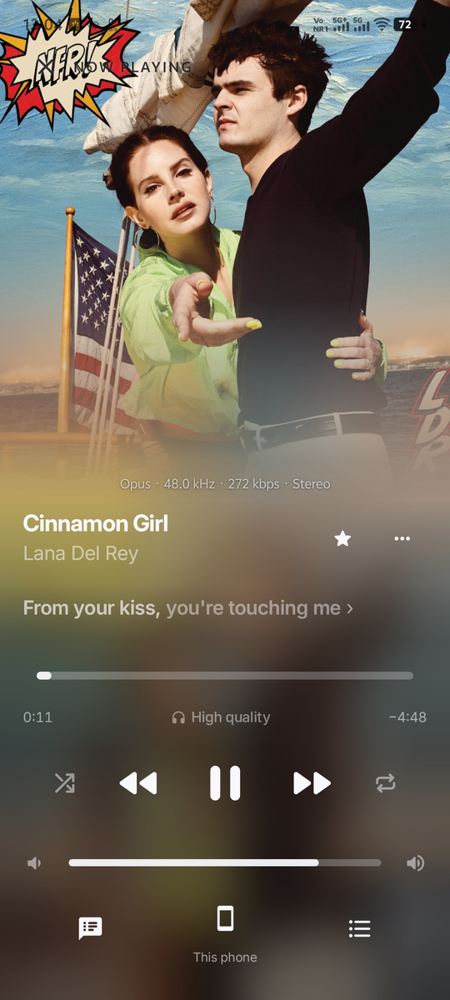
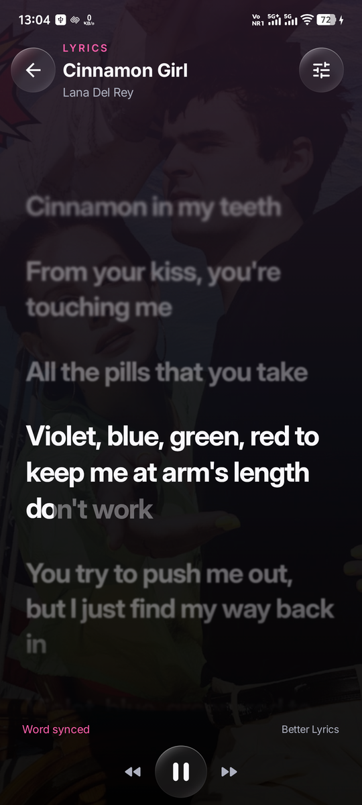
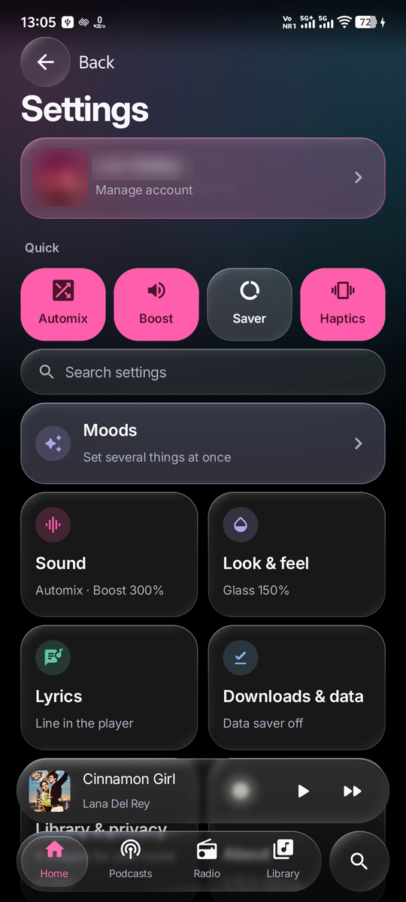
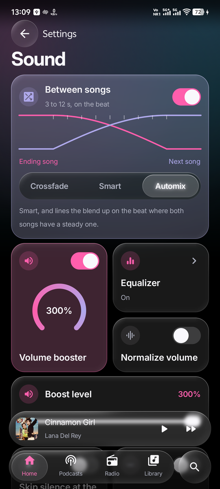
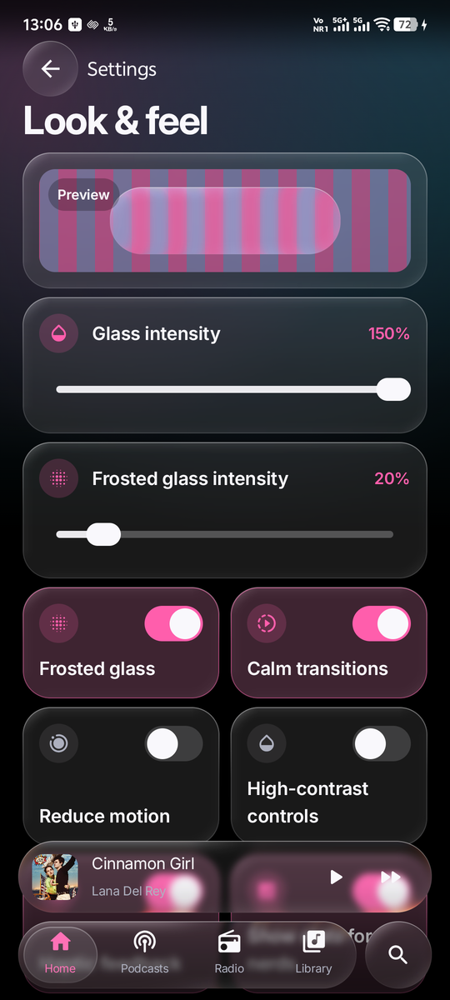
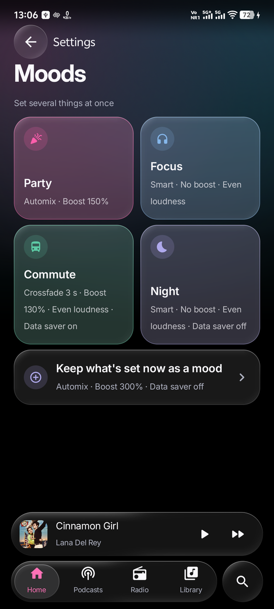
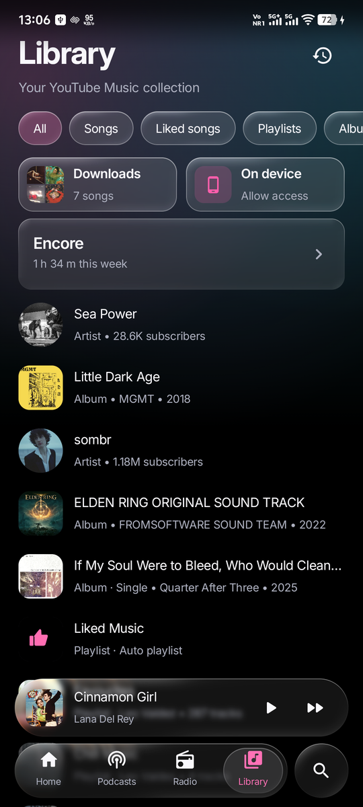
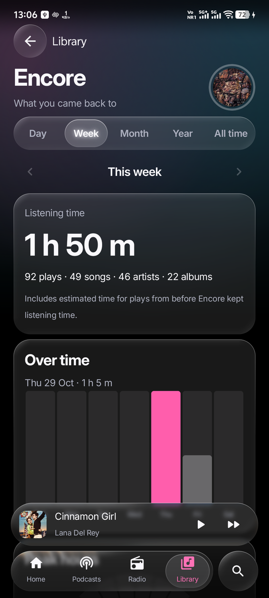

# Riff

An Android music player with YouTube Music browsing, word-synced lyrics, offline downloads, DJ-style Automix blends, listening statistics, and Liquid Glass controls.

[](https://github.com/leovaldez2k22/riff/actions/workflows/ci.yml)
[](#build)
[](LICENSE)

Riff is an independent personal project and is not affiliated with Google or YouTube. Online playback and catalog availability depend on the providers.

## Availability

**Riff 0.30.0** (version code 36) is the latest release, published on 9 November 2026: [download it from GitHub Releases](https://github.com/leovaldez2k22/riff/releases/tag/v0.30.0) and read the [release notes](docs/release-notes-0.30.0.md). It comes in two free editions, `riff-0.30.0.apk` (**Riff**, about 10 MB) and `riff-plus-0.30.0.apk` (**Riff+**, about 123 MB, with Automix, the app equalizer, Sing and more); installing one replaces the other. Android 12 or later, 64-bit ARM. Both are signed with the same certificate as 0.20.0 and 0.21.0 (SHA-256 `e45ac43b9d1c658c03ace002abb4c482cc3d63214a5f8509c801e404c91ff798`), so either **updates 0.20.0 or 0.21.0 in place** and keeps downloads, the queue and settings. If you use Automix or the equalizer, choose Riff+. Neither installs over 0.10.0 or earlier, which used an older certificate: uninstall the old app first. From 0.10.0, Backup on this phone keeps your data in Documents/Riff Backup and Riff offers to restore it; downloads are lost. Earlier releases: [0.21.0](docs/release-notes-0.21.0.md) (6 November 2026), [0.20.0](docs/release-notes-0.20.0.md) (31 October 2026) and 0.10.0 (24 October 2026).

This repository continues the project under **leovaldez2k22** with its Git history. Older documents may name earlier accounts.

## The two editions

Current source builds **Riff** and **Riff+**, both free. They share one package, version and signing key, so installing one replaces the other. How 0.30.0 was built and verified is in the [implementation plan](docs/feature-implementation-plan-0.30.0-2026-11-07.md).

| Feature | Riff | Riff+ |
|---|---|---|
| Browsing, lyrics, downloads, local audio and queue | Yes | Yes |
| Encore statistics, stories, genres and widget | Yes | Yes |
| Crossfade, Smart, booster and normalization | Yes | Yes |
| Automix and its on-device beat model | — | Yes |
| In-app equalizer and Stats for nerds | — | Yes |

If you use Automix or the app equalizer in 0.21.0, choose **Riff+**. Riff keeps those saved choices and uses Smart for stored Automix; moving back to Riff+ restores the choices. Riff can open the phone's equalizer when one is available. About offers the opposite edition for the same installed version when the release feed lists its exact APK.

The source and both published 0.30.0 APKs require Android 12 (API 31) or later. The signed 0.30.0 APKs are 10,257,274 bytes (Riff, 9.8 MiB) and 128,974,021 bytes (Riff+, 123.0 MiB); Riff+ bundles its models, so nothing is downloaded later. The [split log](docs/riff-plus-split-plan-2026-11-07.md#implementation-log) records how the editions were separated and verified.

## Features

**Features introduced in 0.20.0 and 0.21.0** (see the [changelog](CHANGELOG.md)); the table above shows which edition has them from 0.30.0.

- **Liquid Glass** written in Riff, on the shell and every control: a tab bar whose lens lifts, follows your finger, stretches and glides home; glass sliders and segmented controls; heat-aware quality that falls back to plain frost when the phone runs hot, and says so in Look and feel.
- **Settings redesign:** an opening page with the account, quick switches (the supported blend, Boost, Data saver, Haptics), search, and a tile per section saying what is set inside; each section a page of glass tiles: the blend drawn live, a dial for the booster, real glass under the glass sliders, a sung lyrics preview, a storage ring. Switch icons change between an off and an on icon as they turn.
- **Moods:** Party, Focus, Commute and Night set the blend, booster, even loudness and Data saver in one tap; keep what is set now as a mood of your own.
- **Blends:** Crossfade and Smart in both editions; Automix in Riff+. Smart follows each song's ending. Riff+ also supplies the blend filters, bass swap and echo-out, and its on-device Beat This! / ONNX model finds beats and bar lines for Automix; nothing leaves the phone for analysis.
- **Encore:** listening statistics for the day, week, month, year and lifetime, with charts, stories and genres.
- **Equalizer (Riff+):** a Dynamic tone pad or seven manual bands with presets and balance, with derived headroom, working before the booster and inside crossfades.
- **Lyrics:** a redesigned player whose current line is swept word by word, held words before the instrumental dots, other lines blurred and faded, romanized lyrics, lrc.red as a source.
- **Everywhere else:** Android Auto; Cast to Chromecasts and Google speakers; open YouTube Music links in Riff; search suggestions and a top result; skip the silence at a song's end; playback speed; sleep timer by songs or time; song quality per network; Riff+ Stats for nerds; Undo for removals; lock-screen Shuffle and Like; app shortcuts and a play/pause tile; predictive back; a side rail and player pane on large screens; Inter as Riff's type; status bar icons that follow the cover.

**Since earlier releases**

- Browse recommendations, search, albums, playlists, artists, podcasts and live radio; create, rename and delete YouTube Music playlists; pin anything to Home's speed dial.
- Background playback, normalize volume, a volume booster, song quality, queue editing.
- Word-synced or line-synced lyrics with overlapping lines, background vocals and held-word emphasis, timing adjustment, and lyric cards to share.
- Song and collection downloads, optional Smart Downloads, storage budgets.
- A frosted sign-in with the accounts used on the phone and switching between them; separate data for each account, for signed-out listening and for audio on the phone; Privacy and data controls; export and import to another phone; a backup on the phone.
- On-device audio, local saves, listening history and home-screen widgets.
- Reduced motion, high contrast, graded haptics, screen-reader queue actions and Data saver.
- Diagnostics of how the app last closed, shared only by you.

See the [feature guide](docs/features.md) and the [feature plan](docs/feasibility-glass-font-lyrics-artwork-2026-10-27.md), whose implementation log says what each feature differs from the plan and what is still to check on a phone.

## Screenshots

Taken on a phone from the current source (30 October 2026). The account name and picture are blurred.

<table>
  <tr>
    <td></td>
    <td></td>
    <td></td>
  </tr>
  <tr>
    <td></td>
    <td></td>
    <td></td>
  </tr>
  <tr>
    <td></td>
    <td></td>
    <td></td>
  </tr>
</table>

## Phones

Android 12 (API 31) or later; target API 36. The release APK contains native code for 64-bit ARM (`arm64-v8a`) only. x86 emulators run the debug build.

## Build

Requirements: **JDK 21**, **Android SDK platform 37**, **build-tools 36.0.0**, and **Gradle 9.8.2** through the included wrapper (its download is checked against Gradle's published checksum). Dependencies are checked against `gradle/verification-metadata.xml`.

```powershell
$env:JAVA_HOME = 'C:\path\to\jdk-21'
$env:ANDROID_HOME = 'C:\path\to\Android\Sdk'
.\gradlew.bat :app:testRiffDebugUnitTest :app:testPlusDebugUnitTest :app:lintRiffRelease :app:lintPlusRelease :app:assembleRiffDebug :app:assemblePlusDebug
```

On macOS or Linux, set `JAVA_HOME` and `ANDROID_HOME` and use `./gradlew`.

The `edition` flavors are `riff` (default) and `plus`; both retain the same package and signing identity. Riff omits Automix's runtime/model, the in-app equalizer and Stats for nerds; Plus owns their implementations and dependencies under `app/src/plus`. APKs are under `app/build/outputs/apk/<edition>/<build-type>`. Use `--edition plus` for a Plus device, packaging or benchmark lane; the PR lane always checks both.

### Checks

One entry point runs each check lane the same way locally and in CI (Python 3.10+):

```bash
python scripts/quality/verify.py --lane pr
```

| Lane | Command | Needs |
|---|---|---|
| Pull request | `verify.py --lane pr` | Nothing installed: tests, lint, static checks, the release build and its content checks |
| Emulator | `verify.py --lane emulator --allow-install` | One emulator; its network is turned off |
| Physical device | `verify.py --lane device --allow-install --serial <id> --tier R\|L` | An authorized test phone, named explicitly |
| Benchmarks | `verify.py --lane benchmark --allow-install --serial <id> --tier R\|L` | A phone; emulator timings are refused |
| Packaging | `verify.py --lane packaging --allow-install --previous-apk artifacts/release/riff-0.21.0.apk --probe-apk artifacts/quality/packaging-probe/edition-switch-probe.apk` | Both signed candidates and the signed test probe; a fresh disposable emulator |

Without `--allow-install` nothing touches a device. See [testing](docs/quality/testing.md) and [CI lanes](docs/quality/ci-lanes.md).

### Release candidate

Release signing credentials stay outside Git ([release signing](docs/release-signing.md)). `scripts/build-release-candidate.ps1` builds, signs and checks the certificate (`-Offline`, `-OutDir`, and `-Toolchain` to build a clean worktree with the main checkout's key and Gradle cache; `-Preview` also builds **Riff Preview** and **Riff+ Preview** under `com.musicglass.personal.preview`; either preview replaces the other and installs beside the release); `scripts/package-source.ps1` writes one source archive from Git-visible files and verifies every current APK fingerprint input and its bytes. The packaging lane checks the signed source identity and upgrade/switch data using the [test-only probe](scripts/quality/build-packaging-probe.ps1). CI builds an unsigned release. Debug builds use a different key and cannot update a release in place. Never commit keys, passwords, cookies or signed media URLs.

Benchmarks and the Baseline Profile generator are in `:benchmark` and run against a separate fixture-fed build (`com.musicglass.personal.benchmark`). See [performance](docs/quality/performance.md).

## Documentation

- [Features](docs/features.md), [privacy and permissions](docs/privacy.md), [security policy](SECURITY.md)
- Quality: [architecture](docs/quality/architecture.md), [testing](docs/quality/testing.md), [security review](docs/quality/security-review.md), [provider compatibility](docs/quality/provider-compatibility.md), [performance](docs/quality/performance.md), [final report](docs/quality/final-report.md)
- [Documentation index](docs/README.md), which separates current documents from historical records

## Support, privacy, and license

[Report a bug](https://github.com/leovaldez2k22/riff/issues/new/choose) once the repository is public, with the app version, Android version, phone model, reproduction steps and a diagnostics report from Settings → About → Diagnostics. Read any report before posting it publicly. For security issues, follow [SECURITY](SECURITY.md). This personal project has no guaranteed response schedule.

[Privacy and permissions](docs/privacy.md) lists what stays on the phone and every network destination. Android cloud backup and device transfer are disabled.

Riff is licensed under the **[GNU GPL v3](LICENSE)**. Distribute the corresponding source and the [third-party notices](NOTICE.md) with the app. See the [dependency license inventory](docs/dependency-license-inventory.md) and [asset provenance](licenses/placeholder-art.md).
