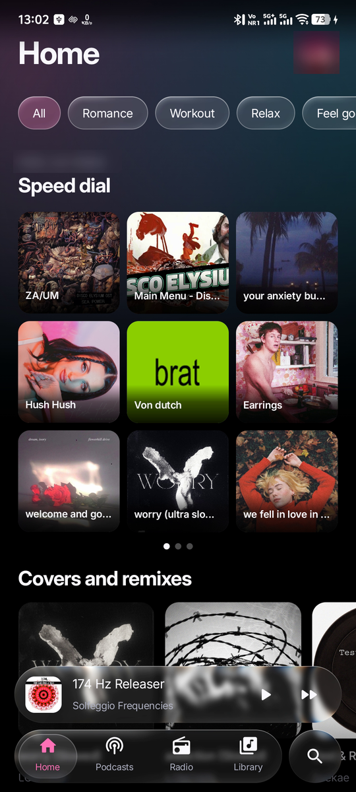
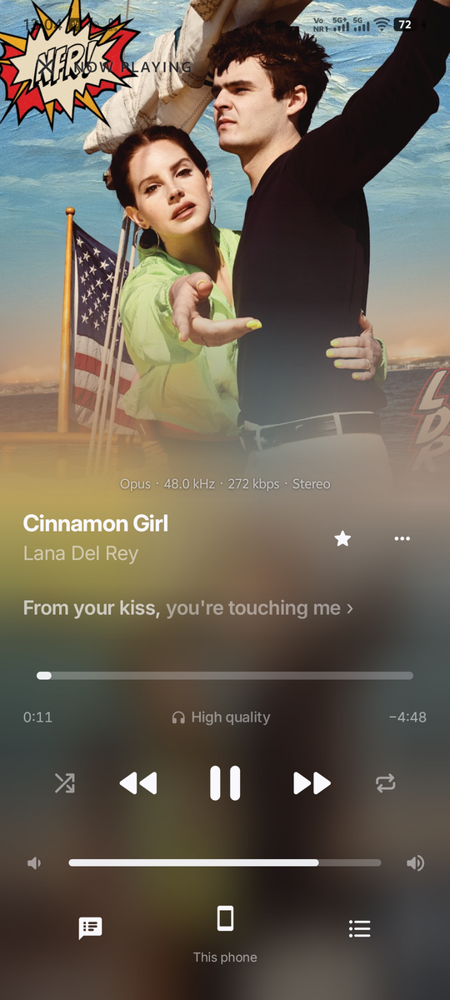
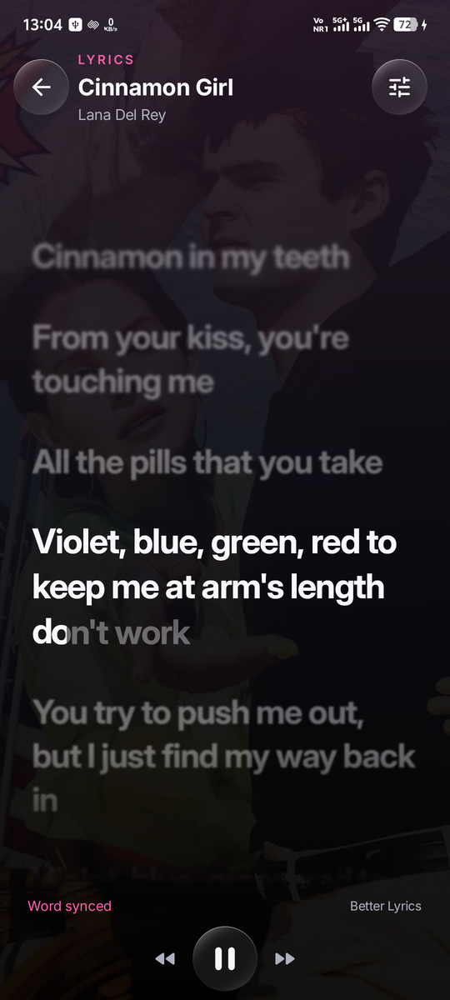
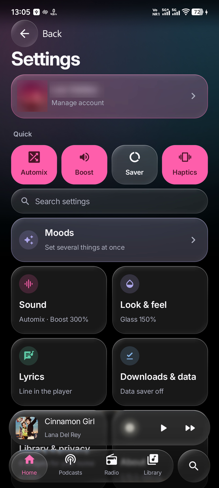
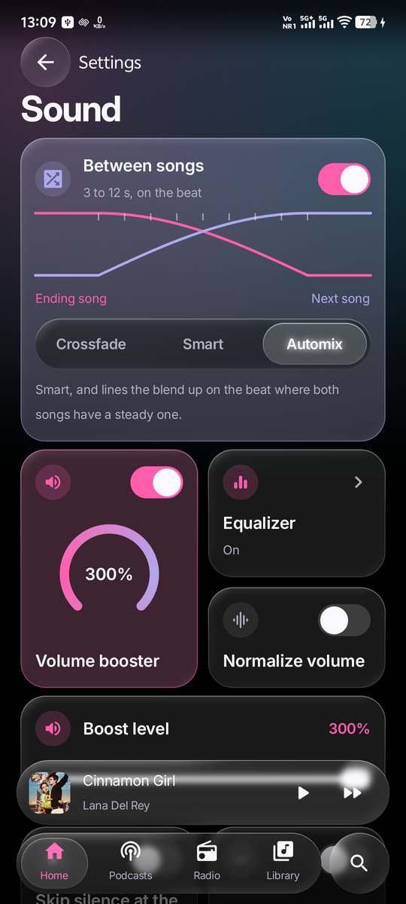
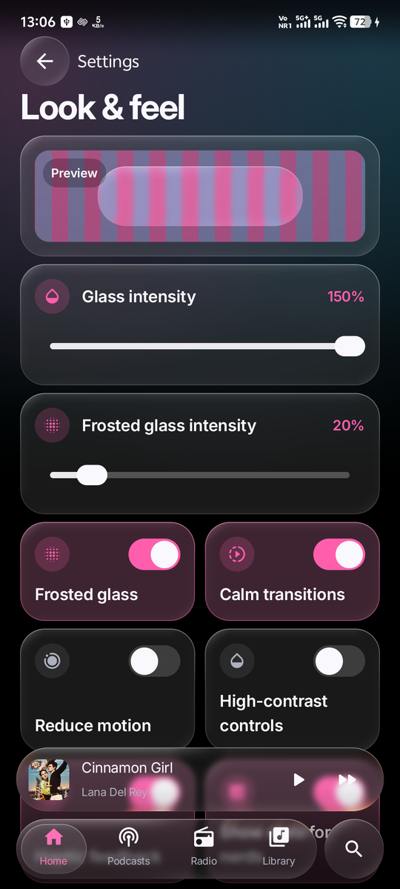
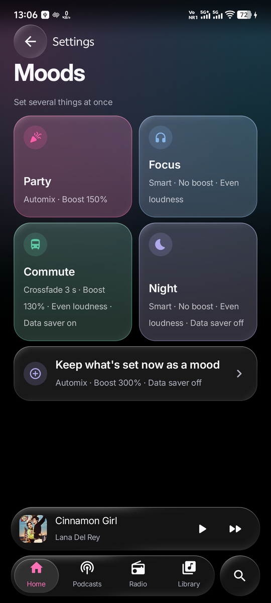
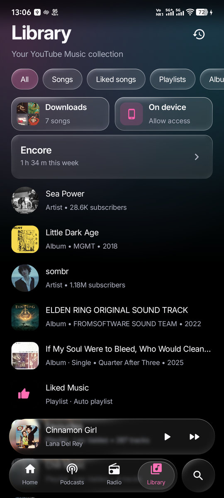
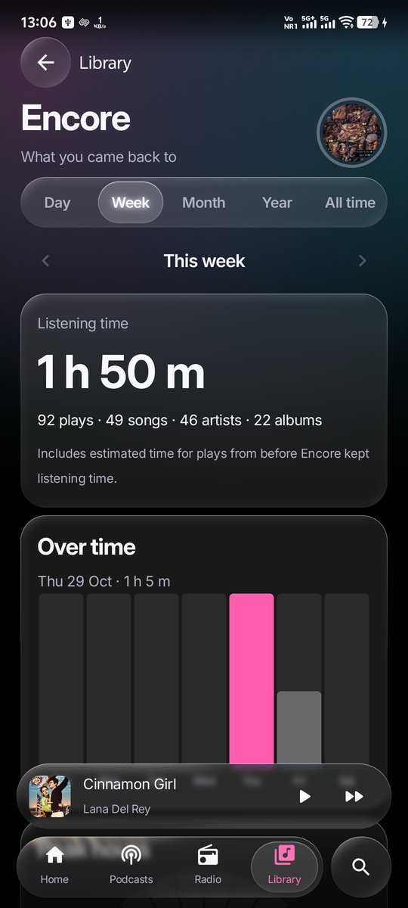

# Riff

An Android music player with YouTube Music browsing, word-synced lyrics, offline downloads, DJ-style Automix blends, listening statistics, and Liquid Glass controls.

[](https://github.com/leovaldez2k22/riff/actions/workflows/ci.yml)
[](#build)
[](LICENSE)

Riff is an independent personal project and is not affiliated with Google or YouTube. Online playback and catalog availability depend on the providers.

## Availability

`main` carries everything up to **30 October 2026**: the 0.10.0 final candidate plus the next round of features (below), which is **unreleased**. The source reports **0.10.0 (version code 33)**; the "What's new" sheet is written for version code 34, the first release that will carry this work. Nothing has been published from this repository, and publishing needs the owner's explicit decision. The last APK distributed was 0.9.0-rc20 (4 October 2026), built under the project's earlier account; later builds are signed with the same certificate and update it in place.

This repository continues the project under **leovaldez2k22** with its Git history. Older documents may name earlier accounts.

## Features

**New since 0.10.0** (unreleased; see the [changelog](CHANGELOG.md))

- **Liquid Glass** written in Riff, on the shell and every control: a tab bar whose lens lifts, follows your finger, stretches and glides home; glass sliders and segmented controls; heat-aware quality that falls back to plain frost when the phone runs hot, and says so in Look and feel.
- **Settings redesign:** an opening page with the account, quick switches (Automix, Boost, Data saver, Haptics), search, and a tile per section saying what is set inside; each section a page of glass tiles: the blend drawn live, a dial for the booster, real glass under the glass sliders, a sung lyrics preview, a storage ring. Switch icons change between an off and an on icon as they turn.
- **Moods:** Party, Focus, Commute and Night set the blend, booster, even loudness and Data saver in one tap; keep what is set now as a mood of your own.
- **Automix:** choose Crossfade, Smart or Automix. Smart and Automix blend where a song winds down, swap the bass halfway, and land on the downbeat when both songs have a beat. Debug builds also run an on-device beat model (Beat This! small, int8 ONNX) for the beat grid; release builds use the built-in onset tracker.
- **Encore:** listening statistics for the day, week, month, year and lifetime, with charts, stories and genres.
- **Equalizer:** a Dynamic tone pad or seven manual bands with presets, pre-amp and balance, working before the booster and inside crossfades.
- **Lyrics:** a redesigned player whose current line is swept word by word, held words before the instrumental dots, other lines blurred and faded, romanized lyrics, lrc.red as a source.
- **Everywhere else:** Android Auto; Cast to Chromecasts and Google speakers; open YouTube Music links in Riff; search suggestions and a top result; skip the silence at a song's end; playback speed; sleep timer by songs or time; song quality per network; stats for nerds; Undo for removals; lock-screen Shuffle and Like; app shortcuts and a play/pause tile; predictive back; a side rail and player pane on large screens; Inter as Riff's type; status bar icons that follow the cover.

**Since earlier releases**

- Browse recommendations, search, albums, playlists, artists, podcasts and live radio; create, rename and delete YouTube Music playlists; pin anything to Home's speed dial.
- Background playback, normalize volume, a volume booster, song quality, queue editing.
- Word-synced or line-synced lyrics with overlapping lines, background vocals and held-word emphasis, timing adjustment, and lyric cards to share.
- Song and collection downloads, optional Smart Downloads, storage budgets.
- A frosted sign-in with the accounts used on the phone and switching between them; separate data for each account, for signed-out listening and for audio on the phone; Privacy and data controls; export and import to another phone; a backup on the phone.
- On-device audio, local saves, listening history and home-screen widgets.
- Reduced motion, high contrast, graded haptics, screen-reader queue actions and Data saver.
- Diagnostics of how the app last closed, shared only by you.

See the [feature guide](docs/features.md) and the [feature plan](docs/feasibility-glass-font-lyrics-artwork-2026-10-27.md), whose implementation log says what each feature differs from the plan and what is still to check on a phone.

## Screenshots

Taken on a phone from the current source (30 October 2026). The account name and picture are blurred.

<table>
  <tr>
    <td></td>
    <td></td>
    <td></td>
  </tr>
  <tr>
    <td></td>
    <td></td>
    <td></td>
  </tr>
  <tr>
    <td></td>
    <td></td>
    <td></td>
  </tr>
</table>

## Phones

Android 12 (API 31) or later; target API 36. The release APK contains native code for 64-bit ARM (`arm64-v8a`) only. A separate `lite` build adds 32-bit ARM (`armeabi-v7a`) for older phones (`scripts/build-lite.ps1`). x86 emulators run the debug build.

## Build

Requirements: **JDK 21**, **Android SDK platform 37**, **build-tools 36.0.0**, and **Gradle 8.13** through the included wrapper (its download is checked against Gradle's published checksum). Dependencies are checked against `gradle/verification-metadata.xml`.

```powershell
$env:JAVA_HOME = 'C:\path\to\jdk-21'
$env:ANDROID_HOME = 'C:\path\to\Android\Sdk'
.\gradlew.bat :app:testDebugUnitTest :app:lintRelease :app:assembleDebug
```

On macOS or Linux, set `JAVA_HOME` and `ANDROID_HOME` and use `./gradlew`.

### Checks

One entry point runs each check lane the same way locally and in CI (Python 3.10+):

```bash
python scripts/quality/verify.py --lane pr
```

| Lane | Command | Needs |
|---|---|---|
| Pull request | `verify.py --lane pr` | Nothing installed: tests, lint, static checks, the release build and its content checks |
| Emulator | `verify.py --lane emulator --allow-install` | One emulator; its network is turned off |
| Physical device | `verify.py --lane device --allow-install --serial <id> --tier R\|L` | An authorized test phone, named explicitly |
| Benchmarks | `verify.py --lane benchmark --allow-install --serial <id> --tier R\|L` | A phone; emulator timings are refused |
| Packaging | `verify.py --lane packaging [--allow-install --previous-apk <apk>]` | A signed candidate; an emulator for the upgrade check |

Without `--allow-install` nothing touches a device. See [testing](docs/quality/testing.md) and [CI lanes](docs/quality/ci-lanes.md).

### Release candidate

Release signing credentials stay outside Git ([release signing](docs/release-signing.md)). `scripts/build-release-candidate.ps1` builds, signs and checks the certificate (`-Offline`, `-OutDir`, and `-Toolchain` to build a clean worktree with the main checkout's key and Gradle cache; `-Preview` also builds **Riff Preview**, the same release under the package `com.musicglass.personal.preview`, which installs beside an installed release without touching its data); `scripts/package-source.ps1` writes the matching source archive from the files Git tracks. CI builds an unsigned release. Debug builds use a different key and cannot update a release in place. Never commit keys, passwords, cookies or signed media URLs.

Benchmarks and the Baseline Profile generator are in `:benchmark` and run against a separate fixture-fed build (`com.musicglass.personal.benchmark`). See [performance](docs/quality/performance.md).

## Documentation

- [Features](docs/features.md), [privacy and permissions](docs/privacy.md), [security policy](SECURITY.md)
- Quality: [architecture](docs/quality/architecture.md), [testing](docs/quality/testing.md), [security review](docs/quality/security-review.md), [provider compatibility](docs/quality/provider-compatibility.md), [performance](docs/quality/performance.md), [final report](docs/quality/final-report.md)
- [Documentation index](docs/README.md), which separates current documents from historical records

## Support, privacy, and license

[Report a bug](https://github.com/leovaldez2k22/riff/issues/new/choose) once the repository is public, with the app version, Android version, phone model, reproduction steps and a diagnostics report from Settings → About → Diagnostics. Read any report before posting it publicly. For security issues, follow [SECURITY](SECURITY.md). This personal project has no guaranteed response schedule.

[Privacy and permissions](docs/privacy.md) lists what stays on the phone and every network destination. Android cloud backup and device transfer are disabled.

Riff is licensed under the **[GNU GPL v3](LICENSE)**. Distribute the corresponding source and the [third-party notices](NOTICE.md) with the app. See the [dependency license inventory](docs/dependency-license-inventory.md) and [asset provenance](licenses/placeholder-art.md).
