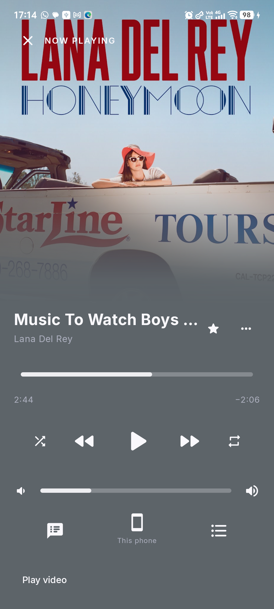
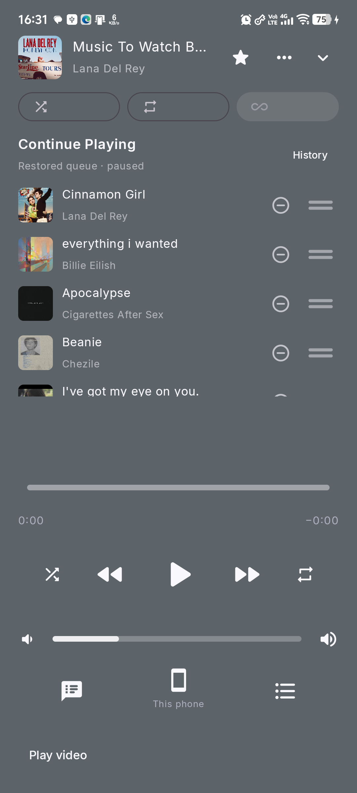
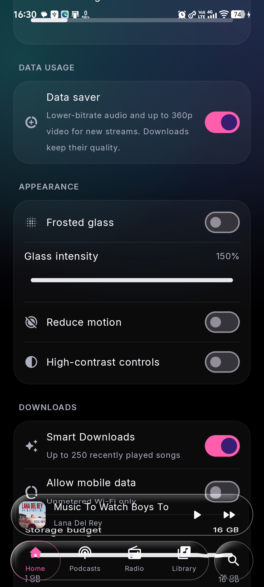

# Riff

An Android music player with YouTube Music browsing, synced lyrics, offline downloads, and a glass interface.

[](https://github.com/leovaldez2k20/riff/actions/workflows/ci.yml)
[](https://github.com/leovaldez2k20/riff/releases)
[](#install)
[](LICENSE)

**[Download rc20 APK](https://github.com/leovaldez2k20/riff/releases/download/v0.9.0-rc20/riff-0.9.0-rc20.apk)** · [Release notes](https://github.com/leovaldez2k20/riff/releases/tag/v0.9.0-rc20) · [All releases](https://github.com/leovaldez2k20/riff/releases) · [Report a bug](https://github.com/leovaldez2k20/riff/issues/new/choose)

Riff is an independent personal project and is not affiliated with Google or YouTube. The current version is a **release candidate**. Online playback and catalog availability depend on the providers.

## Install

The rc20 APK supports **Android 12 or newer on 64-bit ARM (arm64-v8a) phones**. Android 13+ supports liquid refraction; Android 12 uses translucent controls and frosted blur.

1. Download `riff-0.9.0-rc20.apk` from the release's **Assets** section or the direct link above.
2. Open the APK on your phone. If Android asks, allow installation from the browser or file manager you used.
3. Install it. Existing Riff releases using the same signing certificate update in place, retaining app data. Uninstalling deletes app-private downloads, local saves, and settings.
4. Open Riff. Sign in through its YouTube Music screen to access your provider library. Local audio access is requested only when opening On device.

This APK uses the existing release signing key. The stable application ID is `com.musicglass.personal`. Older Lite builds have a separate package and are not replaced by this APK; rc20 currently publishes the standard ARM64 build.

| Release asset | Purpose |
|---|---|
| [Signed APK](https://github.com/leovaldez2k20/riff/releases/download/v0.9.0-rc20/riff-0.9.0-rc20.apk) | Installable app, about 26.2 MiB |
| [Corresponding source](https://github.com/leovaldez2k20/riff/releases/download/v0.9.0-rc20/riff-0.9.0-rc20-source.zip) | Source, build scripts, licenses, and documentation |
| [SHA256SUMS.txt](https://github.com/leovaldez2k20/riff/releases/download/v0.9.0-rc20/SHA256SUMS.txt) | SHA-256 checksums for the APK and source archive |

The release also includes `LICENSE` and `NOTICE.md`. GitHub's automatically generated source archives refer to the release tag. To check a download in PowerShell, use `Get-FileHash .\riff-0.9.0-rc20.apk -Algorithm SHA256` and compare it with `SHA256SUMS.txt`. The public signing certificate fingerprint is in [release signing](docs/release-signing.md).

## What Riff does

- Browse recommendations, search, albums, playlists, artists, podcasts, and live radio.
- Play audio in the background, view an exact official video counterpart when available, and control the queue with Play next, reorder, and remove actions.
- Read word-synced or line-synced lyrics, with on-device English translation when supported.
- Download songs, artwork, and available lyrics for offline playback; optional Smart Downloads use a storage budget and network preferences.
- Access on-device audio, local saves, listening history, sleep timers, and home-screen widgets.
- Customize glass effects, motion, contrast, haptics, and Data saver.

Read the [detailed feature and behavior guide](docs/features.md) for network, cache, queue, download, and account behavior.

## Screenshots

Actual rc20 phone screenshots. Album artwork belongs to its respective owners; screenshots illustrate the app interface.

<table>
  <tr>
    <td></td>
    <td></td>
    <td></td>
  </tr>
  <tr><td>Now playing</td><td>Queue controls</td><td>Data saver</td></tr>
</table>

## What's new in rc20

- Replaces rejected streams during recovery, invalidates stale prefetched streams, and tries a bounded set of alternate profiles while preserving queue position and user pauses.
- Adds a visible remove button to every queue row, including removal of the final song.
- Adds persistent **Settings → Data usage → Data saver** for lower-bitrate audio and up to 360p video on newly resolved streams. Downloads keep their selected quality.
- Adds NetEase Cloud Music and Lyrics.ovh to the lyrics hierarchy.

Lyrics priority: **Better Lyrics TTML → QQ → NetEase → Kugou → LRCLIB → YouTube Music → Lyrics.ovh**. Timing quality takes precedence: word > line > plain; provider order breaks ties. NetEase may require verification and then falls through to later providers. Matched NetEase lyrics were not verified live on the test phone. Lyrics.ovh provides plain text. Megalobiz and Spicy Lyrics are excluded from this release.

Validation: **253 unit/Compose tests**, **eight phone tests**, a **12-song playback run** including Data saver, and **six-song playback on the signed release** passed. Release lint has zero errors; existing warnings remain. The signed release also recovered automatically from a real SABR attestation failure. See [the rc20 verification record](docs/app-revamp-rc20.md) and [CHANGELOG](CHANGELOG.md).

## Build and contribute

Requirements: **JDK 21**, **Android SDK platform 37.0**, **build-tools 36.0.0**, and **Gradle 8.13** through the included wrapper. Minimum Android API is 31; target API is 36. JDK 21 is needed by the InnerTubeX classes used in tests.

```powershell
$env:JAVA_HOME = 'C:\path\to\jdk-21'
$env:ANDROID_HOME = 'C:\path\to\Android\Sdk'
.\gradlew.bat :app:testDebugUnitTest :app:lintRelease :app:assembleDebug
```

On macOS/Linux, set `JAVA_HOME` and `ANDROID_HOME` and use `./gradlew`. The Unix wrapper must be executable (`chmod +x gradlew` if needed).

Debug builds use a different signing key and cannot update an installed release in place. `scripts/build-release-candidate.ps1` signs releases using the maintainer's ignored local keystore and checks its public certificate; without signing credentials, CI builds an unsigned release. Never commit keys, passwords, cookies, or signed media URLs. `scripts/package-source.ps1` packages corresponding source.

See [CONTRIBUTING](CONTRIBUTING.md), the [CI workflow](.github/workflows/ci.yml), and [dependency license inventory](docs/dependency-license-inventory.md).

## Support, privacy, and license

Use [GitHub Issues](https://github.com/leovaldez2k20/riff/issues/new/choose) for bugs and feature requests. Include the app version, Android version, phone model, reproduction steps, and sanitized playback diagnostics when relevant. **Settings → About → Copy playback diagnostics** provides a bounded event log; review anything you post publicly.

For security issues, use [private vulnerability reporting](https://github.com/leovaldez2k20/riff/security/advisories/new). See [SECURITY](SECURITY.md). This personal project has no guaranteed response schedule.

[Privacy and permissions](docs/privacy.md) explains local storage, provider requests, sign-in, translation, and optional voice search. Android cloud backup and device transfer are disabled. App-local saves and downloads are account-scoped and do not provide cross-device sync.

Riff is licensed under **[GNU GPL v3](LICENSE)**. Distribute corresponding source and [third-party notices](NOTICE.md) with the app. See [artwork provenance](licenses/placeholder-art.md), the dependency inventory, and the licenses included in the source archive. Historical implementation reports remain in [docs](docs/).
