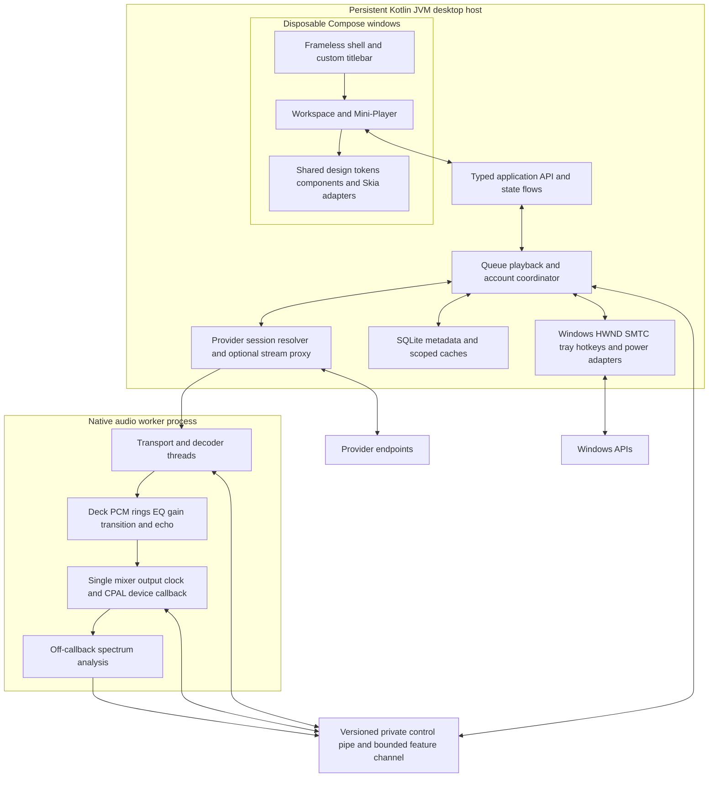

# Preserve Riff’s identity on Windows desktop

**Technical research dossier, UI/UX translation specification and implementation blueprint**  
**Status:** M1 implementation and verification in progress; see [desktop acceptance evidence](../docs/desktop/m1-acceptance.md).  
**Date:** 1 November 2026  
**Inspected source:** `04aabff5c088d2e91786923b6ef047ad6ed4ef15`  
**Initial release:** Windows 11 only; macOS and Linux remain future targets  
**Owner priorities:** Faithful appearance and reliable playback; measure memory rather than impose a 100 MB limit

**Recommendation: start with Compose Multiplatform Desktop, a persistent Kotlin desktop host, and a separate native audio worker.** Riff is an Android Kotlin/Compose application, so choosing a web shell before inspecting the source would unnecessarily turn the entire interface into a rewrite. Compose offers the strongest opportunity to preserve component source, animation semantics and typography. This is a proposed decision, conditional on an early proof of live glass rendering, Windows accessibility, custom chrome and mixed-DPI behavior. Electron is the fallback if that proof fails and the owner accepts a web rewrite; Tauri v2 and Flutter remain evaluated alternatives. Native playback should continue independently of visible windows. “Zero visual regression” is a release acceptance policy backed by reference captures and tests; no runtime can guarantee identical Android/Windows font rasterization or unmeasured performance.

## 1. Establish the actual baseline before choosing a shell

The placeholders in the request are replaced by inspected facts. Riff uses Kotlin, Jetpack Compose, custom Canvas/Android runtime graphics, bundled Inter, Media3/ExoPlayer, InnertubeX, account-scoped local state and offline files. It does not contain a React/Tailwind frontend, and no Spotify extraction baseline was found. Current dependency declarations include InnertubeX 0.7.2, Ktor 3.5.2 and Media3 1.11.1. Native desktop playback is a replacement for the Android playback adapter, not a flag that makes ExoPlayer portable. ([Dependency declarations](</C:/Volume D/Riff/gradle/libs.versions.toml:7>), [current architecture](</C:/Volume D/Riff/docs/quality/architecture.md:12>))

The audit inspected the actual [Home](</C:/Volume D/Riff/docs/images/home.png>), [player](</C:/Volume D/Riff/docs/images/player.png>), [lyrics](</C:/Volume D/Riff/docs/images/lyrics.png>), [Settings](</C:/Volume D/Riff/docs/images/settings.png>), [Library](</C:/Volume D/Riff/docs/images/library.png>), [Encore](</C:/Volume D/Riff/docs/images/encore.png>) and [Look and feel](</C:/Volume D/Riff/docs/images/settings-look.png>) screenshots. Their visual identity is a near-black canvas, restrained blue/purple/teal ambient light, tightly tracked Inter, artwork-first surfaces, floating refractive capsule controls, white primary text, cool muted secondary text and pink selected states. The player melts sharp sleeve artwork into a derived color deck. Lyrics use large left-aligned text, defocused surrounding lines and measured word sweeps. Settings and Encore share the glass, type, curves and spacing rather than introduce separate visual systems.

The screenshots date from 30 October; current source and the handover include later refinements. The older feature plan references commit `9ea71f4` and is historical evidence, not a set of values to copy blindly. Current player title/artist sizes are **20sp/17sp**, superseding the plan’s 26sp/22sp. Full-player open/close are **700ms/600ms**, distinct from the 520ms internal-player transition. Glass defaults are now **125% glass / 25% frost**, while existing user preferences remain authoritative. Artwork motion was dropped by the owner; this desktop plan does not reintroduce animated covers. The handover also preserves deferred Automix CPU/model-policy decisions. ([Plan usage instructions](</C:/Volume D/Riff/docs/feasibility-glass-font-lyrics-artwork-2026-10-27.md:18>), [handover](</C:/Volume D/Riff/docs/handover-0.20.0.md>), [current settings](</C:/Volume D/Riff/app/src/main/java/com/musicglass/personal/AccessibilitySettings.kt:96>))

### 1.1 Freeze the design contract

The following are existing values. Desktop container dimensions introduced later are proposals, not existing Riff tokens.

| Contract | Preserve from current source |
|---|---|
| Color | Ink `#000000`; Raised `#181A22`; Muted `#ADB0BF`; Pink `#FF5EAC`; white primary text |
| Spacing | Screen edge 20dp; art/text gap 12dp; list-item gap 8dp; tight 4dp; block 16dp |
| Base geometry | Minimum press target 48dp; row 60dp; list art 48dp; base icon 24dp |
| Radii | Artwork 12dp; card 14dp; hero 24dp; pill 28dp |
| Display hierarchy | Large title 34sp/40sp, bold, tracking −0.9sp; section 22sp/27sp, bold, −0.4sp; headline 26sp, bold, −0.5sp |
| Text hierarchy | Row title 17sp semibold, −0.4sp; body 15sp, −0.2sp; subtitle 13sp, −0.05sp |
| Settings | Row 19sp, −0.45sp; help 15sp, −0.2sp |
| Player anatomy | Title 20sp, −0.35sp; artist and lyric preview 17sp; like/more 44dp circles with 20dp icons; play 64dp with 52dp icon; skip 56dp with 46dp icon |
| Player sliders | Seek 7dp idle / 12dp dragged; volume 6dp / 10dp |
| Menus | Corner 28dp; width 230–290dp; row 48dp; edge 20dp; icon 24dp; gap 16dp |
| Menu typography/material | Text 17sp/22sp, −0.3sp; detail 14sp/18sp; title 20sp/25sp semibold; tint `#2A2C31` at .72; white rim .10 at 1dp; separators white .12 |
| Small controls | Slider thumb 30×20dp, scale 1.3 held; switch track 51×31dp, thumb 27dp, travel stretch 25% |

Sources: [base colors](</C:/Volume D/Riff/app/src/main/java/com/musicglass/personal/RiffApp.kt:76>), [design tokens](</C:/Volume D/Riff/app/src/main/java/com/musicglass/personal/DesignTokens.kt:25>), [player tokens](</C:/Volume D/Riff/app/src/main/java/com/musicglass/personal/DesignTokens.kt:125>), [type and radius tokens](</C:/Volume D/Riff/app/src/main/java/com/musicglass/personal/DesignTokens.kt:285>).

Preserve the exact bundled **Inter 4.1 variable font**, Text optical size `opsz=14`, Display `opsz=32`, and weights 300–800. The general tracking formula is `−0.0223 + 0.185·exp(−0.1745·size)` em, with component overrides above; time/count labels use tabular numerals. Font family alone is insufficient. Freeze font bytes, optical axes, weight, line height, tracking, baseline and fallback shaping. Desktop logical text units must respect text scaling without double-applying Windows DPI. Windows and Android antialiasing will differ; compare glyph geometry and line wrapping separately from edge raster noise. ([Typography implementation](</C:/Volume D/Riff/app/src/main/java/com/musicglass/personal/AmbientTheme.kt:33>))

### 1.2 Preserve the rendering recipe and motion physics

Riff’s glass records the scene below each control, applies blur and a rounded-rectangle signed-distance lens, then tint, rim/highlight and sharp foreground content. Its shader uses a finite-difference normal, the displacement profile `1−sqrt(1−x²)`, corner-weighted red/blue dispersion, zoom and directional glints. The lifted navigation lens samples outward beyond the bar. **A CSS blur or OS Acrylic replacement would fail fidelity.** Popup glass must sample the current underlying scene, including animated lyrics; stale popup backdrops are a previously fixed defect. ([Glass capture](</C:/Volume D/Riff/app/src/main/java/com/musicglass/personal/RiffGlass.kt:44>), [shader](</C:/Volume D/Riff/app/src/main/java/com/musicglass/personal/RiffGlass.kt:269>), [popup behavior](</C:/Volume D/Riff/app/src/main/java/com/musicglass/personal/FrostedPopup.kt:59>))

| Glass role | Blur / rim / bend / depth / dispersion / highlight | Tint |
|---|---|---|
| Bar | 2 / 20 / 36 / 1 / 1 / .45 | White .06 |
| Lifted lens | 0 / 14 / 12 / 0 / 3 / .60 | Transparent; outward sampling |
| Button | 2 / 14 / 28 / 1 / 1 / .45 | White .06 |
| Card | 8 / 12 / 20 / 0 / 0 / .30 | White .08 |
| Menu | 20 / 10 / 16 / 0 / 0 / .30 | Black .25 |
| Slider | 0 / 12 / 24 / 1 / 1 / .50 | Transparent |

The generic Menu glass role above is distinct from the themed popup panel: RiffMenu adds the `#2A2C31`/.72 material and .10 rim from the token table. Preserve both layers rather than substitute one tint for the other. Distances are current logical units; other entries are fractions. Intensity scales bend to 1.5; frost adds `14·frost` blur and `.10·frost` tint except lens/slider. Full retains dispersion; Reduced removes dispersion; Frost removes lens/refraction; Solid uses `#11131A`. These are explicit user/quality modes, not permission to ship a permanently simplified desktop renderer. Preserve premultiplied alpha, color space, edge clamping, blur reach, texture coordinates and scale conversions. Android AGSL is embedded in Android’s rendering pipeline; similar shader syntax does not establish a drop-in desktop implementation. ([Role implementation](</C:/Volume D/Riff/app/src/main/java/com/musicglass/personal/RiffGlass.kt:95>), [Android AGSL](https://developer.android.com/develop/ui/views/graphics/agsl))

Artwork extraction is deterministic: five-cluster k-means, ten iterations, extreme-value rejection where available, hue grouping within 52° and brightness distance 110, then combined dominance. Preserve fixture outputs rather than substitute an off-the-shelf “vibrant” swatch. The player backdrop derives a 6×6 color mesh from a 128px image, preserves the seam row, flips/rotates remaining rows, applies vibrance 1.12 and floor .045, and three radius-6 box-blur passes. Its blurred copy alpha is .6, sharp-art seam is 50%, and legibility darkening reaches 40%. Existing derived covers remain visible until the new result is ready, then the derived backdrop uses the 1200ms ambient crossfade; the sharp artwork transition separately uses 520ms. This processing belongs off the frame path. ([Palette](</C:/Volume D/Riff/app/src/main/java/com/musicglass/personal/ArtworkPalette.kt:4>), [backdrop](</C:/Volume D/Riff/app/src/main/java/com/musicglass/personal/PlayerBackdrop.kt:38>), [artwork masking](</C:/Volume D/Riff/app/src/main/java/com/musicglass/personal/PlayerArtwork.kt:24>))

Application ambience is a separate system: twelve subdued color triplets, selected by `(dayOfYear*5 + hour/2)%12`, reevaluated each minute, crossfaded over 1200ms. Three radial glows and vertical stops at 0/.18/.53 define the composition. Do not recolor the entire application from the current cover. ([Ambient implementation](</C:/Volume D/Riff/app/src/main/java/com/musicglass/personal/AmbientTheme.kt:73>))

| Motion contract | Current value |
|---|---|
| Press / selection / screen / sheet | 130 / 260 / 420 / 450ms |
| Player internal / artwork / ambient | 520 / 520 / 1200ms |
| General easing / exit duration | Cubic (.2,0,0,1); exit 75% of entry |
| Full-player open / close | 700 / 600ms; cubic (.32,0,.12,1) |
| Settle / player settle | Damping .9 with MediumLow stiffness / damping 1 with Low stiffness |
| Settings tile entrance | Damping .42, Medium stiffness; 35ms stagger capped at 280ms |
| Quick / reduced motion | Duration multiplier .7 / snap; music time and pointer tracking remain real time |

The navigation lens retains its own lift/catch/glide springs: 1400/.55, 900/.9 and 700/1; a 350ms hold, 33% width/36% height lift and velocity stretch up to 25%. Retain these where the lens survives in desktop navigation. A 520ms animation remains 520ms at 120Hz; refresh rate increases samples rather than speed. ([Motion tokens](</C:/Volume D/Riff/app/src/main/java/com/musicglass/personal/GlassMotion.kt:62>), [lens physics](</C:/Volume D/Riff/app/src/main/java/com/musicglass/personal/NavigationLens.kt:174>))

Lyrics preserve 29sp/38sp Display text with −.6sp tracking, backing vocals 20sp/27sp, romanization 19sp/25sp at .70, measured glyph sweeps, joined-script safeguards and RTL-aware reading-edge scaling. Held words rise 2dp, glow 14dp and scale 1.07; neighboring blur is 1/1.75/2.5dp by distance. Activation is 32ms, deactivation 260ms, held rise/release 220/380ms. Instrumental dots remain 13dp with 5dp gaps, 1600ms breathing and 300ms exit. User scroll suspends follow and blur; following centers the earliest overlapping active line near one-third viewport. Preserve the current +200ms user-visible offset as a migration default, but calibrate the extra two-display-frame compensation against desktop audible output latency; copying it blindly would make sync refresh-rate dependent. ([Lyrics tokens](</C:/Volume D/Riff/app/src/main/java/com/musicglass/personal/DesignTokens.kt:325>), [karaoke](</C:/Volume D/Riff/app/src/main/java/com/musicglass/personal/LyricsKaraoke.kt:47>), [follow behavior](</C:/Volume D/Riff/app/src/main/java/com/musicglass/personal/LyricsPanel.kt:42>))

## 2. Select the runtime through a Riff-specific feasibility gate

### 2.1 Compare Tauri v2, Electron, Flutter and Compose Desktop

| Dimension | Tauri v2 | Electron | Flutter Desktop | Compose Multiplatform Desktop |
|---|---|---|---|---|
| Renderer | Windows WebView2; macOS WKWebView; Linux WebKitGTK | Bundled Chromium | Flutter engine; backend must be verified per OS/version | Skia through Skiko, JVM host |
| Existing UI source | Rewrite in web UI | Rewrite in web UI | Rewrite in Dart widgets | Highest potential reuse of common Kotlin/Compose |
| Memory contributors | Rust host, WebView/GPU processes, caches, worker | Main, renderer, GPU, native worker, caches | Engine, Dart heap, native/GPU assets, worker | JVM heap, Skia/native/GPU assets, caches, worker |
| Cold-start contributors | WebView initialization and frontend load | Chromium/process startup and JS load | Engine startup and compiled application initialization | JVM/resource/shader initialization and JIT |
| IPC | Commands and streaming channels | Async IPC, MessagePorts, utility/child processes | Platform channels or native FFI | Typed in-process coordinator calls; framed worker IPC |
| Primary Riff risk | Whole UI rewrite plus future cross-engine drift | Whole UI rewrite and explicit backdrop texture strategy | Whole UI/shader rewrite and backend filtering limits | Android graphics/auth/storage/window adapters; accessibility |
| Comparable Riff RAM/start/throughput data | Unmeasured | Unmeasured | Unmeasured | Unmeasured |

Compose Multiplatform extends Jetpack Compose, but Android-specific APIs still need platform implementations. Electron controls its Chromium version and isolates browser windows in renderers. Tauri inherits multiple system WebViews, increasing future visual validation breadth. Flutter provides desktop targets and its own engine rather than Compose source reuse. These facts support a **Compose-first inference**, not a benchmark victory. ([JetBrains relationship](https://kotlinlang.org/docs/multiplatform/compose-multiplatform-and-jetpack-compose.html), [Skiko](https://github.com/JetBrains/skiko), [Electron process model](https://www.electronjs.org/docs/latest/tutorial/process-model), [Tauri engines](https://v2.tauri.app/reference/webview-versions/), [Flutter desktop](https://docs.flutter.dev/platform-integration/desktop))

No defensible equivalent-scene RAM, cold-start or IPC figures exist for Riff. Do not substitute installer size or generic “20MB versus 300MB” numbers. FFI can avoid serialization but shares crash fate; a process boundary adds scheduling/copy costs and isolation. Benchmark equal payloads and workloads before ranking throughput. Tauri explicitly recommends channels rather than its event system for fast streaming; Electron MessagePorts serve a similar streaming need. ([Tauri frontend communication](https://v2.tauri.app/develop/calling-frontend/), [Electron MessagePorts](https://www.electronjs.org/docs/latest/tutorial/message-ports))

### 2.2 Rendering audit

| Effect | Web shells | Flutter | Compose recommendation |
|---|---|---|---|
| Glass | CSS backdrop filters cover blur/tint; refraction needs scene texture plus shader | Backdrop/custom filters need backend proof | Preserve shader math; replace Android capture/RenderEffect plumbing |
| Mesh gradient | Port exact CPU mesh and render resulting texture | Port exact algorithm | Reuse pure Kotlin math with desktop image adapter |
| Visualizers | Canvas/WebGL with bounded binary frames | CustomPainter/shader | Compose Canvas/Skia, bounded frames |
| Font smoothing | Chromium is controlled in Electron; Tauri varies by WebView/OS | Engine rasterization still differs from Android | Same font/metrics, platform raster differences verified |
| Scrollbars | Theme CSS, verify engine-specific support | Theme widget | Custom Riff scrollbar styling and native-feeling scrolling |
| 120Hz+ | Actual WebView/Chromium presentation must be measured | Workload/backend still determine frames | Verify Skiko frame presentation on target GPU/display |

WebKit supports backdrop filters, but that establishes availability rather than identical cost or refraction. A DOM-based port cannot assume WebGL can sample arbitrary rendered DOM; per-frame screenshot/readback/upload is not an acceptable default. Flutter’s custom shader image filters over rendered content are documented as Impeller-only, so broad desktop parity needs a concrete backend proof. Skiko exposes runtime effects and child shaders, making it a plausible route, not proof that Riff’s AGSL string runs unchanged. ([WebKit CSS status](https://webkit.org/css-status/), [Flutter fragment shaders](https://docs.flutter.dev/ui/design/graphics/fragment-shaders), [Skiko RuntimeEffect](https://jetbrains.github.io/skiko/skiko/org.jetbrains.skia/-runtime-effect/index.html), [RuntimeShaderBuilder](https://jetbrains.github.io/skiko/skiko/org.jetbrains.skia/-runtime-shader-builder/index.html))

**M1 must prove the live refractive scene, packaged accessibility, Snap chrome and mixed-DPI behavior before broad migration.** Compose’s documented Windows accessibility uses Java Access Bridge, disabled by default; the runtime must include `jdk.accessibility`, and installation/setup must work acceptably with actual screen readers. Official documentation lists Linux accessibility as unsupported, an explicit future-release blocker under this track. Electron remains the fallback if the bounded spike fails and its rewrite cost is accepted; simplifying the glass is not the fallback. ([Compose accessibility](https://kotlinlang.org/docs/multiplatform/compose-desktop-accessibility.html))

## 3. Translate space and interaction without stretching the phone

Riff already switches below 600dp, to a medium rail at 600–839dp, and to an expanded right-hand player at 840dp; height below 480dp forces compact layout. Its rail is 80dp and expanded player is 40% wide with a 360dp minimum. Desktop should develop that direction into explicit pane constraints rather than enlarge every component. The dimensions below are proposed logical units at 100% text scale. ([Current rail](</C:/Volume D/Riff/app/src/main/java/com/musicglass/personal/ShellRail.kt:19>), [adaptive shell](</C:/Volume D/Riff/app/src/main/java/com/musicglass/personal/RiffApp.kt:243>))

### 3.1 Main workspace

| Window content width | Proposed spatial behavior |
|---|---|
| 800–1023 | 80-wide rail, one main stage, persistent dock; lyrics/queue replace the main stage or open an anchored overlay |
| 1024–1439 | Sidebar 208–240; main stage minimum 480; inspector 320–400 when space permits; collapse inspector before squeezing content |
| 1440–1919 | Sidebar default 224; main stage minimum 640; inspector default 360; draggable dividers with sensible bounds |
| 1920+ | Keep sidebar/inspector bounded; cap normal main content at 1280 and distribute margins; increase grid columns rather than magnify cards |

Proposed default window is 1280×800, normal minimum 800×600, titlebar 40 and playback dock 88. At 1440 width, a 224 sidebar, two 8-wide divider hit areas and a 360 inspector leave 840 for the main stage. If the main stage would fall below its minimum, close the inspector and retain its state. Resizing preserves route, selection, scroll anchors and playback; it must not reconstruct the player. Short windows scroll content while transport remains reachable. At large text scales, use fewer columns and collapse secondary panes; essential controls remain accessible even if the preferred minimum must grow.

Cards retain existing artwork radii and text sizes, with proposed artwork widths 144–200 and 20–24 gaps. Library rows retain their 60 height; an optional dense mode needs its own reviewed token set rather than silently shrinking defaults. Keep normal reading width around 720 and lyric reading width 480–680. Settings use a bounded tile grid and section navigation, preserving previews and tile entrance physics. Encore expands chart/list placement while keeping selected pink bars and existing type hierarchy. A focused player uses a bounded art/control stage beside lyrics, retaining artwork masks and proportional relationships; it must not turn a square cover into a full-monitor crop.

The playback dock contains current art/title/artist, transport, seek, volume and inspector toggles. Its compact geometry is a new desktop container around existing anatomy. Queue and lyrics are mutually selectable inspector tabs, with an optional focused view in the main stage. The library can remain visible during playback. Hover affordances are additive and must not be the sole way to discover an action.

### 3.2 Mini-Player is a separate app window mode

Proposed compact size is a 360×120 content region, or 360×160 outer window including the 40-high titlebar. Within that content region, use a 48-high art/title row, an 8 gap and a 64-high transport row; 20 horizontal padding leaves 320 available width. Previous/play/next retain their existing control sizes, and restore can reside in the titlebar. Expanded Mini-Player is a 360×420 content region, or 360×460 outer window, with bounded art, seek, volume and an optional current lyric. All dimensions are proposed logical units. Keep title/artist at existing values and ellipsize; grow the window or relayout at large text sizes rather than shrink tokens to fit. Always-on-top is an explicit toggle. Both modes use the same coordinator and audio worker, never create another player or queue, and restore the previous main-window bounds. Remember per-monitor logical bounds, clamp restored windows to a visible work area and handle disconnected monitors.

This is an application Mini-Player, not browser video Picture-in-Picture. Its close behavior follows the same close-to-tray setting as the main window. Allow one visible primary mode initially, main or mini, to reduce duplicate animations and keyboard ambiguity; simultaneous windows can be a later capability. No visible window means no ambient, lyric or visualizer frame production, while playback and token renewal continue.

### 3.3 Frameless chrome must retain Windows behavior

Use an undecorated window with a Riff titlebar, but retain native DWM shadow/corners and standard resize/move semantics. Prefer an opaque application surface unless transparent composition proves necessary. Mica/Acrylic is optional window-level treatment, restricted to approved chrome; it cannot replace Riff’s sampled internal glass. Documented DWM system backdrops require Windows 11 build 22621; earlier Windows 11 builds need the approved opaque/frost surface. ([DWM backdrop types](https://learn.microsoft.com/en-us/windows/win32/api/dwmapi/ne-dwmapi-dwm_systembackdrop_type))

Compose uses `WindowDraggableArea`; Electron’s `app-region: drag`/`no-drag` is shell-specific, and Tauri has its own mechanism. Search, buttons, sliders, text selection and dividers must be excluded from drag regions. Implement minimize, maximize/restore, close-to-tray and explicit Quit with correct accessible names. Test eight-edge resize, double-click maximize, restore-drag, Alt+Space, Alt+F4, Win+Arrow, taskbar thumbnails and Snap Layouts. Microsoft requires proper native caption behavior or `WM_NCHITTEST` handling, including `HTMAXBUTTON`, for custom maximize controls to expose the Snap flyout. A themed icon alone is insufficient. ([Compose windows](https://kotlinlang.org/docs/multiplatform/compose-desktop-top-level-windows-management.html), [Electron drag regions](https://www.electronjs.org/docs/latest/tutorial/custom-window-interactions), [Tauri window customization](https://v2.tauri.app/learn/window-customization/), [Windows Snap guidance](https://learn.microsoft.com/windows/apps/desktop/modernize/apply-snap-layout-menu))

Treat 100/125/150/200% DPI, cross-monitor moves, maximized corners, remote desktop and GPU fallback as first-milestone behavior. macOS later needs traffic-light positioning, full-screen conventions and Vibrancy; Linux needs compositor/window-manager validation. These are platform adapters, not promised Windows-launch features.

### 3.4 Translate gestures into pointer and keyboard contracts

| Existing interaction | Desktop contract |
|---|---|
| Bottom sheet | Themed anchored popover, dialog or persistent inspector depending on task |
| Long-press song actions | Right-click, dedicated overflow button and Shift+F10; retain touch long-press where available |
| Swipe remove/reorder | Visible remove/Undo, drag handles, multiselect and keyboard alternatives |
| Tap lyric / long-press share | Click seeks/restores follow; selection/share command is explicit; text selection must not accidentally seek |
| Drag seek/volume | Precise pointer capture, keyboard increments, accessible value and cancellation |
| Navigation lens | Same optical selected state and physics, with pointer/keyboard activation |

Use Ctrl+K to focus command/search, Space to play/pause only when focus is outside text entry or another consuming control, Escape to unwind the top overlay, and standard Tab/Shift+Tab focus traversal. Lists use arrows, Enter activation, Ctrl+A for supported multiselect and Delete only where removal is clearly scoped and undoable. Queue reorder also offers Alt+Up/Down. Media keys route through the same coordinator as transport buttons. Future macOS maps app commands to Cmd; do not ship Windows shortcuts globally. Wheel changes volume only over the volume control; page scrolling must never unexpectedly alter loudness. Splitter and fader values expose keyboard adjustments and focus rings in the Riff palette.

Internal drag-and-drop uses stable queue-entry IDs and expected queue revision, not row indices that shift during a drag. External file drops validate supported files and treat paths as data. Playlist drops that mutate a provider account require an explicit user action and the account-write authorization applicable to that work. Context menus retain RiffMenu’s 28-radius grey frost, 17/22 typography, icons and separators; native tray menus can follow OS conventions. No generic desktop component library replaces the in-app controls.

### 3.5 Component and view migration matrix

“Keep 1:1” means literal source reuse only for platform-independent code/assets that pass dependency checks. An unchanged visual contract can still require a renderer adapter. Android `RuntimeShader`, `RenderEffect`, `LocalView`, resource/image loading, navigation, Media3 and auth wrappers are not direct desktop reuse. Screen inventory is grounded in [ShellScene](</C:/Volume D/Riff/app/src/main/java/com/musicglass/personal/ShellScene.kt:104>).

| Current component/view | Category | Desktop migration |
|---|---|---|
| Colors, spacing, radii, typography, Inter and owned icon paths | Keep 1:1 (Direct Reuse) | Canonical tokens/resources; preserve font axes and features |
| Pure palette/mesh/lyric models and animation math | Keep 1:1 (Direct Reuse) | Extract after Android dependency audit; preserve fixture outputs |
| Glass rendering and popup capture | Replace/Augment | Desktop Skia capture/effect adapter; identical optical contract |
| Switches/sliders/segmented controls | Keep 1:1 (Direct Reuse) | Reuse common composables where possible; add desktop input/semantics |
| Home speed dial and recommendation shelves | Restructure Layout | Same cards/chips; bounded art, additional columns |
| Search/top result/filter chips | Restructure Layout | Main-stage search plus command entry, same result anatomy |
| Podcasts and Radio | Restructure Layout | Expanded grid/detail arrangement; preserve live/episode semantics |
| Library, collection/album/playlist, artist shelves | Restructure Layout | Sidebar/main/detail containers; preserve art, actions and hierarchy |
| Full player | Restructure Layout | Bounded art and control deck; retain labels, shuffle/repeat and masks |
| Phone mini-player | Restructure Layout | Persistent desktop dock and compact window mode |
| Lyrics view | Restructure Layout | Same glyph/timing effects inside bounded inspector/focus stage |
| Queue sheet | Replace/Augment | Dockable inspector, drag handles, multiselect, keyboard reorder |
| Bottom navigation | Replace/Augment | Themed rail/sidebar; retain selected lens identity |
| Song/player menus and lyric timing dialog | Replace/Augment | Right-click menus/popovers, exact menu tokens and live backdrop |
| Settings landing/sections/Moods | Restructure Layout | Section navigation and bounded tile grid; retain previews/physics |
| Equalizer/Dynamic pad | Restructure Layout | Same faders/pad/curves; precise pointer and keyboard values |
| Encore details/stories | Restructure Layout | Side-by-side charts/lists; bounded cinematic stories |
| Downloads/on-device/history | Restructure Layout | Desktop file import/location controls; same scope/privacy semantics |
| Account/sign-in/privacy/backup | Replace/Augment | Desktop session, secure storage and filesystem adapters; preserve styling |
| Output/Cast picker | Replace/Augment | Capability-based desktop chooser; Android Cast APIs are not reused |
| Loading/empty/offline/Undo/What’s new/diagnostics | Keep 1:1 (Direct Reuse) | Common state/style contracts; desktop containers and diagnostic adapters |
| Android widgets/Quick Settings/Android Auto | Replace/Augment | Windows tray, SMTC and Mini-Player cover desktop use cases; Android features remain Android-only |

Publish a versioned capability matrix for streaming transports, account operations, local formats, downloads, EQ/Automix, lyrics, Cast and OS integrations. Cast requires a separate desktop feasibility decision; an Android dependency is not proof of desktop support. Nothing in this dossier authorizes adding provider writes or promising every Android integration at Windows launch.

## 4. Separate rendering, application state and real-time audio

### 4.1 Proposed process architecture



The persistent Kotlin host owns provider/account state, queue, database, caches and OS integration. Compose windows are views; closing them does not cancel application-scoped jobs. A Rust worker owns decode, DSP, output and the authoritative sample clock. Explicit Quit stops both processes and releases OS resources. **The JVM stays alive in tray**; this is not a sub-100MB promise or UI-process-crash-survival guarantee. A worker crash produces a recoverable playback fault with bounded restart, not an infinite restart loop. Separating the application API from Compose also makes an Electron fallback possible without rewriting playback contracts.

### 4.2 Proposed repository organization

```text
Riff/
  app/                         existing Android application
  benchmark/                   existing Android benchmarks
  shared/model/                media IDs, scopes, queue and lyric models
  shared/design/               tokens, fonts, owned icons, common components
  shared/logic/                pure palette, lyric and planning rules
  desktop/host/                JVM lifecycle and application coordinator
  desktop/ui/                  workspace, chrome, Mini-Player, input adapters
  desktop/platform/windows/    HWND, SMTC, tray, power and credential adapters
  native/audio-worker/         decoder, mixer, DSP, device and feature analysis
  contracts/                   versioned command/event/feature schemas
  fixtures/desktop/            image, motion, audio, provider and migration fixtures
  packaging/windows/           runtime image, installer, signing, update manifests
  docs/desktop/                ADRs, capability matrix and acceptance evidence
```

This is a prospective module map, not an instruction to reorganize Android immediately. Current guidance says one `:app` module plus `:benchmark`; adding shared/desktop modules requires an accepted architecture exception and corresponding documentation change before implementation. Keep Android building throughout. Extract only code whose platform dependencies have been audited; use adapters rather than a broad package move. Preserve dependency verification, license inventory, NOTICE and privacy destinations.

### 4.3 Choose native audio for lifecycle and DSP control

| Placement/library | Strength | Riff-specific limitation |
|---|---|---|
| HTML audio / WebAudio | Browser media pipeline; AudioWorklet has a rendering thread separate from UI control | No existing Riff web audio code; renderer/context lifetime, codec and precise dual-deck behavior need proof |
| Rodio | Convenient sources, sequencing and mixing | Not an automatic guarantee of Riff Automix, encoder trim or sample-perfect boundaries |
| Symphonia + CPAL | Rust decode/demux plus low-level device callback | Verify exact pinned codec/container/seek/gapless coverage, especially provider representations |
| miniaudio | C device/mixer infrastructure, custom decoder support | Needs integration and version/ABI discipline; does not supply provider or Riff planner behavior |
| CPAL + pinned FFmpeg libraries | Broad decode/demux path with explicit custom mixer/DSP | More native packaging, license/configuration and security maintenance |

WebAudio does not run all DSP on the UI thread; its rendering-thread model must be represented fairly. CPAL supplies device streams, not codecs or a streaming scheduler. Symphonia’s supported-format table is a release-specific input to validation. Miniaudio warns against device start/stop inside callbacks. ([WebAudio specification](https://www.w3.org/TR/webaudio-1.0/), [CPAL](https://docs.rs/cpal/latest/cpal/), [Rodio](https://docs.rs/rodio/latest/rodio/), [Symphonia](https://github.com/pdeljanov/Symphonia), [miniaudio manual](https://miniaud.io/docs/manual/index.html))

The proposed M3 baseline is **CPAL plus pinned libavformat/libavcodec decoding inside the worker**, not a shell-launched FFmpeg process pumping anonymous PCM per song. A smaller Symphonia implementation can replace decoding only after the same representation, seeking and gapless fixtures pass. Keep one output device/clock, two prebuffered deck rings and a defined common mix format. Resample off the real-time callback, map channel layouts deliberately, and preserve content time across speed changes. Decode, network, model inference, allocation, locking, logging and IPC serialization must not occur in the device callback.

Riff already has EQ, normalization/boost, shelf-based transition treatment, echo and main/tail handoff. Port the existing equations and processor order using golden PCM fixtures; generic equal-power library crossfade does not replace Automix. Retain silence handling, seek cancellation, damaged-download behavior, predictive trim and six-step handoff semantics. ONNX runtime/model integration and analysis scheduling require desktop adapters and cost measurements. Existing owner-deferred changes to model frequency, thermal fallback and threading remain deferred. The seven recent Automix fixes still lack the complete corpus/listening evidence recorded in the handover; desktop must not describe them as fully validated. ([EQ core](</C:/Volume D/Riff/app/src/main/java/com/musicglass/personal/EqualizerProcessor.kt:26>), [echo core](</C:/Volume D/Riff/app/src/main/java/com/musicglass/personal/EchoProcessor.kt:27>), [processor ordering](</C:/Volume D/Riff/app/src/main/java/com/musicglass/personal/VolumeBoostProcessor.kt:89>), [handover](</C:/Volume D/Riff/docs/handover-0.20.0.md>))

Gapless means no application-inserted silence or dropped content samples between adjacent decoded recordings after encoder delay/end-padding trimming; authored silence remains. Crossfade is a separate mode. Verify MP3/AAC/Opus/FLAC/WAV, sample-rate changes, end metadata and prebuffer deadlines against captured PCM. Unknown delay metadata limits any sample-perfect compressed-stream claim. Test device unplug, sleep/resume, corrupt media, seek during blend, echo termination and network expiry.

### 4.4 Typed command/event contract

Use schema-generated Kotlin/Rust types. Proposed control transport is length-prefixed binary messages over inherited private stdio, with diagnostics on a separate stream; an ACL-restricted per-user named pipe is the alternative if reconnection is needed. Bound message sizes and queues. In-process UI-to-host calls implement the same logical API; they do not need an artificial IPC hop. Schema is transport independent.

| Envelope/semantics | Required fields and rules |
|---|---|
| Handshake | Protocol major/minor, build IDs, supported features, process/session nonce; reject incompatible major version |
| Command | Request ID, scope generation, expected state revision where applicable, deadline and typed payload |
| Result | Matching request ID; accepted/applied status and resulting revision; acknowledgement is not proof audio is audible |
| Event | Monotonic sequence, scope generation, timeline epoch and typed payload; snapshot/replay after gaps |
| Safety | Registered media/source handles, validated ranges and owned paths; no arbitrary executable, URL or filesystem RPC |
| Retry/cancel | Explicit idempotency key for retriable mutations; cancellation token; expired scope/deadline fails safely |
| Errors | Typed unsupported, stale revision, unavailable source, auth required, rate limited, corrupt media, device lost and worker fault; sanitized diagnostics |

| Command | Typed payload / behavior |
|---|---|
| LoadQueue / ApplyQueueEdit | Entry IDs, media IDs, scope, start entry; insert/remove/move with expected queue revision |
| SetPlaying | Desired Boolean, rather than retriable Toggle; explicit user Toggle resolved once by host |
| Seek | Entry ID, timeline epoch, target milliseconds; latest seek supersedes earlier pending seek |
| SetVolume / SetRate / SetRepeat / SetShuffle | Validated scalar/enum and origin; clamp values at host boundary |
| SetDSP | Versioned EQ/normalization/boost/transition settings snapshot |
| PrepareSource / RevokeSource | Opaque handle, representation and expiry; ephemeral credentials stay outside UI/logs |
| SelectOutput | Stable device identity and format preference; device recovery outside callback |
| SubscribeFeatures | Window subscription ID, bin format/count, maximum Hz; explicit unsubscribe |
| GetSnapshot / Shutdown | Coherent state after reconnect / orderly release and process termination |

| Event/channel | Frequency and content |
|---|---|
| PlaybackState / TrackChanged / QueueChanged | On change; stable identities, revisions, duration and supported actions |
| ClockAnchor | Proposed 5–10Hz plus immediate seek/pause/rate/track/device discontinuity; content position, monotonic stamp, sample count/rate, playback rate, latency estimate, epoch |
| LyricsReady | Once per revision/offset change; timed lines/words, provider and offset, never per-frame text |
| Buffering / SourceExpiry / PlaybackFault | On change; host renews/recovers under one bounded policy |
| FeatureFrame | Separate bounded binary channel at 30–60Hz while visible; sequence, epoch, sample timestamp, bins, RMS/peak and format |
| Telemetry | Low-rate callback underruns, buffer depth and worker health; no account secrets or signed addresses |

UI progress and lyric highlighting interpolate the authoritative clock on the Compose frame clock. Monotonic clock domains need a measured mapping across processes; do not compare unrelated raw counters. Seeks increment the timeline epoch and invalidate delayed packets. Proposed steady lyric error is within 30ms of a known reference, with correction within 100ms after seek; measure audible latency rather than hide drift in an animation.

Visualizer analysis consumes a post-mix tap outside the callback. Proposed 256 `uint16` bins at 60Hz are **30,720 bytes/s before headers**, a calculation rather than measured IPC capacity. Capacity-one/latest-frame delivery drops stale frames, never blocks audio and never shares an unbounded queue with commands. Render at display refresh and interpolate if useful. No raw PCM over JSON, 120Hz position polling or shared-memory requirement without profiling evidence.

## 5. Preserve provider boundaries, storage semantics and desktop trust

### 5.1 Stream resolution and optional sidecars

Current `ProviderSessionManager` owns scope/account generation, HTTP and session reset but imports Android Context, CookieManager and preferences. `ProviderStreamResolver` uses Android token/cipher adapters, bounded RAM URL caching, deduplicated resolution and account-reset invalidation. Direct, HLS and SABR choices already exist; signed-out streams are known to stop when the provider refuses them. M1 needs a dependency feasibility spike for the pinned InnertubeX JVM artifact, desktop session acquisition, token/challenge and solver strategy before M3 promises signed-in parity. Do not advertise a supported OAuth flow that has not been established, scrape the owner’s browser profile or use production credentials in fixtures. ([Session wrapper](</C:/Volume D/Riff/app/src/main/java/com/musicglass/personal/ProviderSessionManager.kt:1>), [resolver](</C:/Volume D/Riff/app/src/main/java/com/musicglass/personal/ProviderStreamResolver.kt:45>), [RAM URL rule](</C:/Volume D/Riff/app/src/main/java/com/musicglass/personal/ProviderStreamResolver.kt:159>))

Native/JVM HTTP has no browser CORS wall. Keep extraction behind the provider interface, refresh before expiry, honor Retry-After, use bounded exponential backoff with jitter, deduplicate per scope/media/representation and cancel stale account generations. CORS removal does not solve provider refusals. Do not rotate accounts or proxies to bypass rate limits. Resolver returns source handles and capabilities; expiring URLs and cookies never enter durable metadata or diagnostics.

Prefer controlled byte-stream transport to the decoder. Add a loopback range proxy only if decoder integration requires it: bind loopback on an ephemeral port, require a per-session secret, accept registered handles rather than arbitrary URLs, validate upstream hosts/redirects/DNS, enforce ranges and response limits, support correct 206/Content-Range and cancel obsolete seeks. No LAN listener or arbitrary fetch service. Keep all transport outside the audio callback.

If the compatibility spike justifies yt-dlp, package it as a replaceable adapter rather than the new application architecture. Pin executable/architecture, disable ambient configuration/plugins, use argument arrays and fixed flags, bound runtime/output, and keep cookies out of arguments/logs. Current yt-dlp documentation includes signed checksum manifests and external JavaScript-runtime requirements; the bill of materials can extend beyond yt-dlp and FFmpeg. Stage authenticated adapter updates in versioned user-data directories, verify trusted signature/hash metadata, smoke-test, atomically activate and retain known-good rollback. No uncontrolled self-update during playback. ([yt-dlp project](https://github.com/yt-dlp/yt-dlp))

### 5.2 SQLite and caches

SQLite WAL is already present in `LibraryState`; Media3 SimpleCache already supplies a 256MiB streaming cache, distinct from durable downloads. Desktop changes bindings and cache implementation, not the privacy model. Preserve account scopes, queue-entry identities, local/provider distinctions, retention and Encore semantics. Use a single writer queue, short transactions, indexed scope/search/sort keys, FTS where justified and bounded cursor lifetimes. WAL permits readers with a writer, not multiple simultaneous writers; checkpoint and backup policies matter. Keep active databases on local storage and use SQLite’s backup API for consistent exports. ([Existing WAL](</C:/Volume D/Riff/app/src/main/java/com/musicglass/personal/LibraryState.kt:27>), [existing cache](</C:/Volume D/Riff/app/src/main/java/com/musicglass/personal/MusicDiskCache.kt:12>), [SQLite WAL](https://www.sqlite.org/wal.html), [backup API](https://sqlite.org/c3ref/backup_finish.html))

Audio keys include account scope, provider ID, representation and revision, never expiring URLs. Track verified byte ranges, completeness and integrity; incomplete cache is not an offline download. Eviction protects active playback/downloads and honors explicit budgets. Corrupt/truncated downloads become damaged rather than repeatedly reopen, preserving the 0.20.0 fix. Migration tests use old schemas and rollback-safe transactions; Android-to-desktop transfer uses a versioned export/import format, not a live database copy.

Cover-art keys include source revision and size variant. Use encoded disk LRU plus bounded decoded-memory LRU, visible-item prefetch and single-flight requests. Derive palette/backdrop from the same image generation; reject late old-cover results. Reserve bounds before loading, retain the previous complete image/palette until the next is ready, then use existing transitions. Lists decode thumbnail sizes, not dozens of 1024px covers. Cached reopen can be immediate; uncached network art cannot be guaranteed instantaneous, so palette placeholders must preserve identical geometry without flicker.

### 5.3 OS adapters and security

Windows SMTC belongs in the persistent host through a native adapter. `GetForWindow` requires a top-level HWND owned by the calling process; the audio child cannot borrow the host’s HWND. Retain and validate a suitable host window when Compose windows close. Metadata, timeline, button capabilities and all transport actions come from the same coordinator; avoid double media-key toggles. Future macOS uses `MPNowPlayingInfoCenter` metadata plus `MPRemoteCommandCenter`; Linux uses MPRIS2 D-Bus. These remain future hardware-validated adapters. ([SMTC interop](https://learn.microsoft.com/en-us/windows/win32/api/systemmediatransportcontrolsinterop/nf-systemmediatransportcontrolsinterop-isystemmediatransportcontrolsinterop-getforwindow), [SMTC overview](https://learn.microsoft.com/en-us/windows/apps/develop/media-playback/integrate-with-systemmediatransportcontrols), [Apple Now Playing](https://developer.apple.com/documentation/mediaplayer/mpnowplayinginfocenter), [Apple remote commands](https://developer.apple.com/documentation/mediaplayer/remote-command-center-events), [MPRIS2](https://specifications.freedesktop.org/mpris/latest/Player_Interface.html))

Tray controls restore the window, play/pause, skip and Quit; recover the icon after Explorer restart. Global shortcut conflicts are normal recoverable settings outcomes. Keep Space/Ctrl+K local. Playback-scoped power requests prevent system sleep where appropriate while allowing display sleep; clear them on pause/end/quit. Discord Rich Presence is optional and off until the user opts into listening disclosure, uses supported local RPC without a user/bot token, clears on stop/quit and never blocks audio. ([Windows tray](https://learn.microsoft.com/en-us/windows/win32/shell/notification-area), [RegisterHotKey](https://learn.microsoft.com/en-us/windows/win32/api/winuser/nf-winuser-registerhotkey), [power API](https://learn.microsoft.com/en-us/windows/desktop/api/winbase/nf-winbase-setthreadexecutionstate), [Discord SDK release notes](https://discord.com/developers/docs/social-sdk/release_notes.html))

Store session secrets with Windows user-bound protection such as DPAPI and restrictive ACLs, separate from metadata/cache. DPAPI output is not a portable account backup. Keep auth content outside privileged app rendering, validate imported data and dropped paths, redact credentials/URLs in diagnostics, and accept control messages only through private owned channels. A future web-shell fallback needs a narrow privileged bridge and strict remote-content isolation. ([DPAPI](https://learn.microsoft.com/en-us/windows/win32/api/dpapi/nf-dpapi-cryptprotectdata))

Riff is GPL-3.0; record exact native dependency versions, FFmpeg build configuration, notices and corresponding-source obligations before packaging. FFmpeg license terms depend on configuration. App and extraction-adapter updates need independently signed manifests, version bounds, integrity verification, atomic activation and rollback; HTTPS alone is insufficient. Do not auto-downgrade to vulnerable builds. Publication, pushing and account mutations retain the owner’s approval boundary. ([FFmpeg legal guidance](https://ffmpeg.org/legal.html), [Riff README](</C:/Volume D/Riff/README.md>))

## 6. Execute six milestones with evidence gates

M1 is implemented as a preview and remains under verification; M2–M6 are future work. M1/M2 use deterministic playback/lyric clocks and provider fixtures; production audio arrives in M3. Establish lifecycle ownership in M1, keep the host/worker alive without windows in M3, then complete tray/SMTC integration in M5. This avoids discovering in M5 that closing a window terminates playback. Run `python scripts/quality/verify.py --lane pr` before calling any implementation stage done, plus the desktop-specific gates below. The Android lane does not prove desktop fidelity or audio behavior. The dossier is a plan; the current lane and milestone evidence is recorded in `docs/desktop/m1-acceptance.md`.

### M1 — Frameless shell, custom titlebar and design-system port

**Exact deliverables.** Record the architecture ADR and module exception; pin a Compose/Skiko/JDK toolchain; package a minimal Windows runtime. Build the frameless chrome adapter and a reference gallery containing live-scrolling refractive bar/lens, button/card/menu roles, sliders/switches, actual Inter typography, artwork deck, popup-over-lyrics and multilingual karaoke. Preserve token/font/shader manifests and baseline images/time captures. Add an early dependency spike for InnertubeX JVM compatibility, desktop auth/session/token/solver strategy and native decoder packaging, without implementing production playback. Define main/mini/tray/Quit state ownership and the typed application API.

**Visual/technical risks.** AGSL-to-Skia capture mismatch, alpha/color-space drift, stale popup sampling, font metrics, Java Access Bridge setup, lost Snap semantics, mixed-DPI texture seams and unusable provider dependencies. A successful static screenshot is insufficient for live refraction.

**Verification criteria.** Packaged Windows install passes keyboard and NVDA/JAWS checks for the gallery, menus, sliders and window controls; all required Windows move/resize/Snap behaviors pass. Compare fixed-size components against current Android reference states, and compare deterministic palette/backdrop output numerically. Capture at 100/125/150/200% scaling and cross-monitor resize. Prove real scrolling content refracts under the lens and the lyric-timing popup updates with lyrics. Produce startup/memory/presentation measurements and a written provider feasibility result. If a blocking gate fails after a bounded spike, revisit the ADR with the owner, including Electron rewrite cost; do not silently change stacks or visual quality.

### M2 — Multi-pane workspace, Mini-Player and desktop ergonomics

**Exact deliverables.** Implement the proposed responsive grid, pane constraints, persistent dock, lyrics/queue inspector, focused player, resizable dividers and restored bounds. Translate Home/Search/Library/collection/artist/Podcasts/Radio/Settings/Encore containers using the migration matrix. Add compact/expanded Mini-Player, focus management, context menus, scoped shortcuts, hover states, pointer capture, file-drop validation and keyboard queue reorder. Playback remains fixture-driven.

**Visual/technical risks.** Naive widening, oversized artwork, too-small reading columns, duplicated player state, focus traps, drag versus text/seek conflicts, overlay clipping and redraws in invisible windows.

**Verification criteria.** Exercise 800×600, 1024×768, 1280×800, 1440×900 and ultrawide logical layouts, large text, RTL/Devanagari, reduced motion and high contrast. Resize repeatedly without route/scroll/queue loss. Verify every essential action by keyboard, including context menus and reorder. Mini/main transitions share one queue and clock, recover off-screen bounds, and preserve geometry without art flicker. Capture complete flows and time-sampled morphs; record presented frames at 60/120Hz on declared hardware. No hidden view continues continuous animation.

### M3 — Native audio engine and stream transport/proxy

**Exact deliverables.** Implement worker handshake/control contracts, pinned decoder, CPAL output, one sample clock, prebuffered dual decks, seek/rate/device handling and the full existing EQ/gain/transition/echo processing contract. Add provider resolver/session adapters, expiry/retry policy, source handles, transport-specific direct/HLS/SABR capability handling and optional secured proxy. Add feature analysis and clock anchors. Carry over corrupted-download and recovery semantics. Replace fixtures with production paths only for capabilities proven in the support matrix.

**Visual/technical risks.** Provider auth/challenge failure, unsupported representation, token expiry mid-song, decoder delay/padding errors, two-clock drift, callback starvation, loudness spikes, stale clock packets and model contention. Signed-out provider reliability is an upstream uncertainty, not solved by native playback.

**Verification criteria.** Capture gapless split-tone fixtures for supported codecs/rates; no app-added/dropped boundary samples after valid trim. Compare DSP/transition PCM to golden references within documented numeric tolerances and complete the pending 50-song corpus and 30-pair listening gates before claiming equivalent Automix listening quality. Run at least 30 minutes under resize/search/art-decode/analysis stress with zero worker-reported output underruns on reference hardware. Test expired URLs, rate limits, corrupt files, seeking during blends, device loss and suspend/resume. Verify lyric error/correction targets and bounded 60Hz feature delivery while UI stalls. Dispose all windows during playback: music, renewal and queue advance continue; explicit Quit stops them.

### M4 — Local database, audio cache and cover-art pipeline

**Exact deliverables.** Desktop SQLite driver, transactional schema migrations, scoped library/history/Encore persistence, indexed filtering, consistent export/import, checkpoints and integrity recovery. Implement audio range/cache metadata, validated durable downloads, quotas and safe eviction. Implement encoded/decoded art caches, variant sizing, single-flight/prefetch, generation-safe palette/backdrop derivatives and reserved image bounds.

**Visual/technical risks.** Scope leakage, WAL growth, blocking UI queries, partial-file misclassification, cache eviction of playing audio, old artwork recoloring a new track and decoding oversized covers into memory.

**Verification criteria.** Migrate representative older schemas and simulate interruption/disk-full conditions without corrupting committed data. On a proposed 50,000-item fixture, indexed filter query p95 is under 50ms and visible update under 150ms on reference hardware. Offline library/queue/validated downloads work after restart. Corrupt range/download fixtures fail once into a recoverable damaged state. Account erasure removes the promised data. Cached-art navigation and rapid track changes produce no layout shift, old-palette flash or empty frame between complete covers; memory and quota evidence accompanies captures.

### M5 — SMTC, tray, global media controls and Discord presence

**Exact deliverables.** Host-owned HWND/SMTC adapter, metadata/art/timeline/action publishing, notification-area icon/menu, explicit close/minimize/Quit behavior, media-key routing and configurable global shortcuts. Add Explorer-restart recovery, playback-scoped system-sleep request, optional Discord presence and opt-in disclosure controls. Define macOS/Linux adapter contracts without claiming implementation.

**Visual/technical risks.** Invalid HWND ownership after disposing windows, duplicate media toggles, stale track metadata, shortcut collisions, orphan tray icons, power requests left active and unwanted listening disclosure.

**Verification criteria.** On real Windows 11, media keys and OS controls execute once across main/mini/tray states. SMTC survives visible-window disposal, updates track changes and disables unsupported actions. Explorer restart restores the icon; shortcut conflicts are reported accessibly. Display sleep remains allowed, system-sleep prevention is scoped to active playback, and pause/end/Quit release it. Discord absent/restarted/disconnected never affects audio; opt-out and Quit clear presence. Explicit Quit leaves no worker, tray icon or active playback resource.

### M6 — Packaging, signing and authenticated auto-update

**Exact deliverables.** Reproducible Windows release pipeline, trimmed bundled JVM with required graphics/accessibility modules, correct native DLL/worker architectures, installer/uninstaller and user-data paths. Pin x64 as the proposed first Windows artifact; add ARM64 only after decoder/graphics/ONNX validation. Produce SBOM/NOTICE/source artifacts, signed application/update manifests, staged installation, extraction-adapter version policy and rollback/recovery flow. Prepare publication artifacts for owner review.

**Visual/technical risks.** Missing fonts/native libraries or Access Bridge in packaged builds, DLL search issues, update interruption, incompatible worker/schema versions, stale signatures, antivirus false positives and mismatch between development and installed behavior.

**Verification criteria.** Install on a clean supported Windows 11 machine with no developer JDK or media tools; verify fonts, shaders, accessibility, audio and first-run flows. Test upgrade, interrupted download/install, tampered manifest/payload rejection, incompatible worker refusal and safe recovery without silently undoing database migrations. Verify signatures, hashes and license/source inventory. Re-run the full packaged visual/audio/performance matrix and Android PR lane. The owner approves publication; preparing an installer does not authorize publishing it.

### 6.1 Proposed scorecard and visual acceptance policy

These are starting engineering targets, not existing measurements or runtime guarantees. Confirm reference hardware and adjust explicitly from M1 evidence, never by silently degrading Full glass. Record CPU, integrated/discrete GPU, RAM, Windows build, display refresh/scaling, power mode, cold/warm cache and release build hash. Use at least 30 cold launches, 100 warm reopens and 1,000 local control samples per comparison, keeping test assets and cache conditions identical; report distributions and exceptions rather than a single best result.

| Metric | Proposed acceptance/evidence |
|---|---|
| Visual fidelity | No unreviewed token, geometry, shader, artwork-algorithm or motion changes; component and flow captures at fixed clock states |
| 60/120Hz | Report presented missed-frame ratio and p95/p99 frame times; initial target ≤1% missed frames in controlled representative flows, with 16.67/8.33ms refresh budgets |
| Startup/reopen | Initial targets: cold usable shell p95 ≤2.5s; warm reopen p95 ≤500ms; report first frame and first playable audio separately |
| Command latency | Local command acceptance p95 ≤10ms under visual load, excluding network resolution and actual audible output latency |
| Lyrics | Steady boundary error ≤30ms; seek correction ≤100ms on known reference output |
| Audio reliability | Zero reported worker underruns in declared stress run; gapless/DSP checks per supported format |
| Hidden playback | No UI frame loop; report host+worker CPU with/without analysis and network work separately |
| Memory | Process-tree private commit and working set, JVM/native/cache breakdown and GPU memory, in main/mini/tray/Automix states; no invented 100MB gate |
| Storage/art | Query/update targets from M4; zero geometry shift and stale-generation art/palette swaps in scripted captures |

Freeze current Android component references before extracting code, then approve the first Windows reference set after review. Compare Latin, RTL and joined scripts; dark, light and colorful art; normal/large text; Calm/Quick/reduced motion; all glass modes; pointer/keyboard/screen reader states. Use pixel/geometry comparisons for deterministic art and components, and timestamped sequences for easing, lens deformation, lyrics and artwork transitions. Mask only documented platform raster differences; do not use a permissive whole-screen similarity score that hides changed controls. Existing contrast tokens specify 4.5:1 text and 3:1 controls, while over-picture choices have documented limitations; resolve any desktop accessibility conflict explicitly rather than claim universal compliance already exists. ([Contrast policy](</C:/Volume D/Riff/app/src/main/java/com/musicglass/personal/DesignTokens.kt:440>))

Research used current repository source and official documentation available during this review; external pages are versioned inputs, not proof of future library behavior. No desktop build, memory benchmark, screen-reader run or listening trial was performed. The report and supporting notes are the only new artifacts; existing feature plans and application code are unchanged. Repository status could not be certified because `git status` reported that the operation required a work tree, although the inspected HEAD resolved successfully.

The owner subsequently authorized M1 implementation. Its current status and remaining gates are recorded in `docs/desktop/m1-acceptance.md`.


