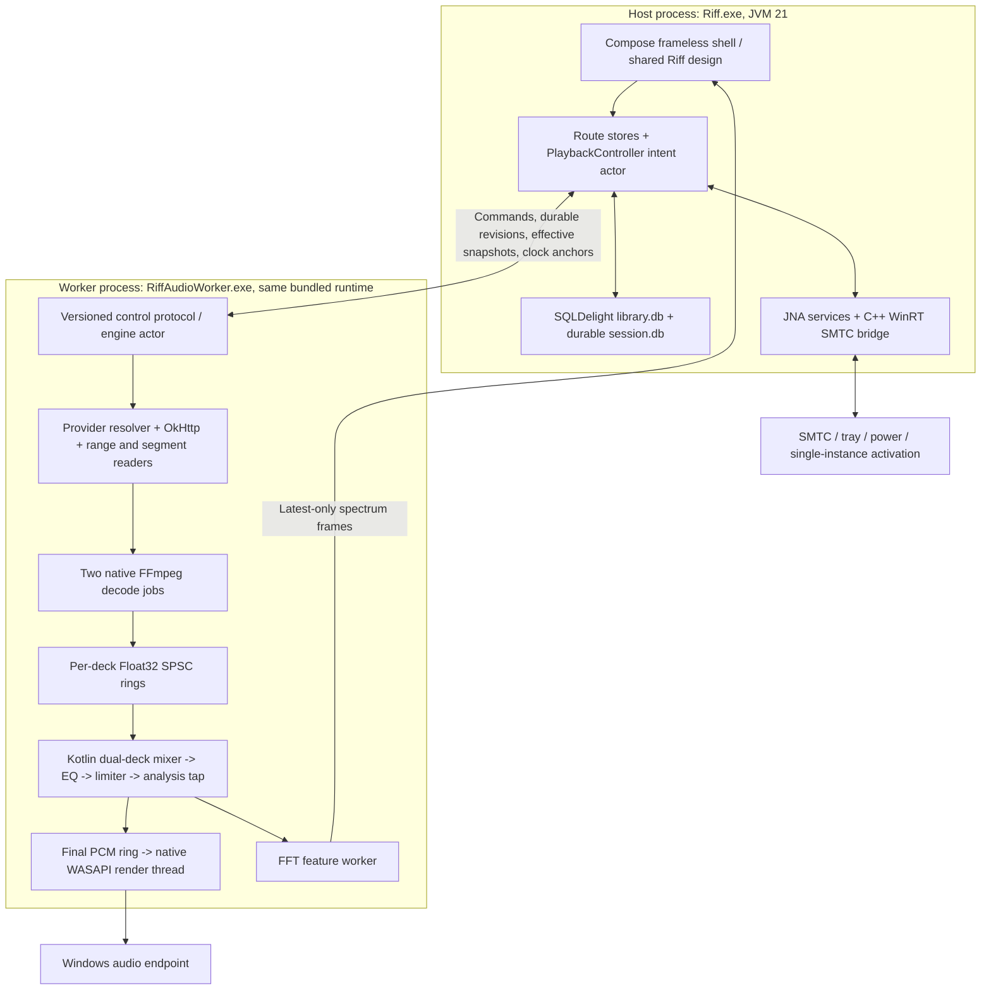

# Riff Windows production completion: forensic audit and engineering specification

Prepared 2 November 2026. Target: Windows 11 x64, Kotlin/JVM 21 and Compose Desktop. Status: research and proposed implementation specification; no player implementation is delivered by this document.


Document navigation: [Part 1: audit and parity](#part-1--forensic-audit-and-android-to-windows-parity) · [Part 2: architecture](#part-2--technical-research-and-architecture) · [Part 3: five phases](#part-3--five-dependency-ordered-execution-phases) · [Part 4: acceptance](#part-4--end-to-end-verification-and-acceptance-matrix).

## Decision and evidence standard

Keep Riff's Compose/Skia presentation and its visual assets. Replace the fixture-fed application composition with real repositories, an isolated audio worker, FFmpeg decoding, the existing dual-deck DSP adapted to bounded Float32 buffers, and an event-driven WASAPI sink. Use SQLDelight with SQLite for desktop persistence, a native C++/WinRT bridge for SMTC, JNA for low-frequency Win32 services, and the existing offline update-security boundary for a separately implemented transport and installer.

The first delivery is one complete vertical slice, not another set of disconnected adapters: local compressed file AND actual provider track -> source resolution -> verified bytes -> decoder -> two-deck DSP -> physical output -> seek/queue operations -> durable checkpoint -> reconstructed session after restart. A controlled HTTPS server proves HTTP integration; it does not prove the target music provider works. If the provider cannot supply an authorized playable transport, that part of Phase 1 is BLOCKED, never replaced by a manufactured URI.

Four labels apply throughout:

- **Observed component:** source exists and its behavior was inspected.
- **Previously tested component:** existing recorded tests demonstrate the stated scope, not a live journey.
- **Proposed:** a concrete architecture or new verification target in this report; not installed or measured.
- **Production accepted:** the named real-input acceptance gate has passed on the packaged application. None of the missing capabilities gains this label merely through this report.

This audit inspected the Android playback/provider/session/persistence/lyrics seams and desktop main-source composition, audio, cache, OS and update boundaries. It is not an exhaustive security review of every Android source line or native library. The contamination register below covers the discovered release-path fixture sources and false-success adapters, including their consumers; further implementation must repeat the dependency/call-site inventory and fail the release on newly discovered fixture reachability.

Source identity: HEAD `e4748bf6a59aa4d56575ef1c97215f2a58b05c92`, shared dirty working tree. Line numbers describe this working tree and may move. Android is in `app/src/main/java/com/musicglass/personal/`; current Windows sources are in `desktop/src/main/kotlin/com/musicglass/desktop/`. Do not infer a clean-commit audit from HEAD alone. Source hashes accompany this report in the forensic index.

Existing evidence: `docs/desktop/handoffs/update-07-result.md` records 146 desktop tests, 12 signer tests, 177 script tests and six isolated packaged startup runs. Those prove their component, cryptographic and startup assertions. They do not establish real MP3/AAC playback, a working provider, SQLite, SMTC publication, an installed update or physical mixed-DPI acceptance. The current capability matrix's broad production-ready labels require correction against this report's gates.

Current pins observed: Kotlin 2.4.10, Compose Desktop plugin 1.12.2, bundled Java 21.0.12.1, JNA 5.19.1; Android Media3 1.11.1, Coil 3.3.0, Ktor 3.5.2 and InnertubeX 0.7.2. Desktop `providerProbe` resolves an isolated JVM dependency configuration; it is not a provider integration in the released application. Desktop identity is 0.1.0 from its generated resource, independently of Android 0.20.0. No dependency was added for this report.

# Part 1 — Forensic audit and Android-to-Windows parity

## 1.1 Subsystem mapping

| Android subsystem and inspected seam | Windows observed state | Production Windows target and proof |
|---|---|---|
| `MusicPlaybackService.kt`, `OriginalAudioEngine.kt`, `PlaybackGateway.kt`: ExoPlayer/Media3 and a service-owned controller | `DesktopAudioBridge`, `AudioWorkerMain`, `DesktopDualDeckMixer`, Java Sound; default in-process, synthesized fallback | Worker-owned `PlaybackController`, FFmpeg source decoders, bounded Float32 decks, existing DSP, WASAPI shared endpoint. Decoder fingerprints and endpoint loopback must identify the requested song. |
| `Crossfade.kt`, `AudioSessionEffects.kt`, normalization and playback faults | Kotlin EQ/limiter/FFT and crossfade components exist | Preserve measured DSP transfer functions; support different source rates, encoder padding, seek epochs and device reset. Verify real two-track transition, gain, peak and underrun traces. |
| `PlaybackSources.kt`, `ProviderStreamResolver.kt`, `AndroidStreamTokenProvider.kt`, `AndroidTokenRuntime.kt`, `SolverService.kt` | `DesktopStreamResolver` manufactures `riff://stream/...`; no equivalent token/challenge execution in main runtime | `DesktopProviderGateway` + transport-specific `PlayableSource`; direct HTTPS range first, segmented HLS/SABR only when actually supported. Port session/cipher policy, replace Android WebView runtime explicitly. |
| Ktor/OkHttp, Android DataSource and playback recovery | URL-shaped strings accepted; mixer treats sources as files | Worker `RangeReader`/`SegmentReader`, OkHttp engine, AVIO cache adapter, cancellation and token-renewal identity checks. Interrupt live traffic and seek beyond cache. |
| `ProviderContracts.kt`, `ProviderCatalogRepository.kt`, `ProviderLibraryRepository.kt`, `YouTubeMusicProvider.kt` | Search/home/library/detail screens filter fixed lists | Shared account-scoped read contracts and cursor pagination, SQLite repositories and real provider results. Keep mutations separately capability-gated. |
| `AccountSession.kt`, `ProviderSessionManager.kt`, Android CookieManager and scoped preferences | Session scope string on handles; no proven desktop login | Session coordinator with scope + generation + nonce; external documented OAuth where supported; DPAPI-protected app-owned provider session material. Do not claim Android cookies already use Keystore encryption. |
| `EncoreRepository.kt` uses Android SQLiteDatabase; playback snapshots/settings also use preferences/files | `DesktopDatabase` is maps + custom delimiter files, despite `.db` and `-wal` names | Real SQLite `library.db` + durable `session.db`; SQLDelight generated queries; deterministic legacy import. There is no existing Room schema to reuse wholesale. |
| `PlaybackPersistence.kt`, `PlaybackSnapshot.kt`, `ScopedPlaybackSnapshots` | Partial track-ID snapshot, fixture-based reconstruction and swallowed failures | Stable queue occurrences, order/shuffle state, both deck positions/fade state, DSP settings and atomic acknowledged mutations. Restart reconstructs sources and explains unavailable entries. |
| `LocalAudioRepository.kt`: MediaStore/content URIs | File drop accepts suffixes, fabricates duration/artist on probe error | `LocalLibraryScanner`, native file identity, FFmpeg probe/tag extraction, bounded directory ingestion and reconciliation. Unknown metadata stays unknown. |
| `MusicDiskCache.kt`, `MusicCachePolicy.kt`, offline download engine/service | Range/art cache components exist without complete runtime flow | Transactional cache index, validated range coverage, account isolation and decoder-backed reads. Explicit offline download state and content integrity distinct from opportunistic cache. |
| `ArtworkImageLoader.kt`, artwork palette/color and glass rendering | Desktop palette/mesh and disk components, fixed meshes in song fixtures | Real image acquisition -> bounded decode -> palette/mesh -> keyed memory/disk variants -> unchanged glass. Pixel parity and no stale artwork on rapid track changes. |
| `LyricsRepository.kt`, `LrcRedLyrics.kt`, `LyricsModels.kt`: provider/local plain, LRC and TTML | Desktop lyrics models/karaoke exist, fixture songs own lyrics | Repository and parsers producing timed document; clock comes from presented audio, no independent demo timer. Missing/incorrect match is visible and recoverable. |
| MediaLibrarySession/MediaSessionService, notification transport | `WindowsSMTC` holds metadata/timeline in AtomicReferences | Host-process C++/WinRT SMTC for actual HWND; Windows flyout + hardware transport + seek verified while main window hidden. |
| Android service lifetime/wake behavior | Tray and power adapters exist; optimistic status | UI host stays alive while hidden; worker independent of window visibility; handle-based system power request only during effective playback. |
| Android navigation, typography, glass, mesh, interaction motion | Frameless shell, custom controls, panes/dock/inspectors/mini player implemented | Retain `CanonicalTokens`, `RiffDesign`, Inter resource, glass uniforms, artwork math, motion curves and component shapes. Replace state inputs, not the visual library. |
| Settings, account transitions and playback policy | Desktop state fields exist, not all backed by runtime capability | Typed settings repository, validated DSP application acknowledgements and account transition quiescence. Disabled capabilities must explain actual availability. |
| Encore/listening statistics | Map-backed aggregate records and screen route | Presentation-time listening spans, deduplicated history, real aggregate SQL and private account scoping; no counting silence while buffering. |
| Radio, podcast and recommendation collections | Static stations/shows/detail fallbacks | Typed provider content kinds, real cursors and playable source capabilities; absent provider support produces an honest unavailable state. |
| Android Auto (`CarLibrary`/`CarBrowse`), tiles/widgets | No functional Windows counterpart established | SMTC/taskbar/tray cover desktop transport. Android Auto remains Android-specific; a parity exception must be documented, not labeled ported. |
| Cast (`CastSupport`) and Automix/BeatThis/ONNX | Desktop DSP crossfade is not full Cast or Automix integration | Cast and analysis-driven Automix remain separately accepted parity features. Reuse pure policy only after native/runtime dependencies and transport semantics pass. Do not turn on a decorative switch. |
| Android APK release/signing | Desktop packaged app launches; historical MSI exists | Reproducible bundled-runtime native distribution, signed native dependencies, per-user installer, fresh VM lifecycle tests and real upgrade recovery. |
| Existing desktop signed update metadata pack | Seven modules offline-tested; production disabled | Preserve trust/parser/freshness/coordinator invariants; add bounded HTTP, artifact verification, Authenticode, installation serialization and compatible-data rollback. |

## 1.2 Fixture contamination and false-success register

These are implementation seams to sever, not reasons to delete useful deterministic tests. Synthetic signals remain useful in DSP tests, under a test-only dependency graph. A sine calculation inside FFT twiddles or an equal-power crossfade is valid mathematics; the issue is a generated track being substituted for missing music.

| ID | Current release-path location | Interception / misleading result | Exact severing seam and replacement |
|---|---|---|---|
| F01 | `WorkspaceModels.kt`, `FixtureTracks`; `DesktopHost.kt:66,72` | Initial current song and queue are real-looking fixed records | Empty initial state; `SessionRepository.restore()` reconstructs stable queue IDs and actual metadata. Move fixture object into `desktop-preview`/test source sets. |
| F02 | `WorkspaceStages.kt:67–108,133–143,283–315,341,395` | Home/search/library/podcast/radio content comes from fixed collections | Each stage accepts immutable state + event callback. Route store selects repository Flow and genuine pagination; no direct `FixtureTracks` reference in release sources. |
| F03 | `WorkspaceStages.kt:438,535,621` | Invalid detail ID falls back to the first fixture album/artist/playlist | Typed `NotFound`, account mismatch or loading/error state. Preserve exact route ID; never show unrelated content as success. |
| F04 | `SongItem` bundles dominant color, synthetic deck mesh and lyrics | UI metadata model implicitly supplies fabricated media-dependent resources | Separate `TrackSummary`, `ArtworkState`, `LyricsState`, and `PlayableCapability`. Derive artwork from fetched pixels and lyrics from matched documents. |
| F05 | `DesktopHost.kt:400–425` | `.mp3/.flac/.m4a/.ogg/.pcm` suffix accepted; failed probe becomes 180-second Local File | `ImportCoordinator.ingest()` performs signature/container probe. Unknown duration nullable; unsupported/corrupt -> explicit failed import with retained path and retry. Raw PCM requires explicit format dialog. |
| F06 | `DesktopStreamResolver.kt:74` | `riff://stream/<scope>/<id>` has no media bytes; expiry/mime are invented | Replace constructor seam with `ProviderGateway.resolve(TrackKey, SessionGeneration)` returning authenticated transport, actual mime/container evidence and expiry from provider. Reject `riff:` at production source boundary. |
| F07 | `DesktopDualDeckMixer.kt:23,301–322` | Missing/non-file source becomes `SyntheticTrackSource`; HTTP interpreted as File | `DeckSourceFactory.open(PlayableSource)` must return a real decoder lease or structured fault. No fallback generator linked in production. |
| F08 | `DecodedAudioTrackSource` in same file, around65–120 | Entire file decoded into heap; conversion failure may keep incompatible format; exception yields empty PCM | Bounded FFmpeg packet/frame decoder with explicit channel/sample format conversion; empty/corrupt/unsupported returns failure, not successful source. |
| F09 | `DesktopAudioBackend.kt:43–46,86–95,110` | Unsupported/lost sink activates timed silent fallback; sample count and latency look valid | Production `AudioSink.open()` returns device fault. `NullSink` is an explicit test-only implementation with a distinct evidence type, never selected automatically. |
| F10 | `DesktopAudioBridge.kt:16,118,171–215`; `AudioWorkerMain.kt` command acknowledgements | Default in-process and swallowed worker startup errors; successful command results can precede hardware/decoder readiness | Mandatory worker in release. Handshake with capabilities + actual device state; command receipts distinguish accepted, durably queued, applied and failed. Worker loss is visible. |
| F11 | `DesktopAudioBridge.kt:243–249` | Spectrum bins generated from sine/time rather than the audible output | Post-DSP audio tap -> actual `DesktopFFT` -> timestamped latest-only feature frames. Silence yields silence, not decorative energy. |
| F12 | `DesktopHost.kt:189–199,435`, persistence catches near563–582 | Optimistic playing/search state and swallowed checkpoint failures | Controller event stream is playback truth; query goes to real search store; durable mutations can fail visibly. Pending seek is separate from confirmed clock. |
| F13 | `DesktopHost` restore near93 and fixture reconstruction | Saved non-fixture tracks cannot reconstruct the session correctly | Persist full source identities and queue occurrences, resolve sources on restore, retain unavailable entries with reason; do not filter them into fixture queue. |
| F14 | `DesktopDatabase.kt:67,76–80,169–204` | ConcurrentHashMaps and delimiter files called transactional DB/WAL; live-file truncation and permissive parse | Replace with SQLDelight SQLite behind `LibraryRepository`/`SessionRepository`. Legacy reader is import-only; keep opaque old files and quarantine ambiguous rows. |
| F15 | `DesktopAudioCache.kt`, `DesktopArtPipeline.kt` | Standalone read/write and raw-pixel deck generation do not establish network->cache->decoder or URL->image->UI integration | Make `RangeReader` sole compressed-byte source; `ArtworkRepository` owns acquisition, decode and palette generation. E2E traces record cache hits at these exact boundaries. |
| F16 | `WindowsSMTC.kt:21` and update methods | Metadata/status/timeline stored in atomics; no real WinRT publication | Replace adapter implementation with native HWND-bound WinRT instance and event subscriptions. Verify actual flyout independently of internal state. |
| F17 | `DesktopOSCoordinator.kt` listener wiring | Play/pause/stop may update local OS status only; seek body is empty; tray toggles optimistically | All callbacks enqueue `PlaybackIntent`; only effective engine snapshots update every OS consumer. Implement seek and stop paths end to end. |
| F18 | `GlobalShortcuts.kt`, coordinator default constructor | Native registration without demonstrated WM_HOTKEY delivery; non-Windows fallback reports Success | One native message-thread owner, explicit routing and unregister. No `WM_HOTKEY` call site found in current main sources. Unsupported/error returns actual capability state. Prefer SMTC for media keys to avoid duplicate actions. |
| F19 | `PowerManagement.kt`, `WindowsTray.kt:107` | Power adapter can report success without API; thread-scoped acquire/release may occur on different threads. Explorer restart method lacks observed TaskbarCreated caller | Handle-based power requests; AWT EDT confinement for tray; observe/recover Explorer restart with registered TaskbarCreated message and prove re-registration. |
| F20 | `DiscordPresence.kt` default application ID | Placeholder client identity and internal state are not verified Discord publication | Owner-provided registered application ID, opt-in feature, named-pipe handshake/reconnect and actual client acceptance. Unconfigured means disabled. |
| F21 | Gallery/`ArtworkDeckFixture` and deterministic clocks | Useful visual previews can be mistaken for music functionality | Separate preview executable/source set; unmistakable preview identity. Release dependency and packaged-byte scan forbid fixture entry points. |
| F22 | Update pack and broad milestone labels | Offline signature/parsing/startup success interpreted as live updates or daily-driver acceptance | Retain component evidence; separately gate HTTP, size/hash, Authenticode, installer, rollback and actual clean-machine upgrades. |

Release contamination check: inspect the Kotlin dependency graph and scan release JAR classes/resources for `FixtureTracks`, `SyntheticTrackSource`, `ArtworkDeckFixture`, demo lyrics and `riff://stream/`. The build must fail if any fixture implementation is reachable from production composition. Test codec files and cryptographic test trust belong in test artifacts, not shipped resources. Runtime diagnostics expose `sourceKind`, decoder name, sink endpoint, worker PID, data-store engine and failure reason; never credentials or signed media URLs.

## 1.3 Visual/component migration contract

| Existing presentation | Migration classification | Required invariant |
|---|---|---|
| `CanonicalTokens`, `RiffDesign`, Inter font and license, `Motion`, glass/gradient controls | Keep 1:1 | Exact font bytes, token values and animation curves; no generic component kit substitution. |
| `ArtworkMath`, `ArtworkPalette`, `AmbientBackdrop`, `DesktopGlass` | Keep algorithm; replace inputs | Identical color space, palette sampling, mesh dimensions and shader uniforms for the same artwork and logical size. DPI conversion occurs once. |
| Workspace panes, sidebar, playback dock, mini player | Keep structure; wire genuine state | Stable playback controller survives window-mode changes; focus restoration, bounded pane widths, no new audio engine per window. |
| Home/search/library/detail views | Keep component styling; replace all fixture collections | Real empty/loading/error/page states use existing tokens. No fabricated monthly listener counts, durations or album tracks. |
| Queue and lyrics inspectors | Keep styling; replace source/clock | Duplicate queue entries retain distinct IDs; lyrics follow the audible deck and seek epoch. |
| Menus, seek/volume, drop/import | Augment behavior | Capability-driven actions, truthful progress, accessible names/focus, no extension-only codec claim. |

Desktop image checks can compare deterministic same-input renders now. Android pixel matching needs matching Android captures; physical mixed-DPI/high-refresh checks need actual hardware. These remain explicit held gates. Neither fake screen dimensions nor a VM proves a physical 165 Hz display or cross-monitor Skia behavior.


### 1.4 Observed visual values that must survive integration

The following were inspected in the desktop sources rather than inferred from screenshots. Preserve the complete files/asset hashes as well as these representative values:

| Source | Observed value / required preservation |
|---|---|
| `RiffDesign.kt` | ink `#000000`, raised `#181A22`, muted `#ADB0BF`, pink `#FF5EAC`; edge20dp, target48dp, card radius14dp; title34sp/40sp line height/-0.9sp tracking |
| `CanonicalTokens.kt` | `RiffSpace`: edge20, row gap12, item8, tight4, block16, target48, list row60/art48, icon24 dp. `RiffMenu`: corner28, width230–290, row48, edge20/icon gap16 dp; text Inter17sp/22sp/-0.3sp, detail14sp/18sp/-0.15sp, title20sp/25sp/-0.35sp Semibold |
| `Motion.kt` | press130, selection260, screen420, sheet450, base player520, player open700/close600, art520, ambient1200 ms; player cubic(.32,0,.12,1), calm cubic(.2,0,0,1), settle damping.9; Quick factor.7; reduced motion uses snap |
| `ArtworkMath.kt` | grid6x6, sample128px, vibrance1.12, floor.045, seam.5; blur radius6 /3 passes, alpha.6, fade.35; preserve `deckMesh` row/column transform and `deckTone` behavior |
| `DesktopGlass.kt` / `shaders/riff-glass.sksl` | Shared immutable Skia RuntimeEffect, independent per-piece uniforms; size/reach/radius/rim/bend/depth/dispersion/highlight/zoom/direction. Rim/bend scale with density once. Bar defaults blur2/rim20/bend36/depth1/dispersion1/highlight.45, white tint alpha.06; retain each other role's complete values and Full/Reduced/Frost/Solid branches |
| `desktop/build.gradle.kts` / font resource | Copies the exact Android `inter_variable.ttf` plus Inter OFL license. Compare original and packaged font digest; preserve all Inter weight/style construction, not only family name |

Source-driven parity tests compare complete token sets and shader source/behavior. Golden images exercise actual art, every glass role, menus, typography/weight/line wrapping, hover/pressed/focus/disabled states, held seek thumb and both motion settings. Hash identity does not alone prove platform rendering; same-input rendered and physical-display acceptance remain necessary. No SF Pro substitution or animated-cover feature is introduced.

# Part 2 — Technical research and architecture

## 2.0 Runtime, module boundaries and ownership



The native audio DLL is loaded into the worker; the C++/WinRT desktop DLL is loaded into the host because SMTC's HWND must belong to its calling process. Worker isolation contains decoder access violations; it is not a sandbox and does not make untrusted codecs safe. Harden build flags, dependency updates and input bounds remain required.

Proposed module split, extracted incrementally rather than a speculative monorepo rewrite:

```text
:riff-model                 pure identity, queue, lyrics and playback contracts
:riff-provider-core         account/session/catalog contracts and pure provider policy
:riff-design                tokens/font resources/artwork math/motion; preserve source identity
:desktop                    Compose views, route stores and composition root
:desktop-data               SQLDelight schemas, migration/import, artwork and library repositories
:desktop-audio-api          bounded versioned worker protocol and native value contracts
:desktop-audio-worker       decoder orchestration, cache IO, mixer/DSP and worker entry point
:desktop-platform-windows   JNA services, SMTC facade, HWND and window integration
:desktop-updater            current metadata code plus new transport/staging/activation contracts
native/riff-audio           MSVC C++20 JNI + FFmpeg + WASAPI
native/riff-windows         C++/WinRT SMTC and Win32 helper exports
native/riff-bootstrap       signed native bootstrap/helper, no Java dependency
:desktop-preview            fixtures and galleries only; excluded from production
:desktop-integration-tests  owned compressed corpus, HTTP server, worker and loopback harness
```

Phase 1 may retain packages under `:desktop` while extracting these boundaries. Do not postpone the vertical slice until module extraction is perfect. A dependency test prevents `riff-model`/provider-core from importing Android, AWT or Compose and prevents production modules depending on preview/test modules.

Threading and lifetime contract:

| Owner | Execution context | Allowed work and cancellation |
|---|---|---|
| Compose state and AWT HWND/tray calls | Compose UI dispatcher; AWT EventQueue for AWT objects | No database, file probe, blocking IPC or WinRT wait. Events marshalled to controller. |
| Host controller | `SupervisorJob` + `Dispatchers.Default.limitedParallelism(1)` actor | Serial intent/revision decisions; launches IO children, never blocks actor waiting on a callback that requires it. |
| SQLite writes/session commits | One dedicated executor per DB, `asCoroutineDispatcher()` | Explicit transactions, busy timeout, bounded retries; repository owner closes connections after jobs drain. |
| HTTP/cache | `SupervisorJob + Dispatchers.IO.limitedParallelism(8)` | Cancellable requests, per-source deadlines and bounded work queue. Decoder demand outranks scan/prefetch. |
| Decoder A/B | Two dedicated native decoder threads | May block on bounded cancellable AVIO cache wait; no UI or render callback. Close/seek stays serialized with decode. |
| Kotlin mix producer | Dedicated elevated-priority JVM thread | Preallocated blocks only, no suspend/IO/logging/locks; sends telemetry via bounded ring. JVM scheduling is measured, not presumed hard-real-time. |
| WASAPI render | Dedicated native MTA thread, MMCSS `Audio` task | Event-driven buffer consume, silence only for recorded underrun; no JNI upcalls, allocation, file/network reads or controller lock. |
| FFT | Dedicated single worker / Default limited to1 | Copy post-DSP tap into bounded analysis ring; drop stale analysis, never stall audio. |
| SMTC | One dedicated native COM MTA thread | WinRT activation/update/events, revoker lifetime; callback queues primitive event, host polls or receives off audio threads. |
| Global shortcuts / activation | Native Win32 message/pipe threads | Bounded validated messages -> host actor. No app state mutations in WndProc. |
| Updater helper | Separate signed native process | Own install lease, stage/activation journal and health watchdog, survives host exit. |

FFM is a preview API in JDK 21 and finalized in JDK 22. Keep the existing supported runtime and use a small JNI audio bridge; do not add preview flags or upgrade the desktop runtime just to avoid a narrow native interface. JNA remains appropriate for cold Win32 calls. Sources: [Oracle JDK 21 FFM](https://docs.oracle.com/en/java/javase/21/core/foreign-function-and-memory-api.html), [OpenJDK JEP 454](https://openjdk.org/jeps/454).
## Domain A — Real codecs, DSP, seeking and output

### A1. Decoder decision

| Approach | Actual strengths | Failure/maintenance considerations | Decision |
|---|---|---|---|
| FFmpeg shared libraries through a thin JNI C++ bridge | One demux/codec/resampler pipeline for MP3, FLAC, MP4/M4A AAC/ALAC, Ogg Vorbis/Opus and WAV; custom AVIO; codec delay/skip metadata and stream timestamps | Native attack surface, build/relicense obligations, container edge cases, ABI changes. Must bound reads, dimensions, channels and allocations. | **Select**, isolated worker and reproducible dynamic LGPL build. |
| FFmpeg via JavaCPP presets | Mature generated bindings, quick spike and low-level API coverage | Broad generated surface, preset-native version coupling, classifier/download size and hidden allocation/lifetime hazards still need control | Viable spike alternative; do not ship two decoder stacks. Select explicit JNI ownership for the production hot path. |
| Rust Symphonia worker/C ABI | Memory-safe demux/decode orchestration and compact feature selection; worker isolation fits architecture | Support is codec/container/feature-specific; a crate name is not proof of HE-AAC, every Opus/container combination or exact gapless semantics | The inspected upstream capability table marks HE-AAC/HE-AACv2 and Opus without completed status and reports no ISO/MP4/AAC-LC gapless support; third-party adapters exist but add their own native/licensing requirements. Not selected for this required matrix without equivalent corpus evidence. Symphonia may be reconsidered only with measured coverage and a single chosen backend. |
| miniaudio C library/PortAudio | Small C integration; miniaudio provides native output and built-in WAV/FLAC/MP3 support | miniaudio's built-in decoders are not a complete AAC/M4A/ALAC/Opus demux stack; PortAudio is an output abstraction, not codec support | Useful alternate sink; would still require FFmpeg or equivalent. Direct WASAPI provides required endpoint/clock/error control. |
| Java Sound SPI: mp3spi/JFLAC/JAAD plus JNI Opus family | Easy JVM integration for individual formats, useful controlled tooling | Separate demuxers, VBR indexing, MP4 edit lists, gapless delay and resampling behavior; deployment/provider SPI availability differs. Current WAV conversion has no compressed-format proof | Reject as primary production engine. No suffix-based capability declaration. |

Official capability/build references: [FFmpeg release archives](https://ffmpeg.org/releases/), [libavformat demux APIs](https://ffmpeg.org/doxygen/trunk/group__lavf__decoding.html), [FFmpeg license conditions](https://svn.ffmpeg.org/legal.html), [Symphonia](https://github.com/pdeljanov/Symphonia), [miniaudio manual](https://miniaud.io/docs/manual/index.html), [JavaCPP presets](https://github.com/bytedeco/javacpp-presets/tree/master/ffmpeg). These describe available mechanisms; they do not establish Riff's integration.

Proposed initial native pin: FFmpeg **8.1.2**, recorded source archive digest and build configuration, MSVC x64 C++20 JNI bridge, exact runtime ABI checks in handshake. Keep `libavformat`, `libavcodec`, `libavutil`, `libswresample` shared DLLs; configure without GPL/nonfree codecs and without native network protocols. Enable the exact required demuxers/decoders/parsers, `file`/custom IO only, and no unnecessary video encoders or devices. Native AAC decoding avoids libfdk-aac. Include LGPL notices, source/build instructions and replacement/relink obligations applicable to distribution; licensing review is a release gate, not an assertion that every FFmpeg build is LGPL. A newer security-fixed compatible version may supersede this pin through dependency review and corpus rerun.

Mandatory codec/container capability manifest, generated from actual decode tests:

| Container | Required coded streams | Required edge cases |
|---|---|---|
| RIFF/WAVE, RF64 if enabled | PCM 16/24/32-bit, Float32; explicit supported endianness | Odd chunks, truncated data, huge declared sizes, mono/stereo; raw PCM only with explicit sample format/rate/channels |
| MPEG audio elementary stream | MP3 CBR and VBR | Xing/VBRI index, ID3v2.4, reservoir/preroll, LAME encoder delay and padding, corrupt frame recovery |
| Native FLAC and Ogg FLAC if enabled | FLAC 16/24-bit | Seek table absent, variable block lengths, CRC error, 44.1/48/96 kHz |
| MP4/M4A | AAC-LC, HE-AAC v1/v2, ALAC | `moov` front/tail, edit lists, fragmented MP4 only if separately accepted, AAC priming and HE output rate/channel changes |
| Ogg | Vorbis and Opus | Chained streams capability explicit, granule positions, Opus pre-skip/end trim, correct 48 kHz Opus timeline |
| WebM | Opus, because the existing provider commonly selects itag251 | EBML seeking/cues, codec delay and discard padding, finite direct resource and segmented transport distinguished |
| ADTS where provider supplies it | AAC-LC/HE-AAC | Missing duration/index, rate changes, honest seek capability |

Do not declare a format supported until decoder output, duration, seek and end trimming all pass. A demuxer opening a file is insufficient. Encrypted/DRM media returns `ProtectedMediaUnsupported`; it is not sent through an arbitrary alternate extractor.

### A2. Source, decoder and native ownership contracts

The following are interface blueprints, not shipping implementations or filled-in stubs:

```kotlin
@JvmInline value class ScopeId(val value: String)
data class TrackKey(val scope: ScopeId, val provider: String, val id: String)
@JvmInline value class QueueEntryId(val value: String)
data class SessionGeneration(val scope: ScopeId, val generation: Long, val nonce: String)
data class RepresentationId(val opaqueId: String, val strongValidator: String?)
data class MediaFormat(val sampleRate: Int, val channels: Int, val channelMask: Long)
data class DecodedInfo(
    val codec: String, val container: String, val sourceFormat: MediaFormat,
    val contentFrames: Long?, val trimStartFrames: Long, val trimEndFrames: Long,
    val seekMode: SeekMode
)
enum class SeekMode { ExactIndexed, DecodeForward, SequentialOnly }
sealed interface PlayableSource {
    data class Local(val path: String, val fileId: String, val size: Long,
                     val modifiedNs: Long) : PlayableSource
    data class HttpRange(val leaseId: String, val representation: RepresentationId,
                         val byteLength: Long?, val expiresAtMs: Long?) : PlayableSource
    data class Segmented(val leaseId: String, val transport: SegmentTransport,
                         val representation: RepresentationId) : PlayableSource
}
enum class SegmentTransport { Hls, Sabr }
interface DecoderLease : AutoCloseable {
    val info: DecodedInfo
    suspend fun prepareSeek(targetContentFrame: Long, epoch: Long): SeekPreparation
    fun readInto(target: java.nio.ByteBuffer, maxFrames: Int, epoch: Long): DecodeRead
}
data class SeekPreparation(val epoch: Long, val firstContentFrame: Long)
sealed interface DecodeRead {
    data class Frames(val count: Int, val firstContentFrame: Long) : DecodeRead
    data object WouldBlock : DecodeRead
    data object EndOfStream : DecodeRead
    data class Failed(val failure: PlaybackFailure) : DecodeRead
}
interface DecoderFactory { suspend fun open(source: PlayableSource): DecoderLease }
```

Credentials/URLs are referenced by opaque worker-owned lease IDs. A URL is not a durable source identity. The worker validates every path/source descriptor; its local-process caller is authenticated by launch nonce and current-user pipe permissions. External activation never accepts internal lease IDs or arbitrary decoder options.

JNI exports are narrow `open`, `pumpDecode`, `seek`, `pollStatus`, `close`, `openSink`, `writeOutput`, `readClock` methods. C++ implementation uses the following C-shaped internal ABI so tests can exercise it without Java:

```c
/* All structs begin with struct_size + abi_version. UTF-8 strings have explicit lengths. */
typedef uint64_t RiffHandle; /* generation + slot; stale handles fail */
int32_t riff_decoder_open(const RiffSourceDesc*, RiffHandle* out, RiffError* error);
int32_t riff_decoder_read(RiffHandle, float* dst, uint32_t frame_capacity,
                         uint64_t epoch, RiffDecodeResult* out);
int32_t riff_decoder_seek(RiffHandle, int64_t content_frame, uint64_t epoch,
                         RiffSeekResult* out);
int32_t riff_decoder_cancel(RiffHandle, uint64_t epoch);
int32_t riff_decoder_close(RiffHandle);
int32_t riff_sink_open(const RiffSinkConfig*, RiffHandle* out, RiffError* error);
int32_t riff_sink_write(RiffHandle, const float*, uint32_t frames, uint64_t epoch,
                       uint32_t* accepted_frames);
int32_t riff_sink_clock(RiffHandle, RiffClockAnchor* out);
int32_t riff_sink_reset(RiffHandle, uint64_t next_epoch);
int32_t riff_sink_close(RiffHandle);
```

`RiffSourceDesc` is a local file descriptor or an application AVIO cache handle; never a shell command or arbitrary FFmpeg URL. `RiffError` contains stable enum code, native errno/HRESULT, bounded diagnostic and retry class. `RiffClockAnchor` contains device generation, epoch, position ticks/frequency, QPC in 100 ns units, output frame index and padding. Native exceptions never unwind through JNI. Validate direct-buffer capacity/alignment, frame*channel overflow, closed handles and finite gain values. Allocate/free AVPacket, AVFrame, AVIOContext, SwrContext, resample buffers and COM interfaces with RAII on all failure paths. JNI never retains a borrowed Java array address after a call; direct buffers are owned by a lease until decoder/sink threads join. Test double-close, cancellation during read and open failure at every allocation stage.

FFmpeg flow: `avformat_open_input` with custom AVIO -> bounded `avformat_find_stream_info` -> select audio stream -> allocate/open codec -> `av_read_frame` -> `avcodec_send_packet` / `avcodec_receive_frame` loop -> apply codec/container skip and end-trim semantics exactly once -> `swr_convert` into a chosen interleaved Float32 mix format. Drain decoder and resampler at true EOF. Retain fractional sample conversion position and PTS mapping. Do not treat EAGAIN, cache starvation and EOF as equivalent.

Initial mix format is stereo Float32 at endpoint mix rate, with explicit channel-layout downmix for sources with more channels. Unsupported layout returns a capability error, never guessed stereo byte interpretation. A rate/device change creates a new output generation, new resampler state and rebuilt filters. Choose blocks of 256 frames initially; benchmark 128/256/512 rather than assume any value works on Bluetooth and laptop power modes.

### A3. Connect the existing DSP without moving stalls into the sink

Native decoder jobs feed two preallocated SPSC rings, each bounded to three seconds maximum. The Kotlin producer consumes ready frames into preallocated direct buffers, applies deck gain/normalization -> equal-power crossfade -> per-channel EQ -> master gain -> limiter -> post-DSP analysis tap. Audit the existing filter state/reset behavior and convert ShortArray-only processing to Float32; quantize/dither only if an endpoint requires integer output. Preserve the Android/desktop effect ordering where observed; any intentional ordering change needs listening and transfer-function evidence.

Final native output ring capacity starts at 250 ms, target occupancy 100–150 ms in shared mode, with metrics for minimum occupancy and producer pause. This is a reliability target, not a promise of low-latency instrument monitoring. The WASAPI thread drains the ring without JVM callbacks. A long JVM pause can still cause underrun; record exact zero-filled frames and surface persistent starvation. Never advance the **content** position for silence inserted because data was unavailable. The device clock advances; the presentation ledger maps those frames to a gap, not to consumed song content.

Crossfade prebuffer uses the next real source, not a synthetic deck. Schedule against presented/content frame mappings, keep both queue occurrence IDs, and reserve at least fade duration plus decode safety within configured memory limits. If next source is not ready: remain on current available audio, then `BufferingNext` at EOF or make a capability-defined gap; never assert `isGapless=true`. If a decode error occurs during a fade, ramp down the failed deck, continue the surviving deck when safe, preserve queue history and show failure. The limiter absorbs mix peaks but must not hide NaNs or runaway gain.

Playback-rate UI currently accepts 0.5–2.0. A sample-rate change alone changes pitch. Phase 1 supports 1.0x with an explicit capability bound; if existing product behavior requires pitch-preserving speed, add a separately tested WSOLA/SoundTouch-based processor with license review, latency reporting and seek-reset behavior before enabling that control. Do not label an unverified rate field a working DSP feature.

### A4. Output selection and clock correctness

| Sink | Assessment | Production policy |
|---|---|---|
| Existing SourceDataLine | Simple PCM output; frame counters in current code count submitted frames and fallback can be silent. Weak direct endpoint/device-generation control | Keep only an explicitly selected diagnostic implementation while migrating; never silent fallback. It cannot certify WASAPI behavior. |
| WASAPI shared, `IAudioClient3`, event callback | Windows mixes with other apps; period negotiation, endpoint notifications, device clock and event-driven fill | **Default.** Query mix format and supported shared engine periods; open sensible supported period, prefill and start. Handle actual `AUDCLNT_E_*` results. |
| WASAPI exclusive | Can bypass system mix/resampling and provide format control | Later opt-in capability, not Phase 1 default. Handle device-in-use, Bluetooth limitations and format rejection with user-visible shared-mode fallback choice. |
| PortAudio/miniaudio output | Easier cross-platform wrapping, but internal fallback/latency choices must be audited | No second production output stack initially; reevaluate only if it preserves clock/device/error requirements with less maintenance. |

Native sink owns `IMMDeviceEnumerator`, `IMMNotificationClient`, `IAudioClient3`, `IAudioRenderClient`, `IAudioClock`, event handle and MMCSS registration. On default-endpoint change, unplug, suspend/resume or `AUDCLNT_E_DEVICE_INVALIDATED`: stop/reset on owner thread, increment device generation, release COM resources, enumerate with bounded backoff (100/300/1000 ms), reopen at actual new format and re-prime from the last confirmed content checkpoint. If no endpoint remains, enter `DeviceUnavailable`, pause logical progression and offer retry/device choice. Do not auto-restore to a different loudspeaker at maximum volume without respecting saved application gain and user output preference. Exclusive failure is not treated as permission to seize another device.

Use `IAudioClock::GetPosition` with `GetFrequency`; the returned device position is not necessarily a sample count. Its paired QPC value is already in 100 ns units. Convert before combining with raw QueryPerformanceCounter or Java `System.nanoTime`. Worker emits anchors with an explicit clock domain; host estimates cross-process offset using bounded ping samples and refreshes it after sleep. Piecewise ledger records output-frame intervals -> deck content-frame intervals, gain envelopes and resampler delay. For a crossfade, two track positions are valid; choose the UI's primary deck by a documented midpoint/ownership rule. Report per-deck clocks for restoring the fade. Sources: [IAudioClient3](https://learn.microsoft.com/en-us/windows/win32/api/audioclient/nn-audioclient-iaudioclient3), [IAudioClock GetPosition](https://learn.microsoft.com/en-us/windows/win32/api/audioclient/nf-audioclient-iaudioclock-getposition).

### A5. Seek/state machine and failures

A single engine actor serializes commands. Decoder, transport and sink completions carry `workerGeneration`, `deviceGeneration`, queue revision and timeline epoch. Discard stale completions without mutating current state.

| State + event | Required transition/action | Completion / failure behavior |
|---|---|---|
| Idle + Load | Resolving -> Probing -> Preparing -> ReadyPaused | Only become ready after real format + buffered PCM + open sink; expose exact failing stage. |
| ReadyPaused + Play | Prefill -> Playing | Acknowledged effective state after sink start; position anchor refers to presented frames. |
| Playing + missing bytes | BufferingCurrent | Keep available frames; ramp to silence at starvation, content clock freezes at last frame. Resume with new anchor after rebuffer. |
| Playing/Paused + Seek(T) | Seeking(epoch+1); cancel prior seek/IO demand, ramp old output down 3–5 ms, stop/reset output and old analysis | Local seek selects index before T; flush codec/resampler, decode preroll and discard until exact trimmed content frame T. Partial HTTP first obtains index/moov and necessary ranges. |
| Seeking + newer Seek | Cancel old request; retain latest requested T | No unbounded scrub queue. Old epochs cannot write into current deck/output ring. |
| Seek data ready | Prime exact T, restore paused/playing intent, ramp in 3–5 ms | `SeekApplied` includes actual frame, epoch and capability; do not acknowledge while data is merely requested. |
| Seeking + range unsupported | DecodeForward if bounded and user accepts; otherwise SeekUnsupported | Do not hang waiting for impossible random access or fabricate exactness. |
| Playing + natural EOF | Gapless boundary or Crossfading -> Playing(next) | Commit consumed occurrence exactly once; decoder delay/end padding removed. |
| Any + device invalidated | RecoveringDevice -> ReadyPaused/Playing or DeviceUnavailable | Rebase clock and discard stale device frames; no replay of already acknowledged queue command. |
| Any + worker crash | WorkerLost -> one bounded restart -> RestorePaused | After repeated crash, stop and show diagnostic; no in-process/synthetic fallback. |
| Any + account switch | Quiescing -> purge old leases/cache access -> bind new generation | Any old account reply rejected; app policy decides retain local queue vs detach private remote entries explicitly. |

`avformat_seek_file`/stream timestamps find a safe prior decode position, not proof of exact audible position. Preroll/encoder delay and resampler phase must be accounted for. Lossy seeking is exact in the decoded, trimmed reference timeline when an index/decode-forward path exists; not every unindexed network source permits instant sample accuracy. Return actual accuracy in the capability model.

```kotlin
sealed interface PlaybackFailure {
    val diagnosticId: String
    data class DecodeException(override val diagnosticId: String, val codec: String,
                               val nativeCode: Int) : PlaybackFailure
    data class UnsupportedContainerException(override val diagnosticId: String,
                                             val detectedType: String?) : PlaybackFailure
    data class StreamCorruptedException(override val diagnosticId: String,
                                        val byteOffset: Long?) : PlaybackFailure
    data class AudioDeviceLostException(override val diagnosticId: String,
                                        val endpointId: String?, val hresult: Int) : PlaybackFailure
    data class SourceUnavailable(override val diagnosticId: String,
                                 val retry: RetryClass) : PlaybackFailure
    data class AuthRequired(override val diagnosticId: String,
                            val generation: SessionGeneration) : PlaybackFailure
}
enum class RetryClass { Never, UserAction, AfterBackoff, AfterRefresh }
```

Production adds explicit cache-disk-full, worker-protocol-mismatch, unsupported-seek and protected-media categories to this same sealed hierarchy before enabling those paths. Bounded diagnostics contain source identity hashes, not path/URL/token contents by default. CancellationException is always propagated rather than rewritten as retryable IO.

## Domain B — Real provider, authentication and streaming

### B1. Provider port is a dependency gate, not a URI formatter

Reuse the **semantics** of Android `ProviderSession`, `ProviderCatalogReader`, `ProviderMutations`, `StreamRequest`, account scope and session generation. Extract pure models/policy into `:riff-provider-core`; do not copy Android Context, CookieManager, Media3 DataSource or Android WebView into desktop modules.

```kotlin
interface DesktopProviderGateway {
    val session: kotlinx.coroutines.flow.StateFlow<ProviderSessionState>
    suspend fun search(query: String, cursor: String?, session: SessionGeneration): CatalogPage
    suspend fun resolve(track: TrackKey, session: SessionGeneration,
                        reason: ResolveReason): Resolution
}
data class ProviderSessionState(val generation: SessionGeneration, val signedIn: Boolean,
                                val capabilities: Set<ProviderCapability>)
enum class ProviderCapability { CatalogRead, ResolveDirect, ResolveHls, ResolveSabr, MutateLibrary }
enum class ResolveReason { Initial, Expiring, HttpRefused, UserRetry }
data class CatalogPage(val tracks: List<TrackKey>, val nextCursor: String?)
sealed interface Resolution {
    data class Ready(val source: PlayableSource, val contentIdentity: String) : Resolution
    data class Failed(val failure: PlaybackFailure) : Resolution
}
```

A real implementation also returns display metadata in a separately typed catalog record; the abbreviated page key list above defines identity, not a license to populate UI with fixtures. Provider resolution lives in the worker for short-lived credentials and byte acquisition. Catalog stores may live in host; session authority sends immutable generation changes and grants opaque leases. Never duplicate mutable login truth in two processes.

Resolution stages: validate account generation -> capability/entitlement check -> single-flight provider request keyed by structured `(scope,generation,track,quality,transport)` -> cipher/challenge/token as required -> select actually supported audio representation -> bounded initial read + container probe -> lease. Expiry is provider-derived, with an early refresh margin; absent expiry is unknown, not invented six hours. Quality/transport changes generate a new representation identity. A 401/403 triggers at most one session/URL refresh per failure window; 429 obeys bounded Retry-After plus jitter, rather than cycling profiles aggressively. Geo/unavailable/removed/attestation failures are distinct, visible and not infinite retry cases.

The handover documents actual Android direct/SABR/PO-token variation and a 2 KB canary that missed ~20-second failures. Desktop acceptance must play a full track, seek after 60 seconds and traverse a queue with the real chosen transport. The existing dependency probe is only JVM artifact compatibility. Phase 1 must demonstrate InnertubeX 0.7.2 desktop catalog + resolver + token needs, using read-only provider calls. If the real provider selects WebM/Opus, that format is part of the first vertical slice even though the local corpus also requires MP3/FLAC/M4A.

Do not claim all transports work: direct range, HLS manifest/segment acquisition and SABR protocol/challenge handling are distinct implementations. Phase 1 enables only proven direct playback; if the target environment requires SABR, implementing its existing-provider transport semantics becomes a Phase 1 dependency, not a fake Direct handle. HLS must validate redirects/keys/segment hosts, discontinuities and encryption support. Unsupported encrypted HLS is rejected. SABR must preserve provider session/sequence/proof state and test multi-segment continuity; a URL-shaped result is insufficient.

### B2. Authentication and protected storage

Official OAuth for installed apps normally uses an external browser, loopback redirect on a random port, PKCE, state/nonce verification and a registered desktop client. Google prohibits developer-controlled embedded user-agents for its OAuth flow; a hidden WebView login is not a safe assumption. Also, access to a YouTube Data API OAuth token is not evidence of a supported music-stream playback grant. Sources: [Google OAuth installed applications](https://developers.google.com/identity/protocols/oauth2/native-app), [OAuth policy on embedded user-agents](https://developers.google.com/identity/protocols/oauth2/policies).

For Riff's current provider, first establish a supported owner-approved session mechanism. Investigate a dedicated WebView2 token/challenge host only for provider-compatible attestation logic, separate from login; validate whether the existing Android JS bridge can run without Android APIs. Do not inject cookies into prohibited OAuth pages, scrape an existing browser profile, request passwords or call a challenge a completed login. If session acquisition cannot be supported, return `AuthRequired`/`ProviderUnsupported`; the provider gate stays open. Signed-out read-only playback may satisfy the first provider slice if it is genuinely playable in the owner's environment, but signed-in library parity remains Phase 2 work.

`CredentialVault` has `load(scope,kind)`, `store(scope,kind,bytes)`, `delete(scope,kind)` and `deleteScope(scope)` suspend methods. Implement user-scope DPAPI with JNA 5.19.1 and explicit `DATA_BLOB`; call `CryptProtectData`/`CryptUnprotectData` with `CRYPTPROTECT_UI_FORBIDDEN`, no `CRYPTPROTECT_LOCAL_MACHINE`. Free returned native buffers with LocalFree and erase mutable secret copies when possible; JVM heap copies cannot be guaranteed erased. Write encrypted blobs atomically under app-owned `%LOCALAPPDATA%\Riff\credentials`, current-user ACL, never in SQLite/cache/logs. DPAPI fails after another-user/machine copy: surface reauthentication, never silently reset identity. Source: [DPAPI example and ownership](https://learn.microsoft.com/en-us/windows/win32/seccrypto/example-c-program-using-cryptprotectdata).

Credential Manager is viable for refresh tokens; DPAPI is selected because the current provider may need a structured cookie/session envelope rather than one password. Store scope, envelope format and non-secret metadata outside or inside the authenticated envelope as appropriate; do not use optional entropy as a hardcoded secret. Account switch sequence is revoke old leases -> cancel IO -> detach old reactive queries -> clear old in-memory tokens -> install new generation -> rebind repositories -> refresh UI. Late responses never cross generation boundaries. Signing out deletes protected credentials and private cache access according to product retention policy; local files are not deleted.

### B3. Byte-range cache, prefetch and AVIO

Select Ktor **3.5.2** with its OkHttp engine, matching the repository pin, for provider/stream requests; inspect and lock the resolved OkHttp dependency rather than adding an incompatible independent major. Separate clients/policies for provider API, media hosts, artwork and updates. A local TCP proxy is unnecessary: custom AVIO feeds FFmpeg from application-controlled readers and removes browser CORS from this JVM architecture. If a future component requires a proxy, bind loopback on a random port with per-process capability token and bounded endpoints; never expose an unauthenticated general fetch proxy.

```kotlin
interface RangeReader : AutoCloseable {
    val representation: RepresentationId
    val lengthBytes: Long?
    suspend fun readAt(offset: Long, count: Int, priority: ReadPriority): ByteArray
    suspend fun prefetch(offset: Long, count: Int, priority: ReadPriority)
    fun cancelEpoch(epoch: Long)
}
enum class ReadPriority { ActiveDecode, SeekIndex, NextDeck, Background }
```

Cache design: 256 KiB blocks initially; persistent compressed sparse file plus SQLite block ledger `(resource,block,start,length,hash,complete)`. Native `FSCTL_SET_SPARSE` is optional optimization with dense bounded-file fallback; logical holes must never be interpreted as fetched zero bytes. Write bytes -> force data according to cache durability policy -> transactionally mark block valid. After crash, only complete validated blocks are readable; unknown ranges refetch. Active decoder/prefetch leases pin blocks against eviction. Enforce disk quota, free-space reserve and LRU on **allocated cached bytes**, not declared media length. Unknown or absurd total size cannot reserve unlimited disk.

For misses, single-flight interval requests coalesce overlaps with bounded in-flight block count. Send `Range: bytes=start-end` and `Accept-Encoding: identity`; validate status, Content-Range start/end/total and actual body count. A server may return 200: accept only as a fresh full sequential representation under a size limit; never append it at the requested offset. A 416 prompts length/revalidation, not EOF unless the offset is proven at final size. Use a strong ETag with If-Range; otherwise maintain conservative representation identity and discard uncertain cached reuse. Range semantics source: [RFC 9110, range responses](https://www.rfc-editor.org/rfc/rfc9110.html).

Native AVIO callback reads an app-owned sparse-file/cache handle. On missing bytes it submits a bounded IO demand to a native queue and waits on a cancellable condition with deadline **on decoder thread only**. A worker IO coroutine drains demand, fetches blocks, commits coverage, then signals completion. Seek/cancel flips the decoder epoch and wakes blocked callbacks with interruption. Shutdown wakes every waiter before joining native threads. This avoids a JVM callback on the render thread and avoids deadlock between decoder lock, cache lock and controller actor. No lock is held over network IO.

Read-ahead target starts at 10–20 seconds compressed current-track coverage, bounded by bitrate/unknown-size budget, plus next-deck startup/index and fade requirements. Demand/seek traffic always preempts background scanning/prefetch. When a URL expires, request a replacement in the same session generation and continue only if content/representation identity and validators establish byte equivalence. Different itag, length, ETag or codec requires a new cache resource, decoder reopen and a presentation-time seek; never concatenate bytes from different encodes. Avoid persisting signed URLs or auth headers. Verify range reuse through actual network counters and cache logs, not by checking a manifest object in isolation.
## Domain C — Real SQLite and crash recovery

### C1. Engine choice and durability

| Candidate | Fit for this repository | Decision |
|---|---|---|
| Room KMP + BundledSQLiteDriver | Official JVM desktop support and a consistent bundled SQLite; useful for a shared Room model. Existing Android persistence is not a single Room schema, so this is not a drop-in port | Viable. Do not adopt a current alpha solely because examples use it; verify compiler/Kotlin and migration stability first. |
| SQLDelight + JVM SQLite driver | Explicit SQL/FTS/triggers/migrations, generated typed queries and coroutine observation; good fit for forensic migration and desktop-specific cache schema | **Select** SQLDelight 2.1.0 `sqlite-driver` and `coroutines-extensions`, with a verified constrained Xerial SQLite JDBC runtime. |

Proposed conservative JDBC candidate: `org.xerial:sqlite-jdbc:3.51.3.0`, verified published release, not asserted to be the newest. Run a Kotlin 2.4.10/Java21 compatibility spike and security/dependency review before adoption; newer reviewed patch may replace it. Explicit Gradle constraint prevents transitive SQLite runtime surprises. Check `sqlite_version()`, `PRAGMA compile_options`, `sqlite_compileoption_used('ENABLE_FTS5')` and an actual FTS5 query in the packaged runtime. If no SQLite driver/native extraction is available, startup reports a storage failure; it does not fall back to maps. Package a user-writable controlled native extraction directory, and test restricted temp directories/AV locking.

Sources: [Room KMP desktop setup](https://developer.android.com/kotlin/multiplatform/room), [Android KMP SQLite drivers](https://developer.android.com/kotlin/multiplatform/sqlite), [SQLDelight JDBC driver](https://sqldelight.github.io/sqldelight/2.1.0/2.x/drivers/sqlite-driver/app.cash.sqldelight.driver.jdbc.sqlite/-jdbc-sqlite-driver.html), [Xerial releases](https://github.com/xerial/sqlite-jdbc/releases).

Two stores avoid an invalid durability promise:

- `library.db`: `journal_mode=WAL`, `synchronous=NORMAL`, `foreign_keys=ON`, `busy_timeout=5000`. Metadata and caches are recoverable/refetchable. NORMAL in WAL preserves transactional consistency but can lose recently committed transactions after power failure.
- `session.db`: WAL + `synchronous=FULL`, foreign keys and bounded busy timeout. Accepted queue/current-state mutations commit here before their durable acknowledgement. Position checkpoint every second initially, and immediately on pause/seek/transition/close; therefore an ungraceful termination can lose up to the checkpoint interval of position, plus scheduling delay. A strict bound must be measured under overload. Never promise exact last audible sample across power loss.

SQLite cannot make writes durable on hardware that lies about flushes, and a software process-kill test is not a power-cut test. The existing update freshness store remains independently protected; ordinary DB rollback must never lower its high-water values. Sources: [SQLite WAL](https://sqlite.org/wal.html), [SQLite synchronous policy](https://sqlite.org/pragma.html#pragma_synchronous).

### C2. Relational schema specification

Below is the base `library.db` schema, to be authored as versioned SQLDelight migrations. IDs are opaque strings, structured scope keys never concatenated with an ambiguous delimiter. Timestamps are UTC epoch milliseconds unless a column says frames. SQL constraints define required invariants; query code also validates input lengths and finite numbers.

```sql
CREATE TABLE account_scope (
  scope_id TEXT PRIMARY KEY NOT NULL, provider TEXT NOT NULL,
  account_id TEXT, created_ms INTEGER NOT NULL
);
CREATE TABLE artist (
  scope_id TEXT NOT NULL, artist_id TEXT NOT NULL, name TEXT NOT NULL,
  artwork_key TEXT, updated_ms INTEGER NOT NULL,
  PRIMARY KEY(scope_id, artist_id),
  FOREIGN KEY(scope_id) REFERENCES account_scope(scope_id)
);
CREATE TABLE album (
  scope_id TEXT NOT NULL, album_id TEXT NOT NULL, title TEXT NOT NULL,
  release_year INTEGER, artwork_key TEXT, updated_ms INTEGER NOT NULL,
  PRIMARY KEY(scope_id, album_id),
  FOREIGN KEY(scope_id) REFERENCES account_scope(scope_id)
);
CREATE TABLE album_artist (
  scope_id TEXT NOT NULL, album_id TEXT NOT NULL, artist_id TEXT NOT NULL,
  ordinal INTEGER NOT NULL CHECK(ordinal >= 0),
  PRIMARY KEY(scope_id, album_id, artist_id),
  FOREIGN KEY(scope_id, album_id) REFERENCES album(scope_id, album_id) ON DELETE CASCADE,
  FOREIGN KEY(scope_id, artist_id) REFERENCES artist(scope_id, artist_id)
);
CREATE TABLE track (
  row_id INTEGER PRIMARY KEY,
  scope_id TEXT NOT NULL, track_id TEXT NOT NULL, provider TEXT NOT NULL,
  kind TEXT NOT NULL CHECK(kind IN ('song','episode','local')),
  title TEXT NOT NULL, artist_text TEXT NOT NULL, album_text TEXT NOT NULL,
  album_id TEXT, duration_us INTEGER CHECK(duration_us IS NULL OR duration_us >= 0),
  artwork_key TEXT, added_ms INTEGER NOT NULL, updated_ms INTEGER NOT NULL,
  availability TEXT NOT NULL, UNIQUE(scope_id, track_id),
  FOREIGN KEY(scope_id) REFERENCES account_scope(scope_id),
  FOREIGN KEY(scope_id, album_id) REFERENCES album(scope_id, album_id)
);
CREATE TABLE track_artist (
  scope_id TEXT NOT NULL, track_id TEXT NOT NULL, artist_id TEXT NOT NULL,
  ordinal INTEGER NOT NULL CHECK(ordinal >= 0),
  PRIMARY KEY(scope_id, track_id, artist_id),
  FOREIGN KEY(scope_id, track_id) REFERENCES track(scope_id, track_id) ON DELETE CASCADE,
  FOREIGN KEY(scope_id, artist_id) REFERENCES artist(scope_id, artist_id)
);
CREATE TABLE track_source (
  scope_id TEXT NOT NULL, source_id TEXT NOT NULL, track_id TEXT NOT NULL,
  source_kind TEXT NOT NULL CHECK(source_kind IN ('local','provider','offline')),
  locator TEXT NOT NULL, file_identity TEXT, size_bytes INTEGER, modified_ns INTEGER,
  codec TEXT, container TEXT, content_fingerprint TEXT, last_probe_ms INTEGER,
  missing_since_ms INTEGER, PRIMARY KEY(scope_id, source_id),
  FOREIGN KEY(scope_id, track_id) REFERENCES track(scope_id, track_id) ON DELETE CASCADE
);
CREATE INDEX track_source_file ON track_source(scope_id, file_identity);
CREATE TABLE library_membership (
  scope_id TEXT NOT NULL, track_id TEXT NOT NULL, saved_ms INTEGER NOT NULL,
  PRIMARY KEY(scope_id, track_id),
  FOREIGN KEY(scope_id, track_id) REFERENCES track(scope_id, track_id) ON DELETE CASCADE
);
CREATE TABLE playlist (
  scope_id TEXT NOT NULL, playlist_id TEXT NOT NULL, name TEXT NOT NULL,
  description TEXT NOT NULL, provider_revision TEXT, updated_ms INTEGER NOT NULL,
  PRIMARY KEY(scope_id, playlist_id),
  FOREIGN KEY(scope_id) REFERENCES account_scope(scope_id)
);
CREATE TABLE playlist_entry (
  scope_id TEXT NOT NULL, playlist_id TEXT NOT NULL, entry_id TEXT NOT NULL,
  track_id TEXT NOT NULL, ordinal INTEGER NOT NULL CHECK(ordinal >= 0),
  provider_entry_id TEXT, PRIMARY KEY(scope_id, playlist_id, entry_id),
  UNIQUE(scope_id, playlist_id, ordinal),
  FOREIGN KEY(scope_id, playlist_id) REFERENCES playlist(scope_id, playlist_id) ON DELETE CASCADE,
  FOREIGN KEY(scope_id, track_id) REFERENCES track(scope_id, track_id)
);
CREATE TABLE play_history (
  scope_id TEXT NOT NULL, event_id TEXT NOT NULL, queue_entry_id TEXT NOT NULL,
  track_id TEXT NOT NULL, started_ms INTEGER NOT NULL, ended_ms INTEGER,
  audible_frames INTEGER NOT NULL CHECK(audible_frames >= 0),
  sample_rate INTEGER NOT NULL CHECK(sample_rate > 0), outcome TEXT NOT NULL,
  PRIMARY KEY(scope_id, event_id),
  FOREIGN KEY(scope_id, track_id) REFERENCES track(scope_id, track_id)
);
CREATE INDEX history_recent ON play_history(scope_id, started_ms DESC);
CREATE TABLE lyrics_document (
  scope_id TEXT NOT NULL, document_id TEXT NOT NULL, track_id TEXT NOT NULL,
  source TEXT NOT NULL, source_version TEXT, language TEXT, format TEXT NOT NULL,
  offset_us INTEGER NOT NULL, duration_us INTEGER, content_sha256 TEXT NOT NULL,
  raw_text TEXT NOT NULL, fetched_ms INTEGER NOT NULL, expires_ms INTEGER,
  PRIMARY KEY(scope_id, document_id),
  FOREIGN KEY(scope_id, track_id) REFERENCES track(scope_id, track_id) ON DELETE CASCADE
);
CREATE TABLE lyric_line (
  scope_id TEXT NOT NULL, document_id TEXT NOT NULL, line_no INTEGER NOT NULL,
  start_us INTEGER, end_us INTEGER, text TEXT NOT NULL, role TEXT,
  PRIMARY KEY(scope_id, document_id, line_no),
  FOREIGN KEY(scope_id, document_id) REFERENCES lyrics_document(scope_id, document_id) ON DELETE CASCADE
);
CREATE TABLE lyric_part (
  scope_id TEXT NOT NULL, document_id TEXT NOT NULL, line_no INTEGER NOT NULL,
  part_no INTEGER NOT NULL, start_us INTEGER NOT NULL, end_us INTEGER NOT NULL,
  utf16_from INTEGER NOT NULL, utf16_to INTEGER NOT NULL,
  PRIMARY KEY(scope_id, document_id, line_no, part_no),
  FOREIGN KEY(scope_id, document_id, line_no) REFERENCES lyric_line(scope_id, document_id, line_no)
    ON DELETE CASCADE,
  CHECK(end_us >= start_us AND utf16_to >= utf16_from AND utf16_from >= 0)
);
CREATE TABLE sync_journal (
  scope_id TEXT NOT NULL, operation_id TEXT NOT NULL, entity_kind TEXT NOT NULL,
  entity_id TEXT NOT NULL, operation_kind TEXT NOT NULL, payload_json TEXT NOT NULL,
  state TEXT NOT NULL CHECK(state IN ('pending','sending','acknowledged','unknown','failed')),
  attempts INTEGER NOT NULL, next_attempt_ms INTEGER, provider_revision TEXT,
  created_ms INTEGER NOT NULL, updated_ms INTEGER NOT NULL,
  PRIMARY KEY(scope_id, operation_id),
  FOREIGN KEY(scope_id) REFERENCES account_scope(scope_id)
);
CREATE INDEX sync_due ON sync_journal(scope_id, state, next_attempt_ms);
CREATE TABLE cache_resource (
  scope_id TEXT NOT NULL, resource_id TEXT NOT NULL, representation_id TEXT NOT NULL,
  relative_path TEXT NOT NULL, total_bytes INTEGER, strong_etag TEXT,
  allocated_bytes INTEGER NOT NULL, accessed_ms INTEGER NOT NULL,
  PRIMARY KEY(scope_id, resource_id),
  FOREIGN KEY(scope_id) REFERENCES account_scope(scope_id)
);
CREATE TABLE cache_block (
  scope_id TEXT NOT NULL, resource_id TEXT NOT NULL, block_no INTEGER NOT NULL,
  byte_start INTEGER NOT NULL, byte_length INTEGER NOT NULL, sha256 TEXT NOT NULL,
  PRIMARY KEY(scope_id, resource_id, block_no),
  FOREIGN KEY(scope_id, resource_id) REFERENCES cache_resource(scope_id, resource_id) ON DELETE CASCADE,
  CHECK(byte_start >= 0 AND byte_length > 0)
);
CREATE TABLE artwork_variant (
  scope_id TEXT NOT NULL, artwork_key TEXT NOT NULL, variant TEXT NOT NULL,
  relative_path TEXT NOT NULL, sha256 TEXT NOT NULL, width INTEGER NOT NULL,
  height INTEGER NOT NULL, accessed_ms INTEGER NOT NULL,
  PRIMARY KEY(scope_id, artwork_key, variant),
  FOREIGN KEY(scope_id) REFERENCES account_scope(scope_id), CHECK(width > 0 AND height > 0)
);
CREATE TABLE migration_import (
  import_id TEXT PRIMARY KEY NOT NULL, source_sha256 TEXT NOT NULL, source_format INTEGER NOT NULL,
  imported_rows INTEGER NOT NULL, quarantined_rows INTEGER NOT NULL,
  completed_ms INTEGER NOT NULL, report_path TEXT NOT NULL
);
CREATE VIRTUAL TABLE track_fts USING fts5(
  title, artist_text, album_text, content='track', content_rowid='row_id',
  tokenize='unicode61 remove_diacritics 2'
);
CREATE TRIGGER track_ai AFTER INSERT ON track BEGIN
  INSERT INTO track_fts(rowid,title,artist_text,album_text)
  VALUES(new.row_id,new.title,new.artist_text,new.album_text);
END;
CREATE TRIGGER track_ad AFTER DELETE ON track BEGIN
  INSERT INTO track_fts(track_fts,rowid,title,artist_text,album_text)
  VALUES('delete',old.row_id,old.title,old.artist_text,old.album_text);
END;
CREATE TRIGGER track_au AFTER UPDATE ON track BEGIN
  INSERT INTO track_fts(track_fts,rowid,title,artist_text,album_text)
  VALUES('delete',old.row_id,old.title,old.artist_text,old.album_text);
  INSERT INTO track_fts(rowid,title,artist_text,album_text)
  VALUES(new.row_id,new.title,new.artist_text,new.album_text);
END;
```

`track_source.locator` is an app-owned local/offline path or stable provider ID, never an expiring signed URL. Scope IDs are present in joins and constraints, not solely UI filters. FTS query joins `track` and filters scope before returning data; bind a parsed/escaped user query to MATCH, never concatenate raw SQL or accept unbounded FTS expressions. Prefix search uses unicode61; substring requirements may warrant an additional trigram index after storage/locale measurement. CJK, Hindi, emoji and transliteration need their own expected-result tests; FTS5 alone does not guarantee every language's product semantics. Sub-10 ms is a proposed warm query p95 SLO on a specified 100k-track machine, excluding network and Compose rendering, not a guarantee from choosing SQLite. Source: [FTS5 external-content and tokenizer behavior](https://sqlite.org/fts5.html).

Durable `session.db` schema is self-contained, so restoring a queue does not require an atomic cross-database transaction:

```sql
CREATE TABLE playback_session (
  scope_id TEXT PRIMARY KEY NOT NULL, revision INTEGER NOT NULL, checkpoint_ms INTEGER NOT NULL,
  current_entry_id TEXT, repeat_mode TEXT NOT NULL, shuffle_seed TEXT NOT NULL,
  shuffle_cursor INTEGER NOT NULL, timeline_epoch INTEGER NOT NULL,
  intended_playing INTEGER NOT NULL, volume REAL NOT NULL, dsp_json TEXT NOT NULL,
  fade_state TEXT NOT NULL, fade_elapsed_frames INTEGER NOT NULL,
  fade_total_frames INTEGER NOT NULL, mix_rate INTEGER NOT NULL,
  CHECK(volume >= 0 AND volume <= 1 AND mix_rate > 0)
);
CREATE TABLE queue_snapshot_entry (
  scope_id TEXT NOT NULL, entry_id TEXT NOT NULL, ordinal INTEGER NOT NULL,
  track_id TEXT NOT NULL, provider TEXT NOT NULL, source_descriptor_json TEXT NOT NULL,
  display_snapshot_json TEXT NOT NULL, shuffle_ordinal INTEGER NOT NULL,
  PRIMARY KEY(scope_id, entry_id), UNIQUE(scope_id, ordinal),
  FOREIGN KEY(scope_id) REFERENCES playback_session(scope_id) ON DELETE CASCADE
);
CREATE TABLE deck_checkpoint (
  scope_id TEXT NOT NULL, deck TEXT NOT NULL CHECK(deck IN ('A','B')),
  entry_id TEXT NOT NULL, content_frame INTEGER NOT NULL, source_rate INTEGER NOT NULL,
  gain REAL NOT NULL, representation_fingerprint TEXT,
  PRIMARY KEY(scope_id, deck),
  FOREIGN KEY(scope_id, entry_id) REFERENCES queue_snapshot_entry(scope_id, entry_id),
  CHECK(content_frame >= 0 AND source_rate > 0)
);
CREATE TABLE command_receipt (
  scope_id TEXT NOT NULL, command_id TEXT NOT NULL, revision INTEGER NOT NULL,
  result_json TEXT NOT NULL, committed_ms INTEGER NOT NULL,
  PRIMARY KEY(scope_id, command_id)
);
```

Persist actual shuffled permutation (`shuffle_ordinal`) as well as RNG algorithm/version and seed; a seed alone may reproduce a different order after algorithm or queue changes. Put RNG algorithm/version inside the versioned settings/descriptor schema or add named columns in the first migration. Validate those JSON payloads with bounded typed serializers; no dynamic class deserialization. A future normalized settings table can replace bounded JSON without changing the durable command boundary.

When updating queue order, avoid transient UNIQUE ordinal collisions: transactionally assign temporary out-of-domain ordering space using a deliberate two-step reorder, or delete/reinsert affected snapshot entries while preserving deck references under `PRAGMA defer_foreign_keys=ON` inside that transaction, with the final foreign-key check before commit. Prefer rebuilding all snapshot child rows in one deferred-FK transaction for bounded current queues; never let a half-reordered queue escape.

### C3. Legacy migration and recovery

1. Stop legacy writers, acquire current-user single-instance/migration lock and record source paths/sizes/SHA-256. Copy original data and custom journal to immutable backup. Existing `library-state.db` is not SQLite; detect magic bytes before opening with a SQLite driver.
2. Parse using a **strict import-only reader** matching the actual old version. Current pipe/comma delimiters are unescaped and numeric parsing can be permissive. Ambiguous embedded delimiters or truncated rows are not losslessly reconstructable. Quarantine original row bytes with reason and show counts; never claim 100% migration by guessing field boundaries.
3. Import into new temporary SQLite files inside transactions, preserving IDs/scopes, remapping duplicate IDs deterministically and recording every mapping. Unresolved references become explicit unavailable/import-issue records or rejected rows, not links to an unrelated track.
4. Run foreign_key_check, integrity_check, FTS rebuild/check, row-count reconciliation, queue-order/duplicate checks and a sampled semantic comparison. Record source digest/import ID; rerun is idempotent and cannot duplicate history/playlists.
5. Close/checkpoint temporary DBs, force files and atomically publish a small storage-version pointer in the same app-owned NTFS directory. Do not overwrite old files in place. Recovery after crash chooses either completed old or completed new generation from the import journal; never merges partially imported data silently.
6. Keep backup until owner-visible import results and next successful starts. Restore on import failure without deleting source. Export a repair report excluding credentials. Failure to write settings/session appears as degraded storage and prevents false durable acknowledgements.

Queue edits commit intent + revision + receipt before dispatch to worker. Worker idempotently applies committed revision; on lost acknowledgement host queries current engine revision and reconciles rather than sending duplicate Next. Physical playback cannot participate in a SQLite transaction; durable desired state and effective audible state are separate. Persist periodic **presented** deck checkpoints, not samples merely submitted to the sink. History event IDs make crash/retry aggregation idempotent.

On restart, restore exact durable queue occurrences/order, repeat, shuffled permutation, gain/EQ, current occurrence and deck checkpoints; revalidate local file fingerprints and reacquire remote leases. Default restore is paused. For a captured crossfade, prepare and seek both real decks to saved source frames, restore envelopes and continue only on user Play. If one source is unavailable, preserve logical queue and offer resume from the available primary deck with an explicit explanation. Do not claim byte-perfect continuity of an in-flight hardware buffer across process termination. WAL checkpointing/backup uses SQLite APIs; never copy an open `.db` while ignoring `-wal`.

## Domain D — Reactive library, images and lyrics

### D1. De-fixtured UDF

`DesktopHost` becomes a composition/controller facade. Route-specific stores (`HomeStore`, `SearchStore`, `LibraryStore`, `AlbumStore`, `ArtistStore`, `PlaylistStore`, `QueueStore`, `LyricsStore`, `SettingsStore`, `EncoreStore`) expose immutable `StateFlow<ViewState<T>>`; views accept only state and callbacks. `ViewState` distinguishes Loading, Content, Empty, OfflineCached, NotFound and Failed with retry action. Do not collapse empty and failed into the same screen.

```kotlin
interface LibraryRepository {
    fun observeTracks(scope: ScopeId, filter: LibraryFilter): kotlinx.coroutines.flow.Flow<List<TrackSummary>>
    suspend fun importLocal(paths: List<String>): ImportBatchResult
    suspend fun reorderPlaylist(scope: ScopeId, playlistId: String,
                                expectedRevision: Long, entryIds: List<String>): MutationReceipt
}
interface PlaybackController {
    val state: kotlinx.coroutines.flow.StateFlow<PlaybackSnapshotState>
    suspend fun submit(intent: PlaybackIntent): CommandReceipt
}
```

These signatures reference versioned model contracts defined in `:riff-model`, not existing fixture `SongItem`. `PlaybackSnapshotState` includes effective state, pending command, durable queue revision, current/secondary deck, anchor and current fault. `CommandReceipt` says whether durability/application succeeded; no Boolean pretending all stages are complete. `LibraryFilter`, `TrackSummary`, import result and mutation receipt carry scoped IDs and nullable unknown metadata. Stable Compose keys use `(scope,entity,entryId)`, not list index or title.

SQLDelight query Flows run on dedicated DB context and convert to UI state on Default. Search uses 200 ms debounce, distinctUntilChanged and flatMapLatest for provider requests, preserving previous results with a pending indicator; local FTS can update immediately. Cancel old cursor requests on query/account change. Cache accepted metadata under matching generation. Never write remote mutations automatically while migrating a library or browsing a screen. Mutation journal retries require provider-supported idempotency; after an uncertain timeout mark `unknown`, reconcile by read, and request user action when the result cannot be established.

Single playback StateFlow feeds dock, focused view, queue, mini player, SMTC and Discord. Closing or recreating a Compose window does not own playback lifetime. Seek drag shows a pending thumb/preview time; confirmed time remains anchored to the engine until SeekApplied. Space ignores editable text fields; shortcuts dispatch the same intents as pointer and SMTC. Accessible loading/errors, keyboard context menu and drag reorder alternatives must survive the data-layer replacement.

### D2. Real local ingestion and metadata

Use Java NIO WatchService initially for Windows change notification, plus reconciliation. The Windows implementation ultimately observes directory notifications; a separate `ReadDirectoryChangesW` IOCP bridge is justified only if measured recursion/scale limits require it. OVERFLOW, dropped events and `ERROR_NOTIFY_ENUM_DIR` require rescan. Watch events are hints, never the canonical library. Source: [ReadDirectoryChangesW overflow behavior](https://learn.microsoft.com/en-us/windows/win32/api/winbase/nf-winbase-readdirectorychangesw).

Pipeline: drop/open/directory selection -> canonicalize and authorize roots -> bounded discovery channel (capacity256) -> debounce file stability across size/mtime samples -> native file identity from volume serial + file ID -> FFmpeg probe (max2 concurrent) -> tag/art extraction -> upsert transaction -> observed library -> optional queue insert. Directory recursion uses a visited file-ID set, avoids reparse-point cycles, applies explicit network/removable-volume policy and never follows a link outside an approved root silently. Handle Unicode/long paths, case-insensitivity without lowercasing display paths, duplicate hard links, UNC failures and files held by another process. Removed files become unavailable, not deleted from playlists/history at once. Recreated/replaced same-path files are re-probed.

Use libavformat metadata for ID3v2.3/v2.4, Vorbis comments and MP4 metadata; preserve title/artist/album/album artist/track/disc/date/duration and codec evidence. Round-trip an actual tag corpus; unsupported tag fields stay absent. `AV_DISPOSITION_ATTACHED_PIC` supplies embedded artwork. Otherwise try configured folder names such as `cover.jpg`, `folder.jpg`, `cover.png` within the track directory, under byte/dimension bounds. No fabricated duration or artist on error. Strip/ignore executable markup and embedded paths. Parse metadata in the isolated worker so malformed files cannot freeze Compose.

`ImportBatchResult` reports each path as Imported, Duplicate, Unsupported, Corrupt, Missing, AccessDenied or Cancelled. Queue import and library import are explicit product intents, not confused side effects. Persist local file identity and a bounded content fingerprint for replacements. Startup performs bounded reconciliation and streams results; it does not block first frame on scanning an entire disk.

### D3. Artwork acquisition and zero-flicker identity

Use Coil **3.3.0** Compose Multiplatform integration with the selected network engine after a desktop compatibility spike, or retain a small Skia decoder behind `ArtworkRepository`; choose one decode/cache owner. Preferred: Coil for image request/decode, `DesktopArtPipeline` for Riff's palette/mesh derivation. Avoid two unrelated disk caches. Key variants by `(scope,sourceContentDigest,pixelSize,colorSpace,paletteAlgorithmVersion)`. Decode off UI thread with limits on compressed bytes, dimensions and decoded memory. Detect corrupt cache entries and refetch once, never loop every recomposition. Source: [Coil Compose documentation](https://coil-kt.github.io/coil/compose/).

Keep fixed logical artwork bounds/aspect ratio before loading. Retain previous artwork until the new key succeeds or a genuine unavailable state is selected; do not flash fixture art. Cancel obsolete requests on track change and check request key before applying palette results. Prefetch next queue cover. Store original compressed art and needed display variants atomically, memory LRU bounded by decoded bytes; gallery/high-DPI variants do not require decoding a 10000-pixel image for a 48dp dock. Feed identical pixels/color transform into existing artwork math and shader. Crossfade old/new art and palette using existing motion tokens, honor reduced motion and avoid layout shift.

### D4. Lyrics parsing and presentation-time sync

`LyricsRepository.get(track,session)` checks local sidecars/embedded lyrics, provider lyrics and the existing configured fallback source with provenance and matching confidence. Port pure parsers/models from Android, not fixed desktop lyric arrays. Cache positive and negative results with source version/expiry; manual offset is per document/content identity. Ambiguous title/artist/duration matches require user selection, not silent lyrics from another recording. Provider/network failures remain distinct from NoLyrics.

Parser contracts produce `LyricsDocument(id,format,language,offsetUs,lines,source,contentDigest)`, `TimedLine(startUs?,endUs?,text,parts,role)` and `TimedPart(startUs,endUs,utf16From,utf16To)`. Plain text has no invented line times. LRC supports multiple timestamps per line, offset tag, duplicate timestamps, minute overflow validation and unordered input normalization. Enhanced LRC handles word boundaries and punctuation without splitting surrogate pairs/grapheme clusters. TTML honors namespace, timebase/frame/tick rates, nested begin/end/dur inheritance and syllable spans, with explicit limits on XML size/depth/node count. Disable external entities, DTD and external schema resolution in the XML parser. Reject pathological times and recover to usable line/plain text with a visible parse diagnostic.

At render time, `withFrameNanos` interpolates the latest hardware anchor only while Playing and within bounded anchor age. Binary search active line and evaluate word intervals in content time; no IPC event per syllable or per display frame. Seek/device generation invalidates interpolation immediately. Pause freezes progress; buffering freezes consumed content, even if device silence is rendered. At crossfade, switch lyrics according to the same primary-deck ownership rule as title/art, or show a designed transition; do not mix document A with deck B's position. Cache text measurement, draw highlight masks with existing karaoke styling and avoid re-laying out all lines at 120 Hz. User scrolling temporarily suspends auto-follow, with keyboard-accessible resume. Verify Unicode ranges, offset changes and drift using timestamped output-loopback markers.
## Domain E — Native Windows integration

### E1. Why the current SMTC adapter cannot publish

`WindowsSMTCAdapter.updateMetadata`, `updatePlaybackStatus` and `updateTimeline` assign AtomicReferences. No WinRT activation, HWND binding or display updater call occurs. Handling APPCOMMAND locally is transport input, not publication of a Windows media session. `DesktopOSCoordinator` also has seek and play/pause/stop wiring gaps. Fixing either side alone is insufficient.

Implement `WindowsMediaSessionNative` in `native/riff-windows`, C++20 with Windows SDK C++/WinRT projections, linked against `windowsapp.lib`, exposing a stable small C ABI invoked through JNA 5.19.1. JNA directly hand-authoring all WinRT COM vtables is possible but unnecessarily fragile for async stream references, HSTRING and event revocation. JNI is reserved for audio hot-path buffers; this low-frequency native facade can use JNA without performance concern.

Implementation sequence:

1. On AWT EDT after the `ComposeWindow` is displayable, obtain its top-level pointer with existing `Native.getWindowPointer(window)`; `Native.getComponentPointer` is an alternative for an actual native Component. No `NativeComponent` class assumption is needed. Pass HWND as pointer-width integer, never Int. Validate IsWindow and ownership PID.
2. On the bridge's one COM-initialized MTA thread, get `ISystemMediaTransportControlsInterop` from `winrt::get_activation_factory<Windows::Media::SystemMediaTransportControls, ISystemMediaTransportControlsInterop>()` and call `GetForWindow(hwnd, guid_of<SystemMediaTransportControls>(), put_abi(smtc))`. The HWND must belong to the calling process; therefore this bridge lives in the UI host, not the audio worker. Source: [GetForWindow contract](https://learn.microsoft.com/en-us/windows/win32/api/systemmediatransportcontrolsinterop/nf-systemmediatransportcontrolsinterop-isystemmediatransportcontrolsinterop-getforwindow).
3. Enable only supported buttons: play/pause/stop/previous/next and seek when the active source permits it. Set `DisplayUpdater().Type(MediaPlaybackType::Music)`, MusicProperties title/artist/album, thumbnail, then `Update()`. App identity/icon must come from packaged identity rather than a fixture title.
4. Acquire cover art through `ArtworkRepository` into an app-owned bounded file, or create an in-memory WinRT random-access stream and `RandomAccessStreamReference::CreateFromStream`. For file art use `CreateFromFile` with lifetime pinned through completion. Never ask SMTC to fetch a signed provider URL. Artwork completions carry track generation so stale results cannot replace current art.
5. Set PlaybackStatus from effective engine state. Create `SystemMediaTransportControlsTimelineProperties` with StartTime=0, EndTime=duration, MinSeekTime=0, MaxSeekTime=seekable end and Position=presented content position; TimeSpan uses 100 ns ticks. Update around 4 Hz plus discontinuities, not every render frame. Unknown/live duration gets honest bounded timeline capabilities.
6. Subscribe to ButtonPressed, PlaybackPositionChangeRequested and relevant repeat/shuffle/rate requests only if implemented. Callback enqueues a primitive event with generation; host controller commits/applies the corresponding intent. Publish resulting effective state even if a request is refused. Event source: [PlaybackPositionChangeRequested](https://learn.microsoft.com/en-us/uwp/api/windows.media.systemmediatransportcontrols.playbackpositionchangerequested).
7. Retain the main window peer while hidden to tray and while mini player is visible; no orphan session tied to a disposed peer. If the host recreates its HWND, revoke old events, disable/release old SMTC and bind the new peer before republishing. Shutdown cancels artwork work, revokes event tokens and destroys WinRT objects on the owner thread.

Native facade:

```c
int32_t riff_smtc_create(uint64_t hwnd, uint64_t* session, RiffError* out);
int32_t riff_smtc_metadata(uint64_t session, const RiffMediaMetadata* value);
int32_t riff_smtc_timeline(uint64_t session, const RiffMediaTimeline* value);
int32_t riff_smtc_status(uint64_t session, uint32_t state, uint32_t button_mask);
int32_t riff_smtc_poll(uint64_t session, RiffMediaEvent* events,
                       uint32_t capacity, uint32_t* event_count);
int32_t riff_smtc_close(uint64_t session);
```

`RiffMediaMetadata` uses explicit-length UTF-8 strings and an optional cached artwork path/stream token. `RiffMediaTimeline` carries track generation and signed 100 ns values checked for overflow. Native event queue bounded to128; repeated seek requests coalesce, discrete commands are never silently dropped. Failure/overflow is observable and triggers a state resync. Return HRESULT-derived failures rather than storing the requested value and reporting success.

Verify the actual Windows Quick Settings/media UI and another process's `GlobalSystemMediaTransportControlsSessionManager` observer. Windows controls whether and where a session appears; do not promise SMTC forces a custom hardware-volume overlay on every Windows build. Check Win+A and hardware media buttons on the target build, plus hidden-window behavior and interference from another media app. De-duplicate by event/source identity where possible; a blanket 150 ms suppression can discard legitimate rapid Next presses.

### E2. Frameless chrome and mixed-DPI

`WindowsChrome` already subclasses the frame/Skia child, retains previous procedures, implements physical-pixel hit testing and returns9 (`HTMAXBUTTON`) for the maximize rectangle. This is a meaningful existing component; the work is hardening and real acceptance, not replacing it with a generic titlebar.

Preserve WS_THICKFRAME/WS_MAXIMIZEBOX/WS_MINIMIZEBOX/WS_SYSMENU semantics while custom-drawing the client area. Handle WM_NCHITTEST with DwmDefWindowProc where applicable, native resize edges/corners before caption, HTMAXBUTTON exactly over the actual maximize region, and HTCLIENT over interactive controls. Route necessary non-client mouse messages so Windows owns Snap Layout hover and native move/size. Do not trigger a second maximize through both Compose onClick and WM_NCLBUTTONUP. Retain callback references and restore every subclass safely on close; reject stale child HWNDs. Source: [Windows custom maximize/Snap Layout requirements](https://learn.microsoft.com/en-us/windows/apps/desktop/modernize/ui/apply-snap-layout-menu).

Use DwmSetWindowAttribute for `DWMWA_WINDOW_CORNER_PREFERENCE` and supported backdrop attributes; treat failure as a capability result. DWM shadows require suitable window styles/composition, not a huge transparent border. Mica/Acrylic are optional OS surface materials, separate from Riff's own glass shader; compare colors/contrast before enabling because stacking materials can alter the exact aesthetic. Respect Windows transparency/high-contrast settings with the existing designed opaque fallback.

DPI: use the JDK/AWT per-monitor awareness supported by the packaged launcher; validate manifest/context rather than calling SetProcessDpiAwareness after AWT creates windows. Compose logical dp, AWT user coordinates and Win32 physical pixels are distinct. Cache physical titlebar hit rectangles after layout with one density conversion; update on move/resize/DPI change. On WM_DPICHANGED, chain to AWT unless Riff explicitly owns sizing for that message; there must be exactly one owner of the suggested rectangle. Rebuild size-dependent Skia render targets and shader uniforms at new physical dimensions; palette/mesh inputs remain logically identical. Source: [WM_DPICHANGED](https://learn.microsoft.com/en-us/windows/win32/hidpi/wm-dpichanged).

Tests: 100/125/150/200% scaling; negative-coordinate monitors; maximized work area/taskbar; snap half/third/quadrants; drag restore; Aero Shake when enabled by Windows; monitor disconnect with off-screen saved window recovery; Remote Desktop reconnect and GPU fallback. Physical move from 100%/60 Hz to 200%/165 Hz is a held hardware gate. Measure presented frames with PresentMon and collect frame-time p50/p95/p99, dropped presents and shader artifacts; a Compose timer count is not displayed FPS. At 60 Hz budget is16.67 ms, at120 Hz8.33 ms, at165 Hz6.06 ms; these are budgets, not measured Riff results. Match Android visual captures separately using same artwork/theme/font/logical component size, allowing explicitly documented rasterizer differences rather than silently accepting altered design tokens.

### E3. Tray, power, media keys, activation and presence

**Tray.** Keep AWT SystemTray initially, all add/remove/menu mutation on EventQueue. Close-to-tray preference hides the main peer without disposing playback; Quit performs controller shutdown and bounded worker join. Observe registered `TaskbarCreated` message from the host's message hook and re-register tray after Explorer restart. Test absent tray, repeated Explorer restarts, stale menu status and app exit while a menu is open. Menu actions share controller intents. Product-owned artwork/icon assets should replace the current programmatically invented tray glyph if they differ from Riff's identity.

**Power.** The existing SetThreadExecutionState call is thread-scoped. If retained, it must be acquired and cleared on one persistent native thread; coroutine dispatchers do not provide that guarantee. Prefer handle-based PowerCreateRequest/PowerSetRequest(PowerRequestSystemRequired)/PowerClearRequest and CloseHandle, with a meaningful reason string. Maintain one desired-state actor and reference count so repeated Playing snapshots do not leak requests. No display-required request for normal music. Clear on pause/stop/error/exit; during short rebuffer use a bounded grace interval. Expose native failure; requests do not prevent explicit user Sleep or every battery/policy action. Sources: [SetThreadExecutionState](https://learn.microsoft.com/en-us/windows/win32/api/winbase/nf-winbase-setthreadexecutionstate), [PowerSetRequest](https://learn.microsoft.com/en-us/windows/win32/api/winbase/nf-winbase-powersetrequest).

**Shortcuts.** Use SMTC as the default hardware-media route. Optional configurable global hotkeys run on one native GetMessage/DispatchMessage thread with RegisterHotKey/UnregisterHotKey and proper WM_HOTKEY handling; report collisions. Do not register unmodified media keys globally and also consume SMTC/APPCOMMAND without an ownership/de-duplication policy. Local Ctrl+K/Space are Compose focus-aware. Closing a window does not leak registrations.

**Single instance / Explorer open.** Create a current-session mutex named from app/channel/current-user SID, then a named pipe with current-user DACL and local-client restriction. Avoid spoofing by verifying server PID/token where practical and using a launch/session nonce. First instance becomes ready only after activation server starts. Second instance forwards a bounded versioned UTF-16/UTF-8 message with argv paths/URLs, waits for receipt and exits; startup races have bounded retry, not two independent players. Validate paths and supported URL hosts, cap payload/count, reject shell fragments/options, and never run a command interpreter. Work in standard-user scope, distinguish installed release/preview channels, and normalize file identity rather than trusting extension. Use SetForegroundWindow rules/FlashWindowEx when foreground activation is denied. Long paths, spaces, Unicode, multiple files and already-hidden main window are required tests.

**Discord.** Retain opt-in; require a real registered application ID. Implement framed local named-pipe IPC to `discord-ipc-0` through9 with bounded connect/read/write, protocol handshake/version, payload cap and nonce matching. `RandomAccessFile` blocking calls on IO alone are not reliably cancellable; prefer native overlapped pipe IO with CancelIoEx on timeout/disable. One IO actor owns connection state `Disabled -> Searching -> Handshaking -> Connected -> Backoff`; exponential backoff with jitter1–60 s, reset after stable session, no UI or audio dependency. Publish only effective playback and user-approved metadata; recompute timestamps after seek, clear on pause/sign-out/disable. No arbitrary local artwork URL assumed usable by Discord; use configured application assets or supported public art policy. Discord absence is a degraded optional capability, never a playback failure.

## Domain F — Release, transport and authenticated activation

### F1. Preserve the existing metadata security boundary

Existing `UpdateEnvelopeVerifier`, `UpdatePayloadParser`, `UpdateEligibilityPolicy`, `UpdateFreshnessStore`, `DesktopUpdateClient`, version handling and offline signer/review remain the starting point. The v1 metadata artifact type is **MSI**; do not quietly reinterpret it as an arbitrary ZIP or executable. A future portable-payload format requires a reviewed schema/version and compatibility change. Default production configuration stays disabled until real trust roots, channel, hosts, sequence authority, publisher policy and installation behavior exist.

New contracts:

```kotlin
interface UpdateMetadataTransport {
    suspend fun collect(request: MetadataRequest): CollectedEnvelope
}
interface UpdateArtifactDownloader {
    suspend fun stage(offer: EligibleUpdateReference,
                      progress: kotlinx.coroutines.flow.MutableStateFlow<DownloadProgress>): StagedArtifact
}
interface WindowsArtifactVerifier {
    suspend fun verify(staged: StagedArtifact): AuthenticatedInstaller
}
interface UpdateActivationClient {
    suspend fun prepare(installer: AuthenticatedInstaller): ActivationTicket
    suspend fun activate(ticket: ActivationTicket): ActivationOutcome
}
```

`MetadataRequest` uses locally configured hosts and bounds; `CollectedEnvelope` is raw bounded bytes plus fetch diagnostics, never trusted parsed fields. `EligibleUpdateReference` is an opaque current-coordinator reference, not user JSON. `StagedArtifact` carries exact path, file identity, byte count, SHA-256 and original signed offer reference. `AuthenticatedInstaller` is privately constructed only after size/hash/AuthentiCode/publisher checks. `ActivationTicket` is single-use, time-bound, offer-digest-bound and revalidated under the install lease. No serializer or public constructor may mint any of those authority-bearing values.

Pipeline: collect raw bounded metadata -> existing signature verification -> strict parser -> target/compatibility/freshness policy -> eligible reference -> download signed artifact -> exact signed length/hash -> WinVerifyTrust + publisher -> install lease + immediate policy revalidation -> helper activation -> health receipt. Missing or failed steps cannot be converted into a successful install receipt.

### F2. HTTP and staging policy

Use a separate Ktor/OkHttp client with TLS platform chain/hostname validation, no trust-all code, explicit connect/read/whole-operation deadlines, cancellation and identity encoding. Pinning is optional additional release policy: select rotating publisher-controlled SPKI pins with current+next overlap if operationally supportable; do not hard-pin a short-lived CDN leaf or call Ed25519 metadata signing TLS pinning. A certificate/TLS failure never retries over HTTP.

Transport validates each redirect (max3), scheme HTTPS, port443 unless explicitly configured, host allowlist, no credentials/fragments and bounded URL/body sizes. Resolve and filter IPv4/IPv6 destinations including loopback/link-local/private/ULA/mapped-address forms unless an explicitly separate development configuration permits them. Bind the validated resolution to the actual socket route, preserve SNI/hostname verification, and verify connected peer address; a DNS preflight followed by an unconstrained second resolution is vulnerable to rebinding. Define proxy policy explicitly because a corporate proxy changes destination enforcement; unsupported route policy returns a diagnosable failure rather than silently bypassing checks. Never forward auth headers across hosts. Reject unsupported content encodings and zip/decompression surprises.

Download to random generated filename in an app-owned staging directory, no filename from remote path. Enforce signed size while streaming; incremental SHA-256, bounded disk usage, cancellation cleanup and disk-full error. Resume only a matching staged artifact with validated offset/strong ETag, Range+If-Range and correct206; 200 restarts from zero. Recompute full final hash before use. Close/flush file and verify regular-file identity/no reparse substitution before installation; ACL and file-lock policy prevent a local swap between verification and helper use. Helper independently revalidates bytes/metadata/publisher after host exit. Stage references are not arbitrary user-supplied paths.

### F3. Locked files, MSI and compatible-data rollback

Never overwrite a running JVM's JAR/DLL/EXE or rename arbitrary live version directories and assume Windows will allow it. Use a signed small native bootstrapper at a stable location, immutable version directories, an activation pointer and an installation journal. Keep the worker native launcher in the same version directory as its matching runtime, bridge and JARs.

For current MSI metadata, first author the per-user MSI so Windows Installer owns registration/repair/uninstall and stages version-specific application files without removing the last accepted generation before health approval. Merely retaining old UpgradeCode while doing a normal destructive major upgrade does not provide this property. The MSI/helper protocol and WiX/jpackage packaging spike must prove side-by-side staging and uninstall bookkeeping. If the current generated MSI cannot support it, production auto-activation stays disabled until packaging is reauthored. Do not introduce an unsigned alternate portable-update path to evade the v1 schema.

Activation state machine:

`Idle -> Offered -> Downloading -> Verified -> AwaitingRestart -> PreparingData -> StoppingProcesses -> Installing -> CandidateReady -> HealthPending -> Committed`

Every stage writes a bounded durable helper journal; failures go to `RetryableFailure`, `Rejected`, or `RollingBack -> RolledBack/RecoveryRequired` with stable reason. Mechanics:

1. Acquire a cross-process install lease scoped to app/channel/user. Re-verify offer eligibility/current freshness and signed artifact under this lease. Separate metadata high-water knowledge from last installed receipt.
2. Prepare a SQLite online backup or closed-store copy including WAL correctly. Candidate uses a separate compatible data generation; preserve old compatible data until health acceptance. Estimate free space before downloading/installing/copying. Never launch old binaries against a database irreversibly migrated by the candidate.
3. Ask host to checkpoint and shut down, worker to drain/stop, then wait for **owned PID + creation-time** process handles. If exit times out, show retry/cancel; do not kill unrelated Java processes. Close tray/hotkeys/SMTC and release file locks before activation.
4. Helper executes only the verified MSI using fixed locally authored arguments and expected per-user scope. Standard-user install does not elevate by default. An intentionally machine-wide package uses a separately reviewed elevated helper, verifies all inputs again across UAC and offers cancellation. MSI return/reboot codes are explicit, not treated as all-success. The helper must reside outside replaced files and retain its own usable dependencies.
5. Stage new immutable `versions/<version>-<artifactDigest>` payload; activation pointer publication is an atomic same-directory file replacement using a Windows primitive with explicit flush policy. The pointer names both binary and compatible data generation. This is not an atomic swap of two non-empty running directories. Journal recovers a power interruption at any boundary.
6. Bootstrapper launches candidate with random health nonce and pipe restricted to the expected user/process. Candidate reports generated build identity, protocol/native ABI, DB migration/integrity state, controller readiness and responsive UI loop. No audio endpoint on a VM is a known capability state, not a reason to claim audible playback; corrupt native load/storage is fatal. Require authenticated health receipt within initial30 s (tuned after cold-machine measurements) and at least two successful starts before old data cleanup.
7. On startup crash/timeout or fatal diagnostic, helper restores previous binary+data pointer, quarantines failed candidate and records reason. It does **not** decrease update freshness/sequence/version floors to accomplish local recovery. An explicit install receipt/policy must distinguish recovery to last accepted installed version from accepting stale remote metadata. If schema-compatible recovery cannot be proven, stop at RecoveryRequired with intact backups.
8. Later cleanup occurs only with no outstanding process handles/file locks and after retention policy. MSI component ownership must remain consistent with active/retained versions. Repair/uninstall during pending health and reboots must replay the journal safely. Test Windows Installer rollback separately from post-start application rollback; they solve different failures.

This is substantially more work than invoking `msiexec` and calling exit0 success. Installer transactions do not automatically reverse arbitrary application data migrations or post-install startup failure.

### F4. Authenticode and CI/CD order

For Riff-produced native DLLs, bootstrapper/helper and generated app/worker EXEs, sign with SHA-256 and RFC3161 timestamp. Keep upstream JRE DLL signatures intact; do not casually re-sign vendor binaries. Verify the trusted bundled JRE provenance, hashes and signatures where present, plus the Riff-created launchers. Sign MSI and any installer EXE wrapper. JAR integrity is established by the signed/hashed distribution; optional JAR signing is a separate mechanism and not Authenticode.

Use Windows SDK signtool with `/fd SHA256` and `/tr <approved timestamp URL> /td SHA256`; choose certificate through a nonexportable OV/EV/HSM-backed store or Microsoft's current **Artifact Signing (formerly Trusted Signing)** CI integration. No private signing key/password in repository, command arguments or logs. A test certificate is confined to isolated VM trust and never shipped as production trust. Verify with `signtool verify /pa /all /v` and native `WinVerifyTrust(WINTRUST_ACTION_GENERIC_VERIFY_V2)`; success is return0, not generic HRESULT SUCCEEDED logic. Validate expected publisher key/rotation policy, chain, timestamp and revocation behavior. Offline revocation-unavailable is a distinct deferred/error policy, never silently trusted. Sources: [SignTool](https://learn.microsoft.com/dotnet/framework/tools/signtool-exe), [WinVerifyTrust](https://learn.microsoft.com/en-us/windows/win32/api/Wintrust/nf-wintrust-winverifytrust).

CI order: verified source/dependencies and SBOM -> reproducible unsigned payload build -> native/corpus/integration tests -> sign Riff executables/native DLLs -> assemble MSI/wrapper -> sign installers -> verify signatures -> compute final artifact exact size/SHA-256 -> allocate channel sequence -> offline/isolated Ed25519 metadata signing -> independently verify complete metadata+artifact chain -> clean-VM upgrade tests -> owner-authorized publication. Authenticode changes file bytes; hashing before signing produces a broken signed-metadata digest.

Signing identifies the publisher and supports trust/reputation; neither OV nor EV guarantees a new download avoids SmartScreen. Record observed behavior and publisher identity rather than promising prevention. Microsoft documents reputation separately: [SmartScreen developer guidance](https://learn.microsoft.com/windows/apps/package-and-deploy/smartscreen-reputation). Clean-machine acceptance includes Smart App Control/Defender policy where enabled, without disabling security settings to force success.
## 2.1 Worker IPC contract and observability

Extend `AudioContract.kt`, `AudioIpcTransport.kt`, `DesktopAudioBridge.kt` and `AudioWorkerMain.kt` together under protocol major2. Existing framed transport may be retained after a boundedness/fragmentation audit. Concrete proposed envelope: magic `RIFA` (4 bytes), major u16, minor u16, type u16, flags u16, payload length u32, request sequence u64, then payload (little endian). Header24 bytes; maximum payload1 MiB. UTF-8 strings have u32 byte lengths; no Java serialization. Validate lengths before allocation. Unknown major aborts handshake. Queues exceeding message limits use BeginQueue/QueueChunk/CommitQueue with expected count/digest/revision; incomplete uploads never replace the active queue.

Handshake contains generated app version, random launch nonce, PID/creation identity, protocol, native ABI, FFmpeg build identity, tested codec manifest and actual sink state. Use current-user named-pipe ACL and process ownership; nonce alone is not authentication. Package a **second native jpackage launcher** `RiffAudioWorker.exe` with its own entry point and shared bundled runtime. The current trimmed runtime lacks `bin/java.exe`; constructing that path and swallowing process-start failure is not a production strategy. Test the installed worker with JAVA_HOME/PATH absent. Bounded rotating stdout/stderr diagnostics stay separate from binary control messages.

| Command | Required identity/semantics | Reply/event |
|---|---|---|
| Handshake | nonce/build/protocol/capabilities | Actual ready/device/codec state or incompatible/fatal failure |
| ReplaceQueue | command UUID, expected durable revision, scoped occurrences/source IDs | DurablyAccepted revision, then Applied or Failed; duplicate UUID returns prior receipt |
| PrepareEntry | occurrence/source identity/session generation | Prepared after real probe and startup PCM |
| SetPlaying | desired Boolean/command UUID | Effective state after sink transition, no optimistic Playing |
| Seek | occurrence/target content time/epoch/command UUID | SeekApplied actual frame/capability or structured failure |
| SetGain/SetDSP | finite validated parameters/config revision | Applied at block boundary with reset/ramp policy |
| SelectEndpoint | endpoint/default policy/output generation | Actual format/device generation/clock discontinuity |
| QueryState | last revision/generation | Full effective snapshot for reconnect reconciliation |
| Shutdown | reason/deadline | Final checkpoint/drain receipt plus independently observed exit |

Clock anchors5–10 Hz plus discontinuities include primary/secondary occurrence, per-deck content frame/rate, output mapping, speed, explicit clock domain, latency, epoch and device generation. UI interpolates progress/lyrics at display refresh. Spectrum max60 Hz,256 quantized bins plus RMS/peak and post-DSP timestamp: approximately30 KiB/s of bins. Use a separate bounded latest-frame channel so analysis cannot block controls; drop stale spectrum, never receipts/faults. Stop or downsample analysis with no visualizer consumer.

Record real input/decoded/output frames, network/cache bytes, ring low-water/underruns, resets/device changes, queue revision, native handles, checkpoint age, provider transport and update stage. A sink count requires endpoint status and content loopback verification for acceptance. Redact credentials, signed URLs and private account identity. Logs have bounded size and isolated test roots.

# Part 3 — Five dependency-ordered execution phases

These phases replace ambiguous completion percentages. They do not relabel old M1–M6 or the seven update-metadata modules. Each needs executable exit evidence; class existence or fixture tests cannot close a phase.

## Phase 1 — Walking skeleton: real bytes to speakers and durable restart

### Objective and definition of done

Packaged Riff imports real MP3, FLAC and AAC/M4A, resolves an actual target-provider catalog track into its required real transport, and plays those bytes through dual-deck mixer/EQ/limiter to physical output. Seek, pause, duplicate-entry reorder, Next/Previous and a two-track transition work. Restart reconstructs durable queue/current checkpoint/settings from real SQLite and reacquires sources. Synthetic generation, silent fallback and `riff:` are unreachable in release. Full catalog breadth can follow, but the accepted import/search path and playback surfaces are genuine.

### Exact engineering tasks

1. **P1-01:** In `WorkspaceModels`, `DesktopHost`, `DesktopAudioBridge`, `DesktopDualDeckMixer`, `DesktopAudioBackend` and `DesktopStreamResolver`, remove automatic fixture/generator/headless fallback. Move `FixtureTracks`, `SyntheticTrackSource`, gallery clocks and fake FFT to preview/test. Add production dependency/resource guard. Empty initial state is valid.
2. **P1-02:** Create scoped identity/queue/failure models and `PlaybackControllerActor`. Modify host/dock/queue/mini consumers to observe effective state and pending commands. Remove immediate isPlaying assignment after send and swallowed persistence errors.
3. **P1-03:** Run SQLDelight/JDBC compatibility spike; create FULL-sync `session.db` and `SqliteSessionRepository` now. Implement typed durable source descriptors, receipts and strict minimal legacy queue import with immutable backup. Full library migration is Phase2, but session restore already uses the target store and actual production data root.
4. **P1-04:** Extend major2 transport, create `WorkerProcessSupervisor` and `RiffAudioWorker.exe` launcher. Modify worker/bridge handshake, stale-epoch handling and receipt reconciliation. Fail visibly if packaged worker cannot start; no dev-JDK/in-process substitute.
5. **P1-05:** Create `native/riff-audio` CMake/MSVC build and dependency/license manifest, `FfmpegDecoderFactory`, owned decoder leases and custom AVIO/local readers. Decode required local MP3/FLAC/AAC-LC M4A plus actual provider codec, commonly WebM/Opus. Memory must not grow with song duration.
6. **P1-06:** Refactor existing mixer/DSP to bounded Float32 blocks/rings. Add `WasapiSharedSink`, hardware anchors and analysis taps. Sink failure stops effective Playing. Preserve actual crossfade/EQ/limiter transfer functions and reset semantics.
7. **P1-07:** Create `ImportCoordinator`/`MediaProbe` and wire file drop/open to signature/container probing. Delete hardcoded180000ms metadata fallback. Show genuine tags/duration or explicit unknown/error.
8. **P1-08:** Implement `DesktopProviderGateway`, session authority, `HttpRangeReader` and cache-backed AVIO; delete manufactured URI factory. Test controlled HTTPS separately from actual provider. Port required cipher/token/direct/SABR behavior to get one genuine complete provider track. If its needed transport is absent, this task remains BLOCKED.
9. **P1-09:** Implement A5 seeking epochs/ramp/reset/preroll, real next-deck prebuffer and acknowledged queue revisions. Preserve duplicates/shuffled permutation. Restore paused at saved deck positions after normal exit and owned-process termination.
10. **P1-10:** Add packaged trace evidence linking encoded digest -> decoded fingerprint -> post-DSP -> endpoint. Run PR lane sequentially with desktop builds; record binaries/native/corpus versions, endpoint and failures. Correct overstated capability labels.

### Data contracts and threading

```kotlin
data class QueueOccurrence(val entryId: QueueEntryId, val track: TrackKey,
                           val source: PlayableSource, val ordinal: Int)
data class DurableSourceDescriptor(val version: Int, val kind: String,
    val track: TrackKey, val localPath: String?, val fileIdentity: String?,
    val qualityPolicy: String?, val representationHint: String?)
data class SessionCheckpoint(val revision: Long, val scope: ScopeId,
    val queueDescriptors: List<DurableQueueEntry>, val primary: QueueEntryId?,
    val deckA: SavedDeck?, val deckB: SavedDeck?, val fade: SavedFade?,
    val shuffleOrder: List<QueueEntryId>, val repeatMode: String,
    val dspJson: String, val checkpointMs: Long)
data class DurableQueueEntry(val entryId: QueueEntryId, val ordinal: Int,
                            val source: DurableSourceDescriptor, val displayJson: String)
data class SavedDeck(val entryId: QueueEntryId, val frame: Long,
                     val sourceRate: Int, val gain: Double)
data class SavedFade(val elapsedMixFrames: Long, val totalMixFrames: Long, val mixRate: Int)
interface SessionRepository {
    suspend fun restore(scope: ScopeId): SessionCheckpoint?
    suspend fun commit(commandId: String, checkpoint: SessionCheckpoint): Long
}
```

Serialize durable descriptors, never runtime lease IDs or signed URLs. Validate nullable field combinations by source kind and schema version. Queue FULL-sync commit precedes durable receipt; engine Applied is separate. Host actor, DB executor, worker actor, two decoder threads and native render owner obey Part2 ownership. No database calls on the mix/render threads.

### Risks and mitigations

| Risk | Prevention/evidence |
|---|---|
| Android-only token runtime/provider refusal | Earliest live spike; transport-specific failure; real provider gate cannot be substituted. |
| JNI memory corruption/leak | Worker isolation, RAII, generational handles, allocation-failure/cancel tests and native sanitizers where supported. |
| GC/mixer starvation | Preallocation/native final ring; measure allocations, GC and occupancy; unexplained underruns fail stress gate. |
| Trimmed runtime launch failure | Installed second-launcher test with no JAVA_HOME/PATH. |
| Submitted frames mistaken for audible position | Hardware clock/presentation ledger and loopback marker calibration. |
| Accepted queue lost/duplicated after restart | FULL transaction/receipt plus crash injection around commit/apply/ack. |
| Ambiguous legacy bytes | Preserve and quarantine; no guessed recovery. |

### Verification gate

Proposed automated tests: `ReleaseCompositionHasNoFixtureDependencies`, `PackagedWorkerStartsWithoutJavaOnPath`, `CompressedCorpusTraversesRealMixer`, `HttpRangeSeekUsesFetchedBytes`, `QueueDuplicateReorderSurvivesRestart`, `SeekDropsPriorEpochFrames`, `NativeOpenFailureReleasesAllHandles`, `SessionCommitCrashMatrix`, `NoEndpointIsNotPlaying`, `ActualSpectrumMatchesPostDspTap`. Use owned/licensed compressed files with hashes, never runtime synthesized replacement tracks.

Human/real-environment: drop tagged MP3/FLAC/M4A and identify each by hearing; seek forward/back after30 s; queue two songs and reorder a duplicate; pause/restore main/mini; quit/restart; terminate only owned app and restore paused within checkpoint tolerance. Separately search a real provider song, play a complete track, seek after60 s and play the next real track. Capture endpoint loopback/fingerprints. Missing provider, synthesized output, silent missing device or failed restart means Phase1 fails.
## Phase 2 — Genuine library, accounts, catalog and storage migration

### Objective and definition of done

Supported Home/search/library/detail/podcast/radio views show genuine scoped data and honest unsupported states. Local scanning, full SQLite schema, secure sessions and legacy migration work on an existing profile. No production view imports fixture collections. Read-only catalog and local playlists work offline with cached data; remote mutations remain explicit authorized actions.

### Exact engineering tasks

1. **P2-01:** Create `:desktop-data` SQLDelight schema/migrations and `SqliteLibraryRepository`, `PlaylistRepository`, `HistoryRepository`, `SyncJournalRepository`; retire custom `DesktopDatabase` from runtime. Keep `LegacyDesktopStoreReader` import-only. Implement C3 backup/import/quarantine and visible reconciliation report.
2. **P2-02:** Create `AccountSessionCoordinator`, `DpapiCredentialVault` and `DesktopAuthenticationCoordinator`; extract Android pure provider contracts. Verify actual provider login support before coding its UI. External OAuth+PKCE only for documented grants; challenge host only for supported token needs. No password handling/browser-profile scraping.
3. **P2-03:** Wire paginated catalog/library/collection/recommendation reads through the desktop provider backend and session generation. Details use exact IDs. Delete first-fixture detail fallbacks; expose actual availability, unknown duration and transport capability.
4. **P2-04:** Create `LibraryScanner`, `DirectoryWatchCoordinator`, `ReconciliationJob` and worker metadata/art commands. Root registration, file identity/replacement/deletion, overflow rescan and incremental progress must work. File deduplication does not remove legitimate duplicate playlist/queue entries.
5. **P2-05:** Implement route stores and Flow queries in `WorkspaceStages`, sidebar, focused views and inspectors. Add genuine Empty/OfflineCached/Failed/NotFound using existing Riff styling. Search cancellation, cursors and account changes must reject stale generations.
6. **P2-06:** Connect real artwork acquisition/cache/palette through `ArtworkRepository` and existing art math. Test decode bounds/stale-key races. Remove hardcoded mesh/lyrics from production track metadata ownership.
7. **P2-07:** Connect playlists/history/Encore to acknowledged operations and presented listening spans. Retain approved privacy/retention choices; external genre lookup remains off by default. Implement local edits first; remote writes need explicit user action and uncertain-outcome reconciliation.
8. **P2-08:** Benchmark actual SQLite FTS on100k records with warm/cold distinction. Test malformed legacy delimiters, duplicates, Unicode, cross-scope data, unwritable disk and interrupted imports. Preserve recovery backups and report rejected counts.

### Data contracts and concurrency

```kotlin
data class LocalRoot(val rootId: String, val path: String, val recursive: Boolean)
data class ScanProgress(val rootId: String, val discovered: Long, val imported: Long,
                        val rejected: Long, val reconciliationRequired: Boolean)
interface LibraryScanner {
    fun scan(root: LocalRoot): kotlinx.coroutines.flow.Flow<ScanProgress>
    suspend fun reconcile(root: LocalRoot)
}
interface CredentialVault {
    suspend fun load(scope: ScopeId, kind: String): ByteArray?
    suspend fun store(scope: ScopeId, kind: String, secret: ByteArray)
    suspend fun deleteScope(scope: ScopeId)
}
data class ImportAudit(val sourceDigest: String, val imported: Long,
                       val quarantined: Long, val backupPath: String)
```

DB executors remain per-store. Initial bounded pools: discovery4, probe2, image decode2; validate by workload. Stream scanner results instead of holding a disk file list in heap. One account authority serializes transitions; worker/provider see immutable generations. SQL query collection stays off UI and route stores cancel on scope change.

### Risks and mitigations

SQLDelight/Kotlin/native compatibility -> packaged driver/FTS/migration spike first. Locked/long paths and reparse loops -> identity-based bounded ingestion. DPAPI machine/user copy failure -> reauthentication with metadata preserved. Tokenizer mismatch -> multilingual expected-result corpus. Stale provider page -> query/session generation. Migration data loss -> original bytes + idempotent import + owner-visible quarantine. Provider API drift -> capability/error state, never fixture substitution.

### Verification gate

`LegacyImportIsIdempotentAndQuarantinesAmbiguity`, `KillAtEveryImportPublishBoundary`, `CrossScopeQueryCannotLeakRows`, `FtsMultilingualAnd100kLatency`, `WatcherOverflowReconcilesDeletesAndRenames`, `LongPathUnicodeAndHardlinkIngestion`, `DpapiDifferentUserCannotDecrypt`, `LateProviderResponseRejectedAfterAccountSwitch`, `RealCollectionPagination`, `ArtworkRapidTrackChangeKeepsMatchingPalette`.

Human: import a real multi-album directory; edit a local playlist; find/queue music from provider; sign out/in or switch account with the supported flow; go offline; restart and observe actual cached library/art. Unsupported routes explain actual limitations. Inspect migration row counts/quarantine instead of assuming a completed import means no data loss.

## Phase 3 — Full audio resilience, lyrics and everyday parity

### Objective and definition of done

Every enabled codec/transport is accepted with real bytes. Gapless/crossfade behavior is measured, device/network failures recover without fake progression, and lyrics follow hardware presentation. Desktop interactions and agreed Android feature semantics work with genuine data and persisted settings. Unported features remain visible in the parity register; decorative controls do not count as support.

### Exact engineering tasks

1. **P3-01:** Finish HE-AAC v1/v2, ALAC, Ogg Vorbis/Opus, provider WebM and all declared WAV/FLAC variants. Implement trim/edit-list/preroll, unknown duration and corrupt/truncated recovery tests. Generate capabilities only from accepted variants.
2. **P3-02:** Harden range cache sparse/block ledger, eviction leases and byte-equivalent URL refresh. Implement any provider-required segmented continuity with actual multi-segment tests; enum-only HLS/SABR is not a capability.
3. **P3-03:** Finish endpoint notification/reopen, mixed source/output rates, sleep/resume/no-device recovery in sink/supervisor. Exclusive mode remains disabled until its own format/device-use/output verification gate passes.
4. **P3-04:** Complete gapless no-fade path, two-deck envelope accounting, priming/padding removal, normalization limits and EQ/limiter stress. Tie sleep timer/stop-after-song to actual transitions. Enable speed control only with accepted pitch-preserving implementation; DSP settings receive application receipts.
5. **P3-05:** Create `LyricsRepository`, `LrcParser`, `EnhancedLrcParser`, `TtmlParser`, match/provenance selection and document cache. Port Android held-word, backing-vocal and instrumental-gap semantics. Plain lyrics never acquire invented timings.
6. **P3-06:** Replace demo clocks in `LyricsKaraoke`/inspectors with hardware-anchor interpolation, primary-deck ownership and seek reset. Implement scroll override/manual offset/romanization according to approved behavior. Review Unicode/transliteration dependencies before enabling them.
7. **P3-07:** Complete real pointer/keyboard/drop/queue/mini-player journeys using one controller. Stale revisions, drag cancel, removal undo and import errors must survive repository updates. Settings change runtime behavior, not just checkbox state.
8. **P3-08:** Close the scope/parity register for downloads/offline lifecycle and integrity, Encore retention/stories, search suggestions, link opening, Cast, Automix and platform-only widgets/Auto. Implement accepted Windows features or obtain explicit scope decisions. A missing user-visible feature cannot silently be called ported. The owner's plan dropped animated covers; do not reintroduce them.
9. **P3-09:** Run long-duration seek/crossfade/network/device chaos and heap/native-handle trend checks. Diagnose unexplained starvation/corruption instead of only increasing timeouts.

### Data contracts and concurrency

```kotlin
data class PresentationAnchor(
    val epoch: Long, val deviceGeneration: Long, val primary: QueueEntryId,
    val primaryFrame: Long, val sourceRate: Int, val qpc100ns: Long,
    val deviceTicks: Long, val deviceFrequency: Long, val speed: Double
)
data class LyricsQuery(val track: TrackKey, val durationUs: Long?, val language: String?)
interface SyncedLyricsRepository {
    fun observe(query: LyricsQuery): kotlinx.coroutines.flow.Flow<LyricsLoadState>
    suspend fun setOffset(documentId: String, offsetUs: Long)
}
sealed interface LyricsLoadState {
    data object Loading : LyricsLoadState
    data class Plain(val documentId: String, val text: String, val source: String) : LyricsLoadState
    data class Timed(val documentId: String, val lines: List<TimedLyricLine>) : LyricsLoadState
    data object NoLyrics : LyricsLoadState
    data class Ambiguous(val candidateIds: List<String>) : LyricsLoadState
    data class Failed(val diagnosticId: String, val retryable: Boolean) : LyricsLoadState
}
data class TimedLyricLine(val startUs: Long, val endUs: Long?, val text: String,
                         val parts: List<TimedLyricPart>)
data class TimedLyricPart(val startUs: Long, val endUs: Long,
                         val utf16From: Int, val utf16To: Int)
```

The production document additionally retains provenance, language, role and offset as specified in D4. UI performs frame interpolation, not a delay-loop clock. Analysis/model work gets a bounded low-priority job and cannot starve decoding; mix/render restrictions remain unchanged.

### Risks and mitigations

Encoder delay/lossy seek mismatch -> canonical decoded references and per-format trim. Bluetooth loss mid-fade -> device generation reset and both-deck checkpoint. Changed encode -> invalidate/reopen at content time. XML bombs -> strict bounds/no external entities. Unicode highlight errors -> UTF-16/grapheme tests. Automix inference stalls -> existing30 s cap and isolated optional work; ordinary crossfade is not beatmatching. Broad parity scope -> explicit owner decisions, no hidden exclusions.

### Verification gate

`CodecCapabilityManifestMatchesCorpus`, `GaplessEncoderDelayAndPadding`, `CorruptFramesNeverBecomeSyntheticMusic`, `ExpiredUrlSameRepresentationContinues`, `ChangedRepresentationReopensAtContentTime`, `CacheHoleNeverReadsAsValidSilence`, `DeviceUnplugDuringCrossfade`, `LyricsSeekPauseAndDeviceEpochSync`, `TtmlExternalEntityAndDepthRejected`, `HeldWordAndBackingVocalTiming`, `RealQueueUndoAndMiniPlayerStaySynchronized`, `EightHourPlaybackHasBoundedHeapHandlesAndNoUnexplainedUnderruns`.

Human: local/provider mixed-rate queue, headphones unplug/reconnect, sleep/resume, offline recovery, line/word lyrics and repeated scrubbing. Verify actual song identity and audible output throughout, not only progress movement.
## Phase 4 — Native Windows behavior and visual/accessibility acceptance

### Objective and definition of done

The actual Windows media session controls the same player; tray/keys/power/Explorer activation work in main/mini/hidden modes; frameless chrome passes native Snap and physical display checks. Riff's inspected visual identity is preserved and accessibility works with dynamic real content. Android comparison and unavailable physical display checks remain explicitly held until equipment exists; unit tests cannot mark them passed.

### Exact engineering tasks

1. **P4-01:** Implement `WindowsMediaSessionNative` C++/WinRT facade and replace atomic-only SMTC adapter; bind host HWND, thumbnail/timeline and revokers. Fix OS coordinator play/pause/stop/seek to dispatch controller intents.
2. **P4-02:** Implement `WindowsPowerRequests` handle lifecycle and `WindowsShortcutMessageThread`; remove emulated-success release paths. Choose SMTC ownership for default media keys and verify de-duplication.
3. **P4-03:** Harden tray EDT access and TaskbarCreated recovery. Hide retains host HWND/audio; Quit releases worker/native/OS resources. Worker crash clears stale Playing/power state.
4. **P4-04:** Create `SingleInstanceActivationServer` and installer file-association integration, with user-scoped mutex/pipe, readiness race handling and bounded argv validation. Proposed ProgID `RiffDesktop.Audio` requires final package identity confirmation. Register only accepted codecs; do not silently take over default file associations.
5. **P4-05:** Audit chrome subclass lifetime/non-client handling/DPI geometry. Preserve custom control styling and native hover behavior. Add optional DWM materials only after visual/opaque-fallback acceptance.
6. **P4-06:** Complete configured Discord application ID, native pipe state machine/reconnection and privacy controls. Absence never blocks playback; publish genuine state and clear on sign-out.
7. **P4-07:** Capture token/font/shader evidence, keyboard/focus/contrast/reduced-motion and NVDA/JAWS journeys. Measure PresentMon presented frames and physical mixed-DPI transitions. Record held equipment gates and approved rasterization exceptions.

### Data contracts and thread ownership

```kotlin
data class WindowsMediaSnapshot(val generation: Long, val title: String,
    val artist: String, val durationUs: Long?, val positionUs: Long,
    val playing: Boolean, val canSeek: Boolean, val artworkCachePath: String?)
interface WindowsMediaSession : AutoCloseable {
    suspend fun publish(snapshot: WindowsMediaSnapshot)
    val requests: kotlinx.coroutines.flow.Flow<PlaybackIntent>
}
interface PlaybackPowerRequest : AutoCloseable {
    fun setSystemRequired(required: Boolean): NativeCallResult
}
sealed interface NativeCallResult {
    data object Applied : NativeCallResult
    data class Failed(val code: Int, val diagnosticId: String) : NativeCallResult
}
```

WinRT stays on COM owner thread, power handles on service owner, WndProc queues events only, AWT objects stay on EDT. Host effective snapshot remains truth; native publication failure is a capability error, not a divergent local Playing state.

### Risks and mitigations

Wrong COM apartment/process HWND -> host-owned service with HWND/PID validation. Event leaks -> revoker/close/recreate native counter tests. Duplicate media command -> one owner/per-event routing. DPI double-scale -> single coordinate conversion owner and real monitors. Visual regression -> same-input hashes/renders plus Android capture. Accessibility sees buttons without state -> role/name/state/action tests during real changes. Missing equipment -> HELD gate, never an inferred waiver.

### Verification gate

`SmtcPublishedToExternalObserver`, `SmtcSeekAndTransportReachEngine`, `HiddenMainWindowKeepsSession`, `ExplorerRestartRestoresTray`, `GlobalHotkeyConflictAndDelivery`, `PowerRequestClearedOnWorkerCrash`, `SingleInstanceParallelLaunchAndUnicodeFiles`, `MaxButtonNativeSnapHitTest`, `MonitorDetachRestoresVisibleBounds`, `NativeAdaptersReleaseAllHandles`.

Human: Win+A/hardware buttons; Explorer open while tray-hidden; main/mini focus; Snap hover/Win+Z; taskbar/Aero; screen-reader library/transport; physical scaling/refresh migration; Android matched captures. Physical held items remain unresolved Phase4 acceptance. Useful Phase5 engineering may proceed while waiting, but release cannot silently treat Phase4 as passed.

## Phase 5 — Signed distribution, live updater and release acceptance

### Objective and definition of done

A standard user installs/runs Riff on fresh supported Windows11 x64 without JDK/dev tools. Package contains matching worker/runtime/native dependencies. Authenticated update downloads/verifies/installs/restarts with compatible-data rollback proven. Production keys/configuration and publication remain owner-controlled; test-key acceptance never means production deployment.

### Exact engineering tasks

1. **P5-01:** Add native provenance/SBOM/licenses/checksum verification and packaged-native loader tests. Bundle the required MSVC runtime app-locally or through a correctly authored prerequisite; no developer-machine DLL reliance.
2. **P5-02:** Create `UpdateHttpCollector`, `BoundedArtifactDownloader`, `VerifiedStagingStore` and route validation. Feed only existing verified metadata/coordinator references. Implement redirects/DNS/socket binding/resume/size/hash/cancellation/disk-full behavior.
3. **P5-03:** Create `WindowsAuthenticodeVerifier`, publisher rotation config and explicit revocation/offline policy. Helper independently verifies staged identity/bytes. No unsigned portable execute path.
4. **P5-04:** Author versioned per-user MSI staging and stable signed bootstrap/helper with install lease/journal, stop/wait, fixed msiexec invocation, pointer publication and nonce health. Preserve current v1 MSI contract. Any other payload needs a separately reviewed schema change.
5. **P5-05:** Create `CompatibleDataGenerationStore`, SQLite backup/migration validation and post-start health/rollback/quarantine. Preserve freshness floors during local binary/data recovery. Test interrupted install/reboot/migration/candidate crash/old-version recovery.
6. **P5-06:** Implement protected CI signing order from F4, isolated metadata signer custody, sequence/expiry authority, trust/publisher rotation and rescue procedure. Owner chooses real channel/hosts/keys/certificate policy. Never ship invented values as valid config.
7. **P5-07:** Test first-run/install/repair/upgrade/update/uninstall on clean standard-user VM, non-ASCII profile, offline and security-enabled setups. User-data retention/deletion is an explicit uninstall choice. Isolated test trust remains outside production package.
8. **P5-08:** Consolidate all audio/library/OS/visual/security evidence and held scope/equipment gates. Run required PR lane and desktop gates sequentially. Produce final signed digests/release notes; publication requires owner authorization.

### Data contracts and processes

```kotlin
data class HealthReceipt(val nonce: String, val buildVersion: String,
    val nativeAbi: Int, val databaseGeneration: String,
    val controllerReady: Boolean, val uiResponsive: Boolean)
data class ActivationJournal(val transactionId: String, val offerDigest: String,
    val previousVersionPath: String, val candidateVersionPath: String,
    val previousDataGeneration: String, val candidateDataGeneration: String,
    val state: ActivationState)
enum class ActivationState {
    Prepared, ProcessesStopped, Installed, PointerPublished,
    HealthPending, Committed, RollingBack, RolledBack, RecoveryRequired
}
```

Host downloads on limited IO; metadata authority keeps its existing lock semantics; helper owns install lease across host exit. Journal is bounded/versioned/flushed/user-ACL-protected. Health pipe checks nonce and process identity; a window existing is not health. Installer/reboot/helper results are observable without secrets.

### Risks and mitigations

Locked binaries -> immutable generations/owned-process exit/external helper. Destructive MSI upgrade -> reauthor staging or keep autoactivation disabled. DB downgrade -> binary/data generation paired rollback. CDN/cert rotation -> maintained host/SPKI policy and explicit failures. Stage substitution -> safe ACL/file identity/helper re-verification. Compromised signing -> independent metadata/publisher checks and rescue policy. SmartScreen -> valid identity plus measured reputation, no bypass promise. Disk/power failure -> journal replay and compatible backups.

### Verification gate

`CollectorRejectsRedirectDnsAndEncodingAbuse`, `ResumeNeverCombinesDifferentArtifacts`, `ArtifactHashAndSizeMismatchNeverExecutes`, `PublisherMismatchRejected`, `ExpiredOrSupersededOfferCannotActivate`, `InstallerLeaseExcludesConcurrentChecksAndActivation`, `LockedWorkerBlocksSafeActivation`, `CandidateCrashRestoresBinaryAndCompatibleData`, `RollbackNeverLowersFreshness`, `PowerBoundaryJournalReplay`, `NoJdkFreshVmInstallAndWorkerPlayback`, `RepairAndUninstallPreserveScope`, `ProductionPackageContainsNoTestTrustOrFixtures`.

Part4 specifies VM/human acceptance. Production channel/signing custody and live deployment remain external owner-controlled gates. No green isolated test grants permission to publish or change the owner's account.
# Part 4 — End-to-end verification and acceptance matrix

## 4.1 Evidence hierarchy and isolated harness

All tests below are **proposed acceptance work**, except the explicitly recorded existing baseline and this report's own checks. Proposed test names are specifications, not a claim those tests already exist. Create `:desktop-integration-tests` and a Windows native harness; do not overload the existing fixture suite with live credentials or let a live network test become nondeterministic unit-test coverage.

| Tier | Input and observation | What it proves / cannot prove |
|---|---|---|
| T0 component | Owned DSP vectors, parsers, SQLite transactions, metadata corpus | Local invariants only; not speakers, providers or installation |
| T1 offline whole pipeline | Actual compressed files -> packaged worker/FFmpeg -> real Kotlin DSP -> explicitly selected recording sink | End-to-end decode/DSP/session mechanics, no physical output claim |
| T2 controlled network | Local isolated HTTPS server serving real compressed corpus with206/expiry/fault controls -> actual worker/cache/decoder | Actual HTTP/cache/seek behavior; not target provider extraction/auth |
| T3 Windows endpoint | Packaged worker -> WASAPI shared -> endpoint loopback captured by independent harness | Data reached an actual endpoint mix; human audibility and physical driver behavior still need listening |
| T4 live provider | Actual catalog ID/session/transport -> decoded fingerprints and endpoint plus full-track continuity | Provider integration in that account/region/time, not indefinite external-service reliability |
| T5 lifecycle/release | Fresh VM install/update/rollback and physical hardware journeys | Distribution and environment acceptance; VM timing does not prove physical mixed-DPI/high refresh |

Every integration run gets a fresh app-owned `%LOCALAPPDATA%`/profile root, no owner library/account by default. Inject test configuration only through explicit test launch mode, never global registry/trust mutation. Record app JAR/native hashes, runtime, endpoint/format, source hashes, test scope, protocol, driver/OS/GPU, warm/cold state and actual verdict. A missing endpoint/provider/monitor is BLOCKED or HELD, never an implicit pass/skip. Do not count all(empty) as success. Release builds cannot auto-select recording/null sinks.

A future runner `scripts/quality/desktop_e2e.py` should accept explicit lanes `offline`, `http`, `endpoint`, `provider`, `vm`, own only its child PIDs, enforce deadlines and emit a gate manifest. This runner does not exist by virtue of being named here. Native harness uses WASAPI loopback capture in shared mode (`AUDCLNT_STREAMFLAGS_LOOPBACK`, `IAudioCaptureClient`) and writes a timestamped Float32/WAV recording. Since Windows10 1703, event-driven loopback is supported; an endpoint still has to exist. Source: [WASAPI loopback recording](https://learn.microsoft.com/en-us/windows/win32/coreaudio/loopback-recording).

## 4.2 Audio loopback, codec and DSP verification

Build a lawful, immutable corpus from owned recordings: voice/acoustic passages, low-level tails, percussion, stereo channel identification and known transients. Encode to MP3 CBR/VBR, FLAC16/24, AAC-LC/HE-AAC/ALAC M4A, Vorbis, Opus Ogg/WebM and PCM formats. Test-generated calibration signals are valid **test inputs**; they must never replace a selected user/provider song at runtime. Store encoded hashes, source duration/rate/layout, trim metadata and canonical reference PCM digests. Independent precomputed decoder output/reference review avoids the production decoder serving as its own entire correctness oracle.

Verification pipeline:

1. Capture decoder output, final DSP tap and endpoint loopback separately. Assert the requested encoded hash/representation matches the real source, not merely that some sound exists. Include a track fingerprint/temporal feature match; a generic sine can pass non-silence but cannot match requested song content.
2. Lossless decode at original rate/layout: compare exact sample values after defined integer->Float32 scaling (24-bit integers fit exactly within Float32 precision) and declared trim. Resampled/downmixed output uses a separately generated reference with stated tolerance, not a byte-equality claim across arbitrary resamplers.
3. Lossy MP3/AAC/Vorbis/Opus: compare to an accepted decoded golden with matching delay/padding treatment, then optionally correlate against the original recording over active windows. Do not compare lossy samples bit-for-bit to source PCM. Measure expected codec-specific tolerance first and freeze it; decoder-version changes require reference review, not quietly regenerating goldens from failing output.
4. For identity-DSP acceptance, all frames must be finite. In known non-silent windows RMS must stay within1 dB of the calibrated reference and temporal normalized correlation initially >=0.98; quieter/intentionally silent windows use expected envelopes, not a blanket noise threshold. These are proposed initial SLOs to validate against the corpus. Inspect stereo swap, truncation, repeated blocks and unexpected zeros independently.
5. For limited output, configure an explicit test ceiling such as0.98 linear peak; assert no sample exceeds the declared limiter ceiling plus numeric tolerance, no NaN/Inf, and clipping counters are zero. Deliberately test boost+EQ+two-deck overlap. Do not infer clipping solely from loopback after Windows volume/enhancements; post-DSP tap is the primary digital ceiling check.
6. Endpoint loopback aligns to reference by marker/cross-correlation and channel/sample-rate conversion. Use a dedicated test endpoint/VM with other apps silent; otherwise the system mix contaminates comparison. Record Windows session/endpoint gain and enhancement settings without secretly changing the owner's output. Report measured delivery latency, gaps and underruns, not only a correlation scalar.
7. Seek to multiple T values, including inside MP3 reservoir, near AAC edit boundary, Opus pre-skip and uncached `moov`-tail M4A. Compare first post-SeekApplied decoded content frame to the canonical trimmed timeline: exact-capability target within1 decoded source frame after prescribed preroll. A source claiming sequential/approximate seek has a separate explicit tolerance, not an exact-pass label. Endpoint marker appearance is bounded by calibrated flush/device period/latency; raw wall-clock target and decoded-sample accuracy are different assertions.
8. Gapless: concatenate independently encoded adjacent passages with known trim; verify no extra decoder priming/padding, missing or duplicated frames at mix input. At endpoint, continuity must match expected resampling/windowing within calibrated device tolerance. With crossfade enabled, validate both content streams and expected equal-power envelopes, limiter behavior and primary-deck switch; continuous noise alone is insufficient.
9. Real FFT check: compute expected spectral peaks/RMS from the captured post-DSP tap and compare emitted bins/timestamps; pause/silence must not produce sine-driven demo energy. Visualizer backlog cannot delay command receipts or produce audio underrun.
10. Run 8-hour local/remote mixed-format session with repeated seek/queue/mini changes and realistic UI load. Record working set, private bytes, JVM heap, native allocations/handles/threads and ring occupancy. Judge memory plateau and configured cache limits; no invented <100 MB hard limit. No unexplained underruns; deliberate fault gaps must align with explicit buffering/device events.

No physical output in CI: T1/T2 may pass with a named test recording sink, while T3 remains BLOCKED. Installing a virtual audio device in a VM is an explicit environment setup, not evidence about the owner's physical Bluetooth/USB driver. Exclusive mode requires a separate output observation strategy because ordinary shared-loopback assumptions do not certify it.

## 4.3 Chaos and failure-injection matrix

| Injection point | Exact fault | Expected state/recovery | Pass evidence |
|---|---|---|---|
| Resolver/session | 401/403 after60 s, expired URL, obsolete account reply | One bounded refresh; same representation continues or changed encode reopens at content time; stale generation discarded | Actual request counts, representation IDs and decoded continuity; no infinite retry |
| Media network | Disconnect during current-track read, resume after10 s | Buffered audio plays; then explicit BufferingCurrent with frozen content clock; bounded reconnect/resume | Endpoint gaps match buffering; cache data not fabricated |
| Rate limiting | 429 with valid/invalid/large Retry-After | Bounded delay/jitter, cancellation and visible retry state | No retry storm or uncontrolled profile switching |
| HTTP range | Wrong206 bounds, truncated body,200 to range,416, changed ETag | Reject/quarantine/refetch or explicit sequential capability; never splice bad range | Cache block ledger never marks invalid bytes complete |
| M4A indexing | `moov` at tail and uncached seek target | Fetch needed index/range under cancellation; no actor/render lock held | Real requested byte ranges and bounded seek completion/failure |
| Decoder | Corrupt MP3 header/frame, bad FLAC CRC, malformed MP4 atom length | Bounded probe/decode error or supported recovery, real fault displayed | No synth fallback, unbounded allocation or worker hang |
| Native bridge | Force access violation in owned decoder test worker | Host reports WorkerLost, one bounded restart, restore paused | UI survives, no repeated crash loop or hidden in-process fallback |
| Audio device | Unplug USB/Bluetooth during crossfade; no remaining device | Device generation reset, preserve both deck checkpoints; recover/reopen or DeviceUnavailable | Real endpoint events, no silent fake Playing; user gain retained |
| Scheduler | Long JVM allocation/GC stress and CPU contention | Native ring absorbs bounded pause; larger failure records underrun | Accurate counters/loopback gaps; no fabricated content advancement |
| Queue protocol | Duplicate/delayed/out-of-order commands, broken pipe after commit before ack | Idempotent receipts/revision reconciliation; partial queue upload discarded | Exact duplicate-entry order after reconnect/restart |
| Session DB | Terminate owned process before/after each FULL transaction commit | Previous or next complete snapshot, no half-queue; accepted durable receipts survive process crash | sqlite integrity/FK checks + semantic queue/revision comparison |
| Power failure | Abrupt VM reset at journal/DB publication checkpoints | Recover a complete generation; NORMAL metadata may lose recent cache edits, session policy honored within actual storage guarantees | Hypervisor reset evidence and journal state; process kill alone insufficient |
| Disk | Full disk during audio/art cache, DB commit, update stage | Stop caching safely; durable mutations fail visibly; update never activates incomplete file | No original-data truncation, false receipt or corrupt readable block |
| Watcher | Overflow, root removal, long-path rename and reparse loop | Bounded rescan/reconcile, missing status retained, no infinite recursion | Actual file identity/library rows converge |
| Artwork | Corrupt/decompression-bomb image and late previous-track response | Bounded reject/refetch once; matching current art or designed unavailable state | No layout shift, stale palette or UI stall |
| Lyrics | External entity, deep TTML, malformed timestamps, surrogate boundary | Reject safely/fall back to honest plain state; preserve valid content | No external XML request, excessive memory or split text highlight |
| Explorer/OS | Restart Explorer, hide main, issue transport/activation | Tray returns; actual media/controller stay coherent | External observer and human Windows UI evidence |
| Auth store | Copy DPAPI blob to other user/machine; corrupt blob | Reauthentication; no plaintext fallback or account leak | Failed decrypt with metadata retained |
| Update metadata | Tampered bytes, wrong key, stale/superseded/expired offer | Existing metadata checks reject before any executable access | No download/activation authority escapes rejection |
| Update artifact | One-byte payload tamper, wrong size, valid signature/wrong publisher | Size/hash/AuthentiCode/publisher gate rejects | Helper never invokes installer; stage quarantined/cleaned |
| Update transport | Redirect to private IP, DNS rebinding, bad TLS, gzip surprise | Fail before unsafe fetch/use; no downgrade | Actual connected route policy and bounded error |
| Update activation | Keep worker DLL locked, concurrent updater or MSI failure/reboot | Safe wait/retry/cancel or journaled reboot path | No live-file overwrite or dual activation |
| Candidate startup | Fail DB migration, missing native DLL, wrong ABI, health timeout | Restore previous compatible binary+data or explicit RecoveryRequired | Successful old launch + unchanged freshness floor |
| Cleanup/uninstall | Crash during old-version cleanup or uninstall pending update | Journal replay, MSI component ownership and retention policy coherent | Active version/data untouched; no orphan auto-launch |

Fault harness controls only owned child processes and isolated roots. Windows uses TerminateProcess/taskkill semantics, not literal Unix `kill -9`. Do not unplug the owner's devices, reset host power or install trust/drivers as an incidental automated test. These are named manual/VM acceptance operations.

## 4.4 Clean Windows11 VM and physical acceptance checklist

1. **Prepare identity/evidence.** Fresh supported Windows11 x64 image/build, standard local user, no JDK/JAVA_HOME/dev tools/FFmpeg/Gradle. Snapshot VM. Record hardware allocation, OS/security state and whether an audio endpoint/GPU is virtual. Use a user profile/path with spaces and non-ASCII characters. Keep Defender/SmartScreen enabled; no global exception added to force launch.
2. **Verify installer provenance.** Download through the intended release channel, preserve Mark of the Web for realistic checks, verify exact digest/publisher/timestamp/chain. Record SmartScreen/Smart App Control results honestly; valid signing cannot guarantee reputation. Confirm per-user installation needs no unexplained UAC.
3. **Install.** Install into intended user scope; inspect Start menu/uninstall entry/icon/version, permissions and user-writable data root. Ensure program files are immutable to casual updater data writes where policy requires. No dependencies fetched from arbitrary hosts on first run.
4. **Launch bundled runtime/worker.** Start from Start menu and Explorer with developer PATH removed. Check generated desktop identity, worker PID/native ABI, JVM crypto/accessibility modules, native codecs and app-local CRT resolution. Missing component is an explicit startup error, never Java Sound/synthetic fallback.
5. **First real local playback.** Import known MP3/FLAC/M4A/Opus files, verify actual metadata/art, listen/capture endpoint, seek, queue duplicate/reorder, change EQ/volume and enter mini mode. A VM with no endpoint records T3 BLOCKED, not audible success.
6. **Real provider.** Use owner-authorized read-only session flow, find a track, play a full song, seek after60 s, queue next and test refresh/network interruption. Redact credentials; no account mutation is needed for the first acceptance path. Record region/session/transport/date because provider results are environment-dependent.
7. **Persistence.** Restart normally then terminate an owned child at controlled DB boundaries; restore paused queue/order/shuffle/current checkpoint/art/settings. Test existing custom-storage migration, visible rejected rows and no accidental reset. Confirm backup and cache eviction behavior.
8. **Windows behavior.** Verify actual Quick Settings/SMTC title/art/timeline and commands, hardware keys, tray-hidden playback, Explorer restart, power request acquisition/release and close-vs-quit. Open several files from Explorer while hidden and ensure one instance. Check optional Discord only with configured client and user opt-in.
9. **UI/accessibility.** Test keyboard-only search/queue/context menus/seek; NVDA or JAWS dynamic labels/state/focus; 100/125/150/200% scaling; high-contrast/transparency/reduced-motion; small/main/mini windows and taskbar work area. Verify no generic replacement styling or fabricated content. Compare current token/font assets and deterministic render captures.
10. **Physical display adjunct.** A VM's synthetic DPI settings do not fulfill cross-monitor display acceptance. On a real machine move between100%/60 Hz and200%/120–165 Hz monitors, snap/maximize/resize, unplug monitor, inspect glass/art/text/hit targets and capture PresentMon traces. Android matched captures require the Android app/phone or a valid recorded baseline. These remain HELD with unavailable equipment.
11. **Device adjunct.** On physical machine test Bluetooth/USB/default endpoint changes during fade, sleep/resume and audio-focused competing apps. VM virtual output cannot establish these driver behaviors.
12. **Update positive path.** With isolated test channel/trust, install A, create real library/session, offer signed B, interrupt/resume download, verify all gates, restart through helper and validate binary+data health receipt. Confirm no stale process remains and source/session restored as designed. Production feed remains disabled until owner configuration/approval.
13. **Update rejection/recovery.** Tamper MSI, use wrong publisher/expired offer, hold DLL open, fill disk, fail migration/candidate startup and reset VM at activation journal boundaries. Verify no unauthorized execution, correct old binary+compatible data recovery and freshness floors never lowered. Test reboot-required MSI return path.
14. **Repair/uninstall.** Repair registered installation, handle pending-update journal, uninstall under standard-user scope, and verify shortcuts/associations/processes/native hooks are removed. Preserve user data unless explicit deletion selected; never remove unrelated Java/user files. Reinstall should follow documented freshness/bootstrap/recovery policy, not claim local high-water state is tamper-proof across deletion.
15. **Release receipt.** Archive installer/metadata/native/runtime hashes, test manifests/logs, audio comparisons, loopback samples, migration reports, visual diffs, OS screenshots, VM snapshots and held decisions. Every required gate has PASS/FAIL/BLOCKED/HELD with reason and source/build identity. A skipped gate is not converted into PASS to meet a date.

## 4.5 Acceptance ownership and remaining decisions

Before code/dependency changes, confirm the native/toolchain download inventory under the handover's existing permission rules; prior approvals remain valid within their scope. Before production release, owner supplies actual provider session policy where unresolved, accepted Windows parity exceptions (especially Cast/Auto/platform-only integrations), final app/channel/host identity, signing authority/custody, publisher rotation/revocation/offline behavior and update recovery retention. These are concrete dependencies, not permission requests generated by this report.

Memory and latency are measured on the selected endpoint/hardware. Proposed initial targets: no unexplained output underruns in8-hour nominal playback; bounded memory independent of track duration; local warm FTS p95<10 ms on declared100k dataset; progress/lyrics presentation error measured against calibrated hardware markers; seek accuracy as source capability permits. Cold-start and120Hz/p99 frame SLOs must be baselined with real presents before a numerical release commitment. Nothing can guarantee identical platform font rasterization or external provider permanence; token/asset/shader identity, observed rendering and explicit parity exceptions make fidelity reviewable.

The next implementation work item is **P1-01 through P1-04**, followed immediately by the local decoder/sink and live-provider spikes. Do not begin by adding more preview screens or enabling updates. Phase1's local and provider/audio/session evidence determines whether there is a working player to expand.
## Appendix A — Implementation invariants to resolve before enabling capabilities

1. **Activation fencing.** Add an explicit coordinator API for `withActivationLease(offerReference, action)` rather than exposing store files/locks to arbitrary installer code. Lock order is install lease -> metadata freshness transaction lock -> helper journal/data-generation locks. Network download occurs before these locks. Revalidate and write an activation fence binding exact envelope digest/sequence/version/artifact digest before host exits. All policy commits and activation participants respect the fence; metadata collection may continue but cannot silently supersede an authorized in-progress transaction. No callback acquires these locks in reverse order. A new higher offer either waits or explicitly cancels a not-yet-started activation under the same authority. Crash recovery reconciles fence/journal/actual installed receipt. Extend and rerun existing ordering/security tests; do not assume the offline revalidation call alone supplies this lifetime guarantee.
2. **Local rollback authority.** Keep a durable accepted-install receipt with previous binary digest, data generation, publisher decision and helper transaction identity. Recovery can select only a previously accepted installed pair retained by this journal; it cannot install an arbitrary lower remote version. Protect receipt/journal with current-user ACL and integrity envelope, define corrupt/absent state as RecoveryRequired, and preserve the existing threat-model limit that a malicious same-user attacker can delete/replace local state. Recovery is distinct from eligibility and does not lower metadata high-water values.
3. **Session order and FK atomicity.** Use `PRAGMA defer_foreign_keys=ON` for the full snapshot rebuild transaction where required, then insert parent/session, queue occurrences and decks in controlled order, validate constraints and commit. `queue_snapshot_entry` does not silently deduplicate the same track. Never checkpoint a transient HTTP lease as if it were a stable source descriptor.
4. **Runtime-owned paths.** Centralize `DesktopPaths`: immutable installed version root; `%LOCALAPPDATA%\Riff\<channel>\data`; credentials; cache; logs; staging; helper journals. Do not continue scattering files under arbitrary `user.home/.riff`. Resolve scope/path names through structured IDs, prohibit traversal/reparse escape at security-sensitive staging/credential boundaries, and migrate old roots without deleting unrelated files.
5. **Dependency changes.** Candidate versions in this report are engineering selections, not newly installed packages or newest-version guarantees. Before adding a dependency, check exact compatibility/security/license, pin and verify artifacts, update verification metadata/inventory/NOTICE and network destinations/privacy. Preserve the Android `:app` and `:benchmark` behavior; proposed desktop module extraction does not authorize an Android architecture rewrite.
6. **Feature-plan authority.** Re-read the relevant current feature section and Automix engine report before implementing those features; their historical commit line numbers are not current source truth. Existing owner decisions include still artwork, optional external-data privacy and explicit retained-statistics defaults. Desktop differences and measurements that conflict with those plans require same-change documentation updates. This report does not override those choices or grant new account-write/publication permission.

## Appendix B — Research evidence and report validation

Source fingerprints and the release-path fixture/adapter search are saved next to this report:

- [Source inventory](<C:/Volume D/Riff/reports/Riff Windows production completion evidence 2026-11-02/source-inventory.json>) — 99 source/resource anchors; includes candidate-name misses instead of implying uninspected files exist.
- [Fixture and adapter call sites](<C:/Volume D/Riff/reports/Riff Windows production completion evidence 2026-11-02/fixture-and-adapter-sites.txt>) — search inventory supplementing F01–F22; math-only sine uses are not misclassified as synthetic tracks.
- [Document validation](<C:/Volume D/Riff/reports/Riff Windows production completion evidence 2026-11-02/document-validation.json>) — both SQL schemas executed against temporary SQLite3.37.2 with WAL/foreign keys; FTS insert/update/delete triggers, duplicate track occurrences, two-deck FK checks and integrity checks passed. This validates document SQL mechanics, not SQLDelight compiler compatibility or the future packaged SQLite driver.
- [Fresh required PR lane](<C:/Volume D/Riff/artifacts/quality/lanes/pr-20261102T114105Z/lane-summary.json>) — `python scripts/quality/verify.py --lane pr`, PASS_LOCAL across all nine gates. No phone install, provider/account operation, production feed, new native dependency installation or app implementation was performed for this report.

The first document-only SQL harness had an incorrect INSERT placeholder count; it was corrected and both schemas rerun successfully. No passing application integration claim is inferred from these checks. The desktop/signing/startup counts in the baseline remain prior recorded evidence, not a claim that those suites were rerun as live player acceptance during this report.

External factual references are linked near their claims throughout Part2/Part4. Findings about Riff itself come from its current source and handover. Native architecture, interfaces, phase test names, buffer sizes and numerical SLOs are explicitly proposed engineering decisions, pending implementation and measurements. No M1–M6 status is upgraded by producing this document.

## Phase 1 implementation deviations recorded 2 November 2026

The walking skeleton uses the existing :desktop module with explicit controller/worker/native owners rather than delaying the journey for complete Gradle module extraction. DesktopHost is the serialized controller actor; DesktopSessionRepository is the SQLDelight/JDBC WAL/FULL checkpoint/receipt store. The decoder/sink JNI bridge is built with approved portable Zig 0.15.2/MinGW rather than unavailable MSVC/Windows SDK tools. The verified FFmpeg archive supplies n8.1.3-32-g760d10603e-20261102, LGPLv3 shared, not the report's proposed 8.1.2 build; hashes, licenses and replacement/source notes are recorded under native/riff-audio. These are explicit implementation differences, not substitutions of test audio or output.

The existing desktop octave-band TPT equations are retained in Float32. They are not the Android seven-manual/three-dynamic layout; complete Android EQ parity remains later work, as corrected in Feature 10's feasibility plan. Float32 avoids intermediate integer clipping, uses the existing 32000/32768 limiter ceiling/release and boost smoothing, and adds a short master-volume ramp. Local late seeks use exact rewind/decode-forward, which can be slower than indexed seek. HTTP 206 is range-cached with bounded responses; a server ignoring Range has a capped 8MiB whole-object fallback, not unlimited buffering. Decoder-owned caches are ephemeral in Phase 1; persistent offline cache is later scope.

Anonymous Music search in this environment can return only profiles/collections despite HTTP200. The accepted search path uses actual public YouTube video search when no playable Music items exist, followed by the same real InnertubeX resolver/SABR transport. The actual packaged acceptance plays a complete provider WebM/Opus track, seeks after 60 seconds, transitions to a local compressed track, and restores a stable-ID session. It does not establish authenticated account features, HLS, all provider profiles or future protocol compatibility. Detailed receipts and current phase status are in docs/desktop/phase-1-status.md.
